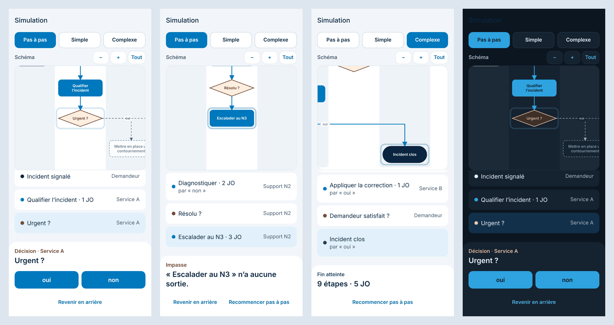
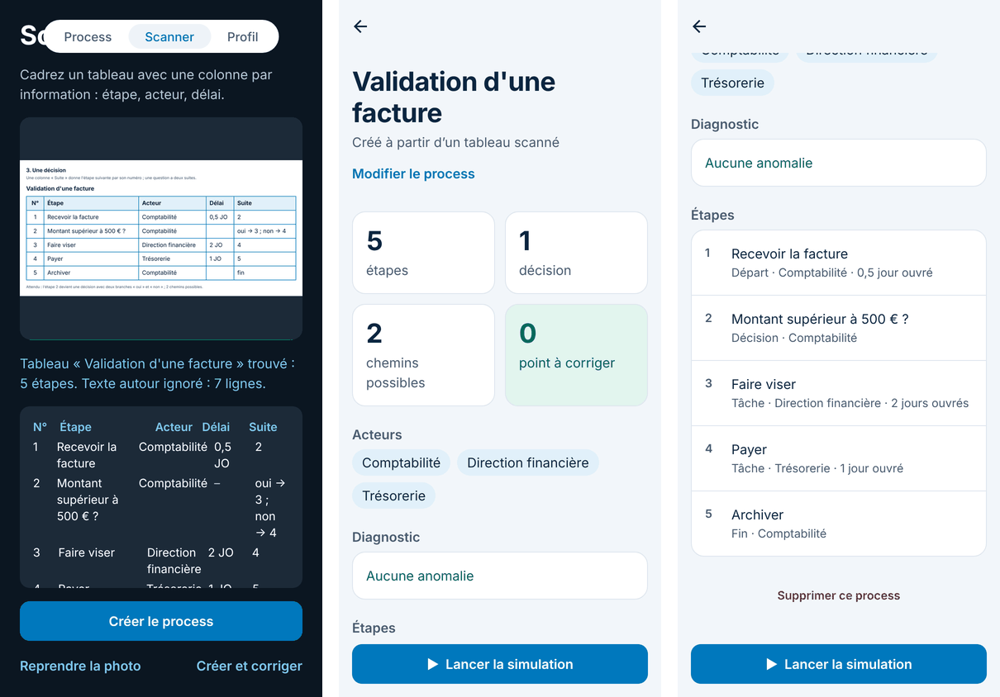
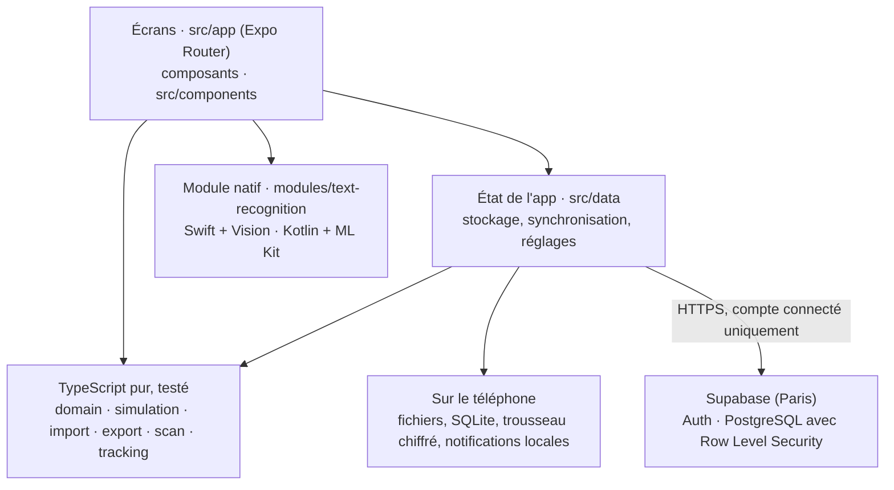

<p align="center"></p>

<p align="center"><b>Testez un workflow métier avant vos utilisateurs.</b><br>Importez un schéma ou photographiez un tableau, voyez ce qui cloche, puis parcourez-le pas à pas.</p>

<p align="center">
  <a href="https://github.com/mloick/SIMUFLOW/actions/workflows/verifications.yml"></a>
  <a href="https://mloick.github.io/SIMUFLOW/app/"></a>
  
  
  
</p>

<p align="center">Français · <a href="README.md">English</a></p>

<p align="center"></p>

SimuFlow est une application mobile qui transforme un workflow métier en un parcours interactif et vérifié. Elle fonctionne sur iPhone, sur Android et [dans le navigateur](https://mloick.github.io/SIMUFLOW/app/). Version 1.0, réalisée seul dans le cadre d'un cours de développement mobile en Master. Tous les exemples de l'app et de la documentation sont fictifs.

## En cinq lignes

- **Pour qui** : les chefs de projet et analystes qui conçoivent des workflows de gestion des services informatiques (ITSM) avec les métiers.
- **Problème** : un schéma statique se valide mal. Impasses, décisions à sens unique et délais incohérents sont découverts trop tard, une fois le workflow en service.
- **Promesse** : SimuFlow les rend visibles en moins d'une minute, et permet de rejouer le process branche par branche.
- **Trois écrans clés** : Détail (diagnostic), Simulation (pas à pas), Scanner (d'une photo à un process).
- **Deux fonctions du téléphone** : la caméra avec lecture du texte sur l'appareil (module natif en Swift et en Kotlin), et des rappels d'échéance locaux.

## Fonctionnalités

- **Importer** un fichier draw.io, BPMN 2.0, Visio (`.vsdx`), JSON, Excel ou CSV, ou **photographier** un tableau de process.
- **Diagnostiquer** : impasses, étapes inatteignables, chemins qui ne finissent jamais, décisions à sens unique, branches sans nom.
- **Corriger** le process dans un éditeur ; l'app apprend des règles de lecture à partir de vos corrections.
- **Simuler** pas à pas, ou voir tous les chemins d'un coup avec le chemin critique.
- **Exporter** en PDF, draw.io, BPMN 2.0 ou JSON, anonymisé si besoin.
- **Suivre une vraie demande**, avec des échéances en jours ouvrés français et un rappel le jour J.
- **Synchroniser** entre appareils avec un compte, en restant utilisable hors connexion ; tout est supprimé avec le compte.

La visite complète, avec captures, est dans le [guide des fonctionnalités](docs/fonctionnalites.md). Les maquettes des écrans sont dans [`docs/maquette/`](docs/maquette/).

<p align="center"></p>

## Fonctions du téléphone

- **Caméra avec lecture du texte sur l'appareil.** Un module Expo local écrit en Swift (Vision) et en Kotlin (ML Kit) lit la photo sur le téléphone ; le reste du scanner (lignes, tableau, process) est en TypeScript. Sur le web, le même écran utilise Tesseract (WebAssembly). La photo ne quitte jamais l'appareil.
- **Notifications locales, sans serveur.** Pour une demande suivie en vrai, un rappel arrive le matin de l'échéance de chaque étape, puis à nouveau si elle est dépassée ; le toucher ouvre la demande. L'interrupteur et une notification d'essai sont dans l'onglet Profil.

## Démarrer

Prérequis : un Mac avec Xcode, et Node.js 22.13 ou plus récent.

```bash
npm install
npm run ios:simulateur   # compile et ouvre dans le Simulateur iOS
npm run ios:iphone       # compile et installe sur un iPhone branché en USB
```

SimuFlow est un build de développement, pas Expo Go, car il contient un module natif local. Les dossiers `ios/` et `android/` sont générés (génération native continue) et jamais versionnés. Après un changement d'`app.json` ou un nouveau module natif, lancer `npx expo prebuild --clean --platform ios` puis recompiler. Sinon, une fois l'app installée, `npx expo start` suffit. `npm run nettoyer` efface les fichiers de compilation pour libérer de la place.

| Cible | Commande |
| --- | --- |
| APK Android, sans Mac | `npx eas-cli@latest build --platform android --profile preview` |
| Mise à jour à distance des builds installés | `npx eas-cli@latest update --channel preview --message "..."` |
| Version web, en local | `npm run web` |
| Version web, export | `npm run export:web` (publiée sur GitHub Pages à chaque fusion sur `main`) |

Installer un build EAS sur un iPhone demande un compte Apple Developer payant ; avec un compte gratuit, utiliser le build Xcode ci-dessus. La version web s'ajoute à l'écran d'accueil d'un téléphone comme une app ; tout y marche sauf les rappels.

**Vérifications**

```bash
npx tsc --noEmit   # types
npx expo lint      # analyse du code
npm test           # tests unitaires et de composants (Jest)
npm run e2e        # test de bout en bout (Maestro, Simulateur iOS)
```

**Backend.** Un projet Supabase. Son adresse et sa clé publishable sont dans `src/backend/config.ts` (publiques par conception : les accès sont décidés par le serveur). Le schéma et ses règles d'accès sont versionnés dans `supabase/migrations/`, avec leurs tests dans `supabase/tests/`.

## Architecture



- Les **écrans** affichent et réagissent, sans plus. Chaque règle (diagnostic, chemins, simulation, lecture des fichiers, échéances) est en **TypeScript pur**, sans React ni Expo, et donc testée à part.
- L'**état de l'app** est d'abord local : process, réglages et demandes suivies restent sur le téléphone, puis se synchronisent avec Supabase quand on est connecté et en ligne.
- **Supabase** ne garde que ce dont un compte a besoin. La Row Level Security fait que chaque compte ne voit que ses propres lignes.
- Le **module natif** ne fait que lire le texte d'une photo ; tout ce qui suit est du TypeScript partagé.

Le détail, fichier par fichier, est dans la [documentation technique](docs/technique.md).

## Choix techniques

| Choix | Pourquoi |
| --- | --- |
| Expo SDK 58 avec builds de développement | Un seul code pour iOS et Android, modules natifs possibles, configuration dans `app.json` plutôt que dans des projets natifs modifiés à la main |
| Expo Router (routes typées) | Navigation par fichiers, liens profonds (`simuflow://`) inclus, un lien vers un écran absent est une erreur de type |
| TypeScript strict, cœur pur | La logique du simulateur est le produit : la garder sans interface la rend testable et réutilisable (scanner, import et éditeur la partagent) |
| Supabase (UE, Paris) | Vrai PostgreSQL avec règles d'accès appliquées par le serveur (RLS), authentification hébergée, offre gratuite ; aucun serveur maison à sécuriser |
| Stockage d'abord local | L'app marche sans compte et hors connexion ; la synchronisation est un plus, pas une condition |
| Lecture du texte sur le téléphone (Vision, ML Kit) | Les photos ne quittent pas le téléphone, ça marche hors ligne, sans clé d'API ni coût |
| Notifications locales | Les échéances sont connues sur le téléphone : pas de serveur push, de jeton ni de donnée personnelle à envoyer |
| `expo-secure-store` pour la session | Le jeton de connexion reste dans le trousseau iOS ou le Keystore Android, jamais dans une sauvegarde |
| EAS Build et EAS Update | Build Android installable sans Android Studio ; correctifs envoyés à distance |
| Jest, React Native Testing Library, Maestro, GitHub Actions | Tests unitaires du cœur, tests de composants qui lisent l'écran comme un utilisateur, un parcours de bout en bout, toutes les vérifications à chaque pull request |

## Documentation

- [Guide des fonctionnalités](docs/fonctionnalites.md) : ce que fait l'application, en termes simples, avec captures.
- [Documentation technique](docs/technique.md) : structure, commandes, architecture, fichier par fichier.
- [Sécurité](docs/securite.md) : la checklist sécurité remplie (OWASP MASVS), clés, règles d'accès, données sur le téléphone.
- [Travailler avec l'IA](docs/ia.md) : ce qui guide l'IA (AGENTS.md, CLAUDE.md, skills, MCP) et comment nous travaillons avec.
- [BPMN 2.0 en bref](docs/bpmn.md) : la norme, ce que SimuFlow en lit et y écrit, et l'import Visio.
- [Logo](docs/logo/) : un chemin en S, un process parcouru pas à pas ; c'est aussi l'icône de l'app et son écran de démarrage.
- [Site](https://mloick.github.io/SIMUFLOW/) et [politique de confidentialité](https://mloick.github.io/SIMUFLOW/confidentialite.html), construits depuis `docs/site/`.

## Technologies

Expo SDK 58, React Native 0.88, React 19.3, Expo Router, TypeScript 6 (strict), Supabase (`@supabase/supabase-js` 2), Reanimated 4, react-native-svg, expo-camera, expo-notifications, expo-secure-store, expo-sqlite. Tests : Jest 30 avec `jest-expo`, React Native Testing Library, Maestro. CI : GitHub Actions.

## Licence

Voir [LICENSE](LICENSE).
