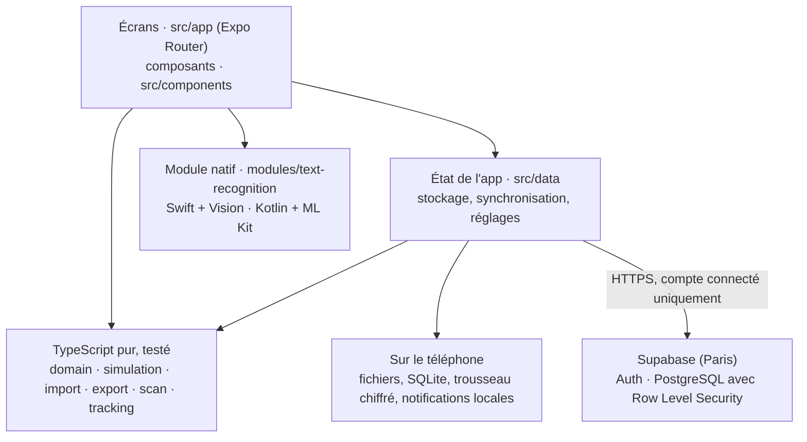

<p align="center"></p>

# SimuFlow

Français · [English](README.md)

SimuFlow est une application mobile qui transforme un workflow métier en un parcours interactif et vérifié. On importe un schéma draw.io ou on photographie un tableau de process, on voit les anomalies, puis on rejoue le process pas à pas en choisissant chaque branche.

> État : version 1.0, complète pour le cours (octobre 2026). Fonctionne sur iPhone (build Xcode) et Android (build EAS). Tous les exemples de l'app et de la documentation sont fictifs.

**Ce que l'on peut faire**

- **Ajouter un process** depuis un fichier draw.io ou JSON, ou en **photographiant un tableau** (étape, acteur, délai) : le texte est lu sur le téléphone par un module natif (Swift avec Vision sur iOS, Kotlin avec ML Kit sur Android).
- **Voir ce qui cloche** : impasses, étapes inatteignables, chemins qui ne finissent jamais, décisions à sens unique, branches sans nom.
- **Le corriger** dans un éditeur (étapes, décisions, branches). L'app apprend des règles de lecture de vos corrections et les réapplique aux imports suivants.
- **Le rejouer** pas à pas, ou voir tous les chemins d'un coup avec le chemin critique. L'exporter en PDF, en fichier draw.io ou en JSON.
- **Suivre une vraie demande** : chaque étape a son échéance en jours ouvrés français, avec un rappel local le matin du jour J.
- **Le retrouver partout** avec un compte : process et règles de lecture synchronisés entre vos appareils, utilisables hors connexion, supprimés avec le compte.

## Pour qui

Les chefs de projet et analystes qui conçoivent des workflows de gestion des services informatiques (ITSM) avec les métiers. Un schéma statique se valide mal : impasses, décisions à une seule sortie et délais incohérents sont découverts trop tard. SimuFlow les rend visibles en moins d'une minute.

## Écrans clés

- **Process** : vos process avec leur état de diagnostic, puis les process d'exemple dans une section repliable.
- **Détail** : chiffres clés, diagnostic avec un bouton « Voir » sur chaque problème, acteurs et étapes ; on y modifie, exporte ou suit une vraie demande.
- **Importer** : choisir un fichier draw.io ou JSON (ou un scan), vérifier et corriger l'aperçu, puis le garder.
- **Simulation** : le schéma s'allume au fil du parcours ; chaque décision demande quelle branche suivre. La vue « Tous » montre tous les chemins, une couleur par famille, avec le chemin critique. Le schéma s'exporte en PDF, en fichier draw.io ou en JSON.
- **Scanner** : on photographie un tableau (étape, acteur, délai) et il devient un workflow.
- **Suivi** : une vraie demande, étape par étape, avec l'échéance de chaque étape en jours ouvrés et le retard éventuel.
- **Profil** : le compte et la synchronisation, les rappels d'échéance, le réglage des exemples, les règles de lecture apprises, et une section « À propos » (état du serveur, revoir la présentation, politique de confidentialité, version de l'app).

La maquette complète est dans [`docs/maquette/`](docs/maquette/).

## Logo

Le logo est un chemin en S : un point de départ, deux virages, une flèche d'arrivée. Il représente un process que l'on parcourt pas à pas, et forme le S de SimuFlow. Son histoire, ses couleurs et ses fichiers sont dans [`docs/logo/`](docs/logo/). C'est aussi l'icône de l'app et son écran de démarrage.

## Fonctionnalités du téléphone

- Caméra avec lecture de texte sur le téléphone (module natif en Kotlin et en Swift).
- Notifications locales (sans serveur) : rappels d'échéance de chaque étape d'un process suivi en vrai : le matin du jour de l'échéance, puis à l'échéance si elle est dépassée ; toucher un rappel ouvre la demande. L'interrupteur et une notification d'essai sont dans l'onglet Profil.

## Démarrer

Prérequis : un Mac avec Xcode, et Node.js 22.13 ou plus récent.

```bash
npm install
npm run ios:simulateur   # compile et ouvre dans le Simulateur iOS
npm run ios:iphone       # compile et installe sur un iPhone branché en USB
```

L'app est un build de développement compilé par Xcode, pas Expo Go : elle contient un module natif local. Les dossiers `ios/` et `android/` sont générés (génération native continue), jamais versionnés ni modifiés à la main. Après un changement d'`app.json` ou un nouveau module natif : `npx expo prebuild --clean --platform ios`, puis recompiler. Sinon, une fois l'app installée, `npx expo start` suffit : les changements de JavaScript apparaissent en quelques secondes. `npm run nettoyer` efface les fichiers de compilation pour libérer de la place.

**Build installable (sans Mac).** `npx eas-cli@latest build --platform android --profile preview` produit un APK Android qui s'installe depuis un lien ou un QR code. Installer un build EAS sur un iPhone demande un compte Apple Developer payant ; avec un compte gratuit, utiliser le build Xcode ci-dessus. Les mises à jour de JavaScript arrivent aux builds installés sans nouveau build grâce à EAS Update : `npx eas-cli@latest update --channel preview --message "..."`.

**Vérifications.**

```bash
npx tsc --noEmit   # types
npx expo lint      # analyse du code
npm test           # tests unitaires et de composants (Jest)
npm run e2e        # test de bout en bout (Maestro, Simulateur iOS)
```

Le backend est un projet Supabase. Son adresse et sa clé publishable sont dans `src/backend/config.ts` (publiques par conception) ; le schéma de la base et ses règles d'accès sont versionnés dans `supabase/migrations/`, avec leurs tests dans `supabase/tests/`.

## Architecture



- Les **écrans** affichent et réagissent, sans plus. Chaque règle (diagnostic, chemins, simulation, lecture des fichiers, repérage du tableau, échéances en jours ouvrés) est en **TypeScript pur**, sans React ni Expo, et donc testée à part.
- L'**état de l'app** (`src/data/`) garde process, réglages et demandes suivies d'abord sur le téléphone, puis synchronise les process et règles de lecture du compte avec **Supabase** quand on est connecté et en ligne.
- **Supabase** ne garde que ce dont un compte a besoin. La Row Level Security fait que chaque compte ne voit que ses lignes ; rien n'est lisible sans connexion.
- Le **module natif** lit le texte d'une photo sur le téléphone ; le reste du scanner (lignes, tableau, process) est en TypeScript.

Le détail, fichier par fichier, est dans [`docs/technique.md`](docs/technique.md).

## Choix techniques

| Choix | Pourquoi |
| --- | --- |
| Expo SDK 58 avec builds de développement | Un seul code pour iOS et Android, modules natifs possibles, configuration dans `app.json` plutôt que dans des projets natifs modifiés à la main |
| Expo Router (routes typées) | Navigation par fichiers, liens profonds (`simuflow://`) inclus, un lien vers un écran absent est une erreur de type |
| TypeScript strict, cœur pur | La logique du simulateur est le produit : la garder sans interface la rend testable et réutilisable (scanner, import et éditeur la partagent) |
| Supabase (UE, Paris) | Vrai PostgreSQL avec règles d'accès appliquées par le serveur (RLS), authentification hébergée, offre gratuite ; aucun serveur maison à sécuriser |
| Stockage d'abord local | L'app marche sans compte et hors connexion ; la synchronisation est un plus, pas une condition |
| Lecture du texte sur le téléphone (Vision, ML Kit) | Les photos ne quittent pas le téléphone, ça marche hors ligne, sans clé d'API ni coût ; écrit comme un module Expo local en Swift et en Kotlin |
| Notifications locales | Les échéances sont connues sur le téléphone : pas de serveur push, de jeton ni de donnée personnelle à envoyer |
| `expo-secure-store` pour la session | Le jeton de connexion reste dans le trousseau iOS ou le Keystore Android, jamais dans une sauvegarde |
| EAS Build et EAS Update | Build Android installable sans Android Studio ; correctifs envoyés à distance aux builds installés |
| Jest, React Native Testing Library, Maestro, GitHub Actions | Tests unitaires du cœur, tests de composants qui lisent l'écran comme un utilisateur, un parcours de bout en bout sur le Simulateur, toutes les vérifications à chaque pull request |

## Documentation

- [Documentation technique](docs/technique.md) : architecture, structure, commandes.
- [Guide des fonctionnalités](docs/fonctionnalites.md) : ce que fait l'application, en termes simples.
- [Sécurité](docs/securite.md) : la checklist sécurité remplie (catégories OWASP MASVS), puis clés, règles d'accès, comptes, données sur le téléphone.
- [Travailler avec l'IA](docs/ia.md) : ce qui guide l'IA (AGENTS.md, CLAUDE.md, MCP) et comment nous travaillons avec.
- [Site](https://mloick.github.io/SIMUFLOW/) et [politique de confidentialité](https://mloick.github.io/SIMUFLOW/confidentialite.html), construits depuis `docs/site/` et publiés par GitHub Pages.

## Technologies

Expo SDK 58, React Native 0.88, React 19.3, Expo Router, TypeScript 6 (strict), Supabase (`@supabase/supabase-js` 2), Reanimated 4, react-native-svg, expo-camera, expo-notifications, expo-secure-store, expo-sqlite. Tests : Jest 30 avec `jest-expo`, React Native Testing Library, Maestro. CI : GitHub Actions.

## Licence

Voir [LICENSE](LICENSE).
