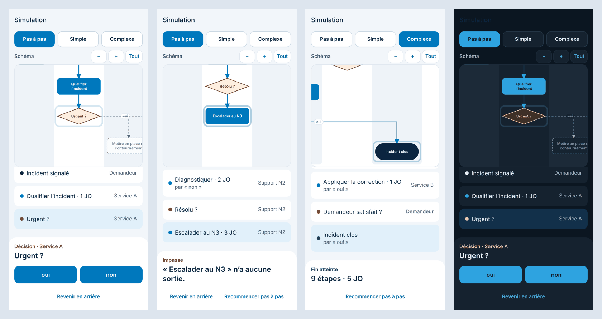
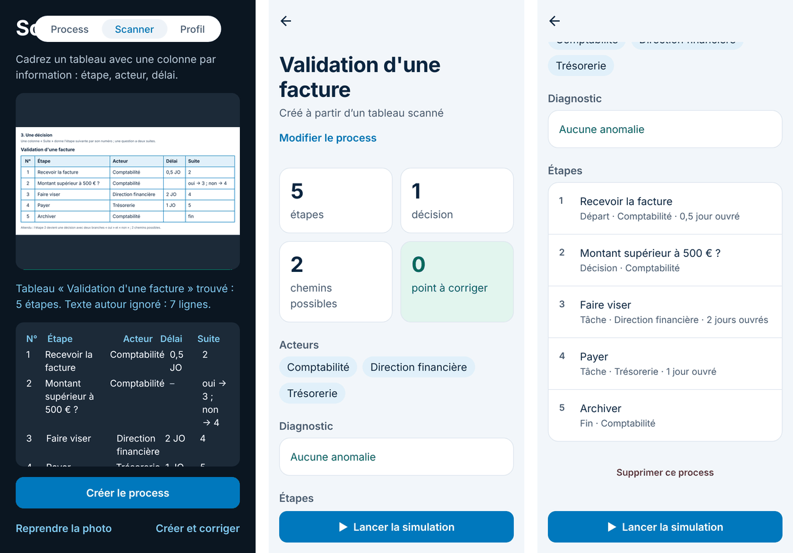
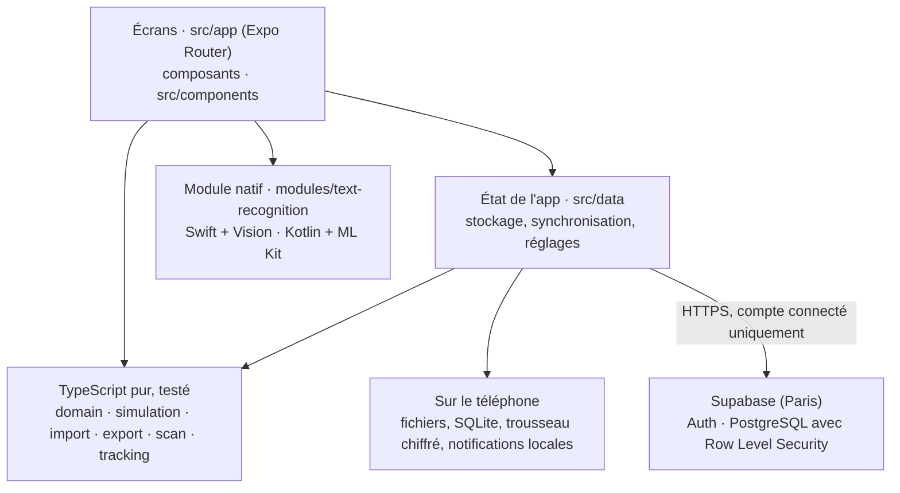

<p align="center"></p>

<p align="center"><b>Testez un workflow métier avant vos utilisateurs.</b><br>Importez un schéma ou photographiez un tableau, voyez ce qui cloche, puis parcourez-le pas à pas.</p>

<p align="center">
  <a href="https://github.com/mloick/SIMUFLOW/actions/workflows/verifications.yml"></a>
  <a href="https://mloick.github.io/SIMUFLOW/app/"></a>
  
  
  
</p>

<p align="center">Français · <a href="README.md">English</a></p>

<p align="center"></p>

SimuFlow est une application mobile qui transforme un workflow métier en un parcours interactif et vérifié. Elle fonctionne sur iPhone, sur Android et [dans le navigateur](https://mloick.github.io/SIMUFLOW/app/). Version 1.0, un projet personnel de Loïck, conçu et développé seul. Tous les exemples de l'app et de la documentation sont fictifs.

## En cinq lignes

- **Pour qui** : tout chef de projet et son équipe, quel que soit le secteur (informatique, logistique, RH, achats, finance, service client…), qui modélisent un process et doivent le faire valider par tous ceux qu'il concerne. Un workflow de support informatique n'est qu'un exemple parmi d'autres.
- **Problème** : un schéma statique se valide mal. Impasses, décisions à sens unique et délais incohérents sont découverts trop tard, une fois le workflow en service.
- **Promesse** : SimuFlow les rend visibles en moins d'une minute, permet de rejouer le process branche par branche, et fait valider à chaque acteur sa partie, sur tous les process d'un projet d'équipe.
- **Trois écrans clés** : Détail (diagnostic), Simulation (pas à pas), Scanner (d'une photo à un process).
- **Trois fonctions du téléphone** : la caméra avec lecture du texte sur l'appareil (module natif en Swift et en Kotlin), des rappels d'échéance locaux, et les raccourcis Siri (App Intents en Swift).

## Fonctionnalités

- **Importer** un fichier draw.io, BPMN 2.0, Visio (`.vsdx`), JSON, Excel ou CSV, coller un process **écrit en texte** (une ligne par étape), ou **photographier** un tableau de process.
- **Diagnostiquer** : impasses, étapes inatteignables, chemins qui ne finissent jamais, décisions à sens unique, branches sans nom.
- **Corriger** le process dans un éditeur (y compris faire de plusieurs suites des branches en parallèle, avec la jonction ajoutée là où elles se retrouvent) ; l'app apprend des règles de lecture à partir de vos corrections.
- **Simuler** pas à pas, ou voir tous les chemins d'un coup avec le chemin critique. **Tâches en parallèle** (passerelles parallèles BPMN) : plusieurs équipes avancent en même temps, dans l'ordre que l'on veut ; l'étape qui les réunit attend toutes les branches, et le délai compté est celui de la plus longue. Les cas simple, complexe et « Tous », le nombre de chemins et le PDF comptent aussi toutes les branches. Elles se lisent depuis un fichier BPMN, et depuis draw.io quand un losange porte « + » ou « En parallèle » ; rien n'est deviné.
- **Exporter** en PDF (avec un résumé en clair de chaque cas), draw.io, BPMN 2.0 ou JSON, anonymisé si besoin.
- **Suivre une vraie demande**, avec des échéances en jours ouvrés français et un rappel le jour J ; avec des tâches en parallèle, chaque branche a sa carte, son échéance et son chrono.
- **Mode Délais (SLA / OLA)** : chaque étape a son délai pour son équipe (OLA) et le process son délai promis au client (SLA), lus dans le tableau importé ou saisis dans l'éditeur. Pendant le suivi, deux chronos passent du vert à l'orange puis au rouge, une notification prévient avant le dépassement du SLA et un bilan dit à la fin si les délais ont été tenus ; la simulation compare les jours cumulés au SLA.
- **Partager** un process avec ses acteurs : inviter des collègues par identifiant ou e-mail, et relier chacun à un acteur du schéma ; ils le lisent sans pouvoir le modifier, et chacun relit sa partie : chaque étape est validée, ou signalée à revoir avec un commentaire ; les étapes des autres acteurs restent lisibles, sans avis à donner, et le serveur le vérifie. Le propriétaire suit qui a fini, ce qui est à corriger, et voit « entièrement validé » à la fin. Des alertes dans l'app (et en notification sur le téléphone) annoncent un nouveau partage, une étape à revoir et un process entièrement validé. Les acteurs sans compte reçoivent un lien web par acteur, valable 30 jours et prolongeable par le propriétaire : ils confirment leur nom et relisent leur partie dans le navigateur.
- **Synchroniser** entre appareils avec un compte, en restant utilisable hors connexion ; un process modifié à deux endroits est fusionné étape par étape (une étape changée de deux façons garde les deux versions), un projet champ par champ ; tout est supprimé avec le compte.
- **Vos couleurs** : quatre palettes (Océan, Aurore, Menthe, Corail), chacune en clair et en sombre, au choix dans les Réglages ; l'app utilise la police Plus Jakarta Sans. Un petit bouton « ? » à côté de chaque réglage ouvre une courte explication.
- **Projets** : regrouper plusieurs process d'un même chantier dans un projet (dans leur propre onglet « Projets », séparés entre ceux que je pilote et ceux où je suis collaborateur), dont celui qui le crée est le chef de projet ; il invite une équipe de collaborateurs, qui voient tous les process du projet, et peut passer son rôle de chef à l'un d'eux ; un **tableau de bord** montre à toute l'équipe où en est la relecture de chaque process du projet, les étapes signalées à corriger et qui n'a pas fini ; ranger un process depuis sa fiche ou depuis le projet, renommer ou supprimer le projet (ses process restent). Synchronisés avec le compte.
- **Accueil** : recherche, filtres (Tous, À corriger, Partagés, Exemples) avec leur nombre, une carte « Reprendre » qui ramène à la demande suivie en cours, la cloche des alertes, un bouton « Nouveau », et des états clairs pour le chargement, la liste vide, l’erreur et le hors ligne.
- **Écrans refaits** : le détail d'un process donne ses chiffres clés, un grand bouton « Lancer la simulation », quatre actions rapides et des sections à déplier ; la simulation pose une carte de l'étape sous un schéma vivant, avec suivi auto, minicarte, plein écran et mise en page paysage ; « Nouveau process » présente les huit sources en tuiles ; le scanner a un viseur animé ; suivi, alertes, partage, formulaires et export suivent le même style.
- **Français ou anglais** : tous les écrans suivent la langue du téléphone, ou le choix fait dans les Réglages. Ce que vous importez reste tel quel, de même que les fichiers exportés et les quatre exemples, en français.

La visite complète est dans le [manuel d'utilisation](https://mloick.github.io/SIMUFLOW/manuel/), interactif : un parcours par rôle, des guides courts pas à pas avec les vrais écrans, une démo jouable, un lexique et une FAQ. La [liste des fonctionnalités](docs/fonctionnalites.md) donne l'état de chacune en une ligne. Les maquettes des écrans sont dans [`docs/maquette/`](docs/maquette/).

<p align="center"></p>

## Fonctions du téléphone

- **Caméra avec lecture du texte sur l'appareil.** Un module Expo local écrit en Swift (Vision) et en Kotlin (ML Kit) lit la photo sur le téléphone ; le reste du scanner (lignes, tableau, process) est en TypeScript. Sur le web, le même écran utilise Tesseract (WebAssembly). La photo ne quitte jamais l'appareil.
- **Notifications locales, sans serveur.** Pour une demande suivie en vrai, un rappel arrive le matin de l'échéance de chaque étape, puis à nouveau si elle est dépassée ; si le process a un SLA, un rappel arrive aussi aux trois quarts du SLA, puis à son dépassement. Le toucher ouvre la demande. L'interrupteur et une notification d'essai sont dans l'onglet Réglages.
- **Raccourcis Siri (iOS 18 et plus).** Des App Intents écrits en Swift permettent à Siri, à l'app Raccourcis et à Spotlight d'ouvrir SimuFlow sur un onglet (« Ouvrir Projets dans SimuFlow »). Un plugin de configuration Expo (`plugins/`) ajoute le fichier Swift à la cible de l'app iOS pendant le prebuild ; l'action ouvre simplement un lien `simuflow://` qu'Expo Router sait déjà lire.

## Démarrer

Prérequis : un Mac avec Xcode, et Node.js 22.13 ou plus récent.

```bash
npm install
npm run ios:simulateur   # compile et ouvre dans le Simulateur iOS
npm run ios:iphone       # compile et installe sur un iPhone branché en USB
```

SimuFlow est un build de développement, pas Expo Go, car il contient un module natif local. Les dossiers `ios/` et `android/` sont générés (génération native continue) et jamais versionnés. Après un changement d'`app.json` ou un nouveau module natif, lancer `npx expo prebuild --clean --platform ios` puis recompiler. L'app tourne désormais en paysage (`orientation: default` dans `app.json`) : un build iPhone fait avant ce changement doit être recompilé. Sinon, une fois l'app installée, `npx expo start` suffit. `npm run nettoyer` efface les fichiers de compilation pour libérer de la place.

| Cible | Commande |
| --- | --- |
| APK Android, sans Mac | `npx eas-cli@latest build --platform android --profile preview` |
| Mise à jour à distance des builds installés | `npx eas-cli@latest update --channel preview --message "..."` |
| Version web, en local | `npm run web` |
| Version web, export | `npm run export:web` (publiée sur GitHub Pages à chaque fusion sur `main`) |

Installer un build EAS sur un iPhone demande un compte Apple Developer payant ; avec un compte gratuit, utiliser le build Xcode ci-dessus. La version web s'ajoute à l'écran d'accueil d'un téléphone comme une app ; tout y marche sauf les rappels.

**Vérifications**

```bash
npx tsc --noEmit   # types
npx expo lint      # analyse du code
npm test           # tests unitaires et de composants (Jest)
npm run e2e        # test de bout en bout (Maestro, Simulateur iOS)
```

**Backend.** Un projet Supabase. Son adresse et sa clé publishable sont dans `src/backend/config.ts` (publiques par conception : les accès sont décidés par le serveur). Le schéma et ses règles d'accès sont versionnés dans `supabase/migrations/`, avec leurs tests dans `supabase/tests/`. Ils arrivent sur la base par la CLI Supabase, lancée depuis le Mac après une fusion : `npm run db:etat` liste les scripts déjà passés, `npm run db:envoyer` passe les nouveaux dans l'ordre (la CLI passe par `npx`, version 3.2.0 ; une fois : `npx supabase@3.2.0 login`, puis `link`).

## Architecture



- Les **écrans** affichent et réagissent, sans plus. Chaque règle (diagnostic, chemins, simulation, lecture des fichiers, échéances) est en **TypeScript pur**, sans React ni Expo, et donc testée à part.
- L'**état de l'app** est d'abord local : process, réglages et demandes suivies restent sur le téléphone, puis se synchronisent avec Supabase quand on est connecté et en ligne.
- **Supabase** ne garde que ce dont un compte a besoin. La Row Level Security fait que chaque compte voit ses propres lignes, plus ce qu'on a partagé avec lui (un process, un projet), sans pouvoir modifier les process des autres.
- Le **module natif** ne fait que lire le texte d'une photo ; tout ce qui suit est du TypeScript partagé.

Le détail, fichier par fichier, est dans la [documentation technique](docs/technique.md).

## Choix techniques

| Choix | Pourquoi |
| --- | --- |
| Expo SDK 58 avec builds de développement | Un seul code pour iOS et Android, modules natifs possibles, configuration dans `app.json` plutôt que dans des projets natifs modifiés à la main |
| Expo Router (routes typées) | Navigation par fichiers, liens profonds (`simuflow://`) inclus, un lien vers un écran absent est une erreur de type |
| TypeScript strict, cœur pur | La logique du simulateur est le produit : la garder sans interface la rend testable et réutilisable (scanner, import et éditeur la partagent) |
| Supabase (UE, Paris) | Vrai PostgreSQL avec règles d'accès appliquées par le serveur (RLS), authentification hébergée, offre gratuite ; aucun serveur maison à sécuriser |
| Stockage d'abord local | L'app marche sans compte et hors connexion ; la synchronisation est un plus, pas une condition |
| Lecture du texte sur le téléphone (Vision, ML Kit) | Les photos ne quittent pas le téléphone, ça marche hors ligne, sans clé d'API ni coût |
| Notifications locales | Les échéances sont connues sur le téléphone : pas de serveur push, de jeton ni de donnée personnelle à envoyer |
| `expo-secure-store` pour la session | Le jeton de connexion reste dans le trousseau iOS ou le Keystore Android, jamais dans une sauvegarde |
| EAS Build et EAS Update | Build Android installable sans Android Studio ; correctifs envoyés à distance |
| Jest, React Native Testing Library, Maestro, GitHub Actions | Tests unitaires du cœur, tests de composants qui lisent l'écran comme un utilisateur, un parcours de bout en bout, toutes les vérifications à chaque pull request |

## Documentation

- [Manuel d'utilisation](https://mloick.github.io/SIMUFLOW/manuel/) ([source](docs/site/manuel/index.html)) : comment se servir de l'app, en termes simples, guide par guide, avec les vrais écrans.
- [Liste des fonctionnalités](docs/fonctionnalites.md) : chaque fonctionnalité et son état, en une ligne.
- [Documentation technique](docs/technique.md) : structure, commandes, architecture, fichier par fichier.
- [Sécurité](docs/securite.md) : la checklist sécurité remplie (OWASP MASVS), clés, règles d'accès, données sur le téléphone.
- [Travailler avec l'IA](docs/ia.md) : ce qui guide l'IA (AGENTS.md, CLAUDE.md, skills, MCP) et comment nous travaillons avec.
- [BPMN 2.0 en bref](docs/bpmn.md) : la norme, ce que SimuFlow en lit et y écrit, et l'import Visio.
- [Logo](docs/logo/) : un chemin en S, un process parcouru pas à pas ; c'est aussi l'icône de l'app et son écran de démarrage.
- [Site](https://mloick.github.io/SIMUFLOW/) et [politique de confidentialité](https://mloick.github.io/SIMUFLOW/confidentialite.html), construits depuis `docs/site/`.

## Technologies

Expo SDK 58, React Native 0.88, React 19.3, Expo Router, TypeScript 6 (strict), Supabase (`@supabase/supabase-js` 2), Reanimated 4, react-native-svg, Plus Jakarta Sans (`@expo-google-fonts`), expo-camera, expo-notifications, expo-secure-store, expo-sqlite. Tests : Jest 30 avec `jest-expo`, React Native Testing Library, Maestro. CI : GitHub Actions.

## Licence

Tous droits réservés. Le code est public pour pouvoir être lu, mais il ne peut être ni copié, ni modifié, ni redistribué, ni utilisé à des fins commerciales sans l'accord écrit de l'auteur. Voir [LICENSE](LICENSE).

Les versions publiées avant ce changement étaient sous licence MIT et le restent.
