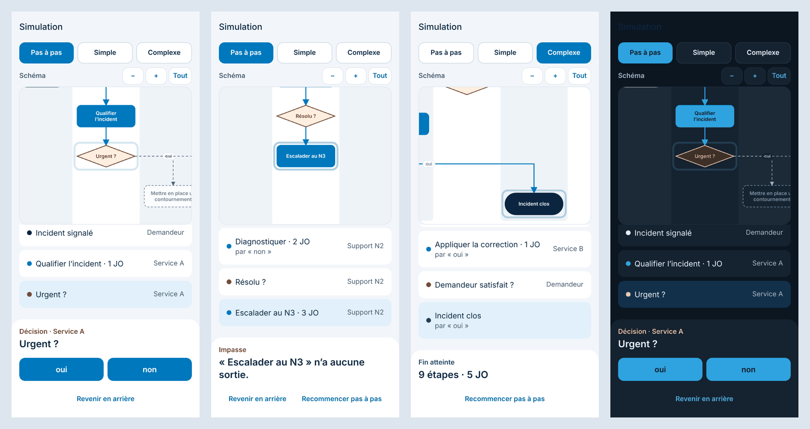
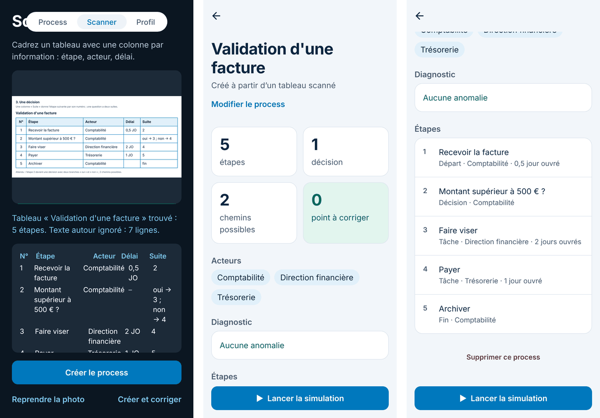
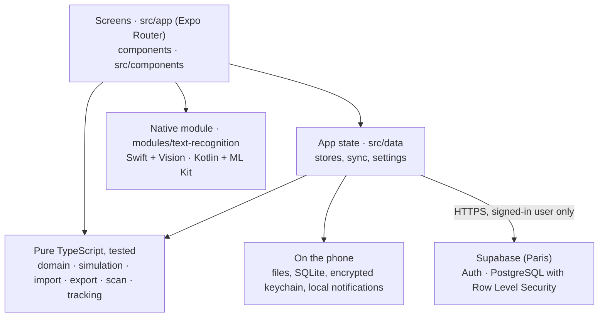

<p align="center"></p>

<p align="center"><b>Test a business workflow before your users do.</b><br>Import a diagram or photograph a table, see what is broken, then walk through it step by step.</p>

<p align="center">
  <a href="https://github.com/mloick/SIMUFLOW/actions/workflows/verifications.yml"></a>
  <a href="https://mloick.github.io/SIMUFLOW/app/"></a>
  
  
  
</p>

<p align="center"><a href="README.fr.md">Français</a> · English</p>

<p align="center"></p>

SimuFlow is a mobile app that turns a business workflow into an interactive, checked walkthrough. It runs on iPhone, Android and [in the browser](https://mloick.github.io/SIMUFLOW/app/). Version 1.0, built solo for a Master's mobile development course. All examples in the app and the docs are fictional.

## In five lines

- **For whom**: project managers and analysts who design IT service management (ITSM) workflows with business teams.
- **Problem**: a static diagram is hard to validate. Dead ends, one-way decisions and inconsistent delays show up too late, once the workflow is live.
- **Promise**: SimuFlow makes them visible in under a minute, and lets you replay the process branch by branch.
- **Three key screens**: Detail (diagnostic), Simulation (step by step), Scanner (from a photo to a process).
- **Two phone features**: the camera with on-device text recognition (a native module in Swift and Kotlin), and local deadline reminders.

## Features

- **Import** a draw.io, BPMN 2.0, Visio (`.vsdx`), JSON, Excel or CSV file, or **photograph** a process table.
- **Diagnose**: dead ends, unreachable steps, paths that never finish, one-way decisions, unlabelled branches.
- **Correct** the process in an editor; the app learns reading rules from your corrections.
- **Simulate** step by step, or see every path at once with the critical path.
- **Export** as PDF, draw.io, BPMN 2.0 or JSON, anonymised if needed.
- **Follow a real request** with deadlines in French working days and a reminder on the due date.
- **Sync** across devices with an account, offline first; everything is deleted with the account.

The full tour, with screenshots, is in the [features guide](docs/fonctionnalites.md) (French). The screen mockups are in [`docs/maquette/`](docs/maquette/).

<p align="center"></p>

## Phone features

- **Camera with on-device text recognition.** A local Expo module written in Swift (Vision) and Kotlin (ML Kit) reads the photo on the phone; the rest of the scanner (rows, table, process) is TypeScript. On the web, the same screen uses Tesseract (WebAssembly). The photo never leaves the device.
- **Local notifications, no server.** For a request you follow for real, a reminder arrives the morning of each step's deadline, then again once it is missed; tapping it opens the request. The switch and a test notification are in the Profile tab.

## Getting started

Requirements: a Mac with Xcode, and Node.js 22.13 or later.

```bash
npm install
npm run ios:simulateur   # build and open in the iOS Simulator
npm run ios:iphone       # build and install on an iPhone plugged in over USB
```

SimuFlow is a development build, not Expo Go, because it includes a local native module. The `ios/` and `android/` folders are generated (Continuous Native Generation) and never committed. After changing `app.json` or adding a native module, run `npx expo prebuild --clean --platform ios` and build again. Otherwise `npx expo start` is enough once the app is installed. `npm run nettoyer` deletes build files to free disk space.

| Target | Command |
| --- | --- |
| Android APK, no Mac needed | `npx eas-cli@latest build --platform android --profile preview` |
| Over-the-air update of installed builds | `npx eas-cli@latest update --channel preview --message "..."` |
| Web version, locally | `npm run web` |
| Web version, export | `npm run export:web` (published to GitHub Pages on every merge to `main`) |

Installing an EAS build on an iPhone requires a paid Apple Developer account; with a free account, use the Xcode build above. The web version can be added to a phone's home screen like an app; everything works there except reminders.

**Checks**

```bash
npx tsc --noEmit   # types
npx expo lint      # lint
npm test           # unit and component tests (Jest)
npm run e2e        # end-to-end test (Maestro, iOS Simulator)
```

**Backend.** A Supabase project. Its address and publishable key are in `src/backend/config.ts` (public by design: access is decided by the server). The schema and its access rules are versioned in `supabase/migrations/`, with tests in `supabase/tests/`.

## Architecture



- **Screens** only display and react. Every rule (diagnostic, paths, simulation, file reading, deadlines) lives in **pure TypeScript** with no React or Expo import, so it is unit-tested in isolation.
- **App state** is local first: processes, settings and followed requests stay on the phone, then sync with Supabase when signed in and online.
- **Supabase** stores only what an account needs. Row Level Security lets each account see only its own rows.
- The **native module** only reads text from a photo; everything after that is shared TypeScript.

File-by-file detail is in the [technical documentation](docs/technique.md) (French).

## Technical choices

| Choice | Why |
| --- | --- |
| Expo SDK 58 with development builds | One codebase for iOS and Android, native modules allowed, config in `app.json` instead of hand-edited native projects |
| Expo Router (typed routes) | File-based navigation, deep links (`simuflow://`) for free, a link to a missing screen is a type error |
| TypeScript strict, pure core | The simulator logic is the product: keeping it free of UI makes it testable and reusable (scanner, import and editor share it) |
| Supabase (EU, Paris) | Real PostgreSQL with access rules enforced by the server (RLS), hosted auth, free plan; no custom server to secure |
| Local-first storage | The app works without an account and offline; sync is an addition, not a requirement |
| On-device text recognition (Vision, ML Kit) | Photos never leave the phone, works offline, no API key or cost |
| Local notifications | Deadlines are known on the phone, so no push server, token or personal data to send |
| `expo-secure-store` for the session | The sign-in token stays in the iOS Keychain or Android Keystore, never in a backup |
| EAS Build and EAS Update | Installable Android build without Android Studio; fixes shipped over the air |
| Jest, React Native Testing Library, Maestro, GitHub Actions | Unit tests for the core, component tests that read the screen like a user, one end-to-end flow, all checks on every pull request |

## Documentation

All in French.

- [Features guide](docs/fonctionnalites.md): what the app does, in plain words, with screenshots.
- [Technical documentation](docs/technique.md): structure, commands, architecture, file by file.
- [Security](docs/securite.md): the filled-in security checklist (OWASP MASVS), keys, access rules, data on the phone.
- [Working with AI](docs/ia.md): what guides the AI (AGENTS.md, CLAUDE.md, skills, MCP) and how we work with it.
- [BPMN 2.0 in brief](docs/bpmn.md): the standard, what SimuFlow reads and writes, and the Visio import.
- [Logo](docs/logo/): an S-shaped path, a process walked step by step; also the app icon and splash screen.
- [Website](https://mloick.github.io/SIMUFLOW/) and [privacy policy](https://mloick.github.io/SIMUFLOW/confidentialite.html), built from `docs/site/`.

## Tech stack

Expo SDK 58, React Native 0.88, React 19.3, Expo Router, TypeScript 6 (strict), Supabase (`@supabase/supabase-js` 2), Reanimated 4, react-native-svg, expo-camera, expo-notifications, expo-secure-store, expo-sqlite. Tests: Jest 30 with `jest-expo`, React Native Testing Library, Maestro. CI: GitHub Actions.

## License

See [LICENSE](LICENSE).
