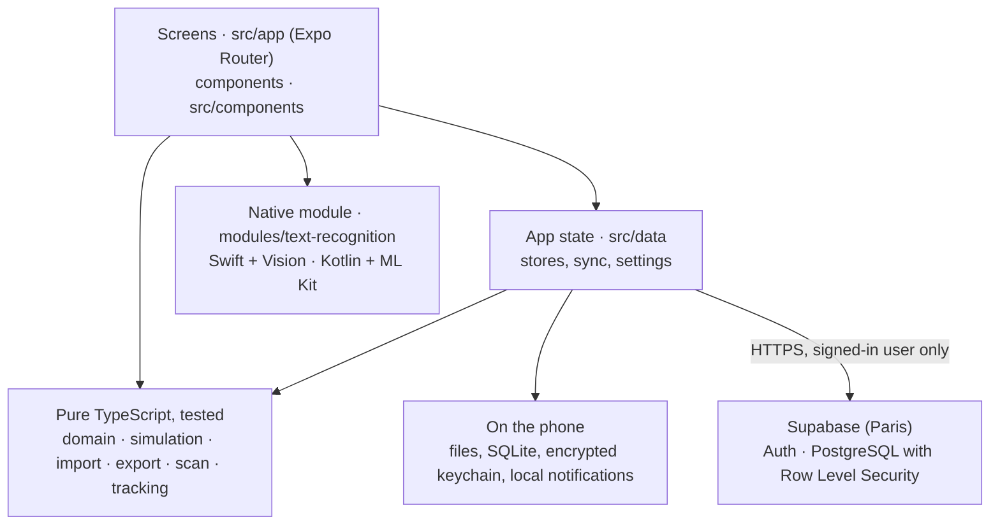

<p align="center"></p>

# SimuFlow

[Français](README.fr.md) · English

SimuFlow is a mobile app that turns a business workflow into an interactive, checked walkthrough. Import a draw.io diagram or photograph a process table, see the anomalies, then replay the process step by step by choosing each branch.

> Status: version 1.0, feature-complete for the course (October 2026). Runs on iPhone (Xcode build) and Android (EAS build). All examples in the app and the docs are fictional.

**What you can do**

- **Add a process** from a draw.io or JSON file, or by **photographing a table** (step, actor, delay): the text is read on the phone by a native module (Swift with Vision on iOS, Kotlin with ML Kit on Android).
- **See what is wrong**: dead ends, unreachable steps, paths that can never finish, one-way decisions, unlabeled branches.
- **Correct it** in an editor (steps, decisions, branches). The app learns reading rules from your corrections and reapplies them on the next imports.
- **Replay it** step by step, or see every path at once with the critical path. Export it as a PDF, a draw.io file or JSON.
- **Follow a real request**: each step gets its deadline in French working days, with a local reminder the morning of the deadline.
- **Keep it everywhere** with an account: processes and reading rules sync across devices, work offline, and are deleted with the account.

## Who it is for

Project managers and analysts who design IT service management (ITSM) workflows with business teams. A static diagram is hard to validate: dead ends, one-way decisions and inconsistent delays show up too late. SimuFlow makes them visible in under a minute.

## Key screens

- **Process**: your processes with their diagnostic status, then the sample processes in a collapsible section.
- **Detail**: key figures, the diagnostic with a "Show" button on each problem, actors and steps; edit, export or follow a real request from here.
- **Import**: pick a draw.io or JSON file (or a scan), check and correct the preview, then keep it.
- **Simulation**: the diagram lights up as you walk through it; each decision asks which branch to follow. The "Tous" (All) view shows every path, one colour per family, with the critical path. The diagram can be exported as a PDF, a draw.io file or JSON.
- **Scanner**: photograph a table (step, actor, delay) and turn it into a workflow.
- **Follow**: a real request, step by step, with each deadline in working days and the delay so far.
- **Profile**: your account and sync, deadline reminders, the examples switch, learned reading rules, and an "About" section (server status, replay the welcome tour, privacy policy, app version).

The full mockup is in [`docs/maquette/`](docs/maquette/).

## Logo

The logo is an S-shaped path: a starting point, two turns and an arrival arrow. It stands for a process walked through step by step, and draws the S of SimuFlow. Its story, colors and files are in [`docs/logo/`](docs/logo/) (French). It is also the app icon and the splash screen.

## Phone features

- Camera with on-device text recognition (native module in Kotlin and Swift).
- Local notifications (no server): deadline reminders for each step of a process you follow for real: the morning of the deadline, then when it is missed; tapping one opens the request. The switch and a test notification are in the Profile tab.

## Getting started

Requirements: a Mac with Xcode, and Node.js 22.13 or later.

```bash
npm install
npm run ios:simulateur   # build and open in the iOS Simulator
npm run ios:iphone       # build and install on an iPhone plugged in over USB
```

The app is a development build compiled by Xcode, not Expo Go: it includes a local native module. The `ios/` and `android/` folders are generated (Continuous Native Generation) and never committed or edited by hand. After a change to `app.json` or a new native module: `npx expo prebuild --clean --platform ios`, then build again. Otherwise, once the app is installed, `npx expo start` is enough: JavaScript changes show up in a few seconds. `npm run nettoyer` deletes build files to free disk space.

**Installable build (no Mac needed).** `npx eas-cli@latest build --platform android --profile preview` produces an Android APK that installs from a link or QR code. Installing an EAS build on an iPhone requires a paid Apple Developer account; with a free account, use the Xcode build above. JavaScript updates reach installed builds without a new build through EAS Update: `npx eas-cli@latest update --channel preview --message "..."`.

**Checks.**

```bash
npx tsc --noEmit   # types
npx expo lint      # lint
npm test           # unit and component tests (Jest)
npm run e2e        # end-to-end test (Maestro, iOS Simulator)
```

The backend is a Supabase project. Its address and publishable key are in `src/backend/config.ts` (public by design); the database schema and its access rules are versioned in `supabase/migrations/`, with tests in `supabase/tests/`.

## Architecture



- **Screens** only display and react. Every rule (diagnostic, paths, simulation, file reading, table detection, working-day deadlines) lives in **pure TypeScript** with no React or Expo import, so it is unit-tested in isolation.
- **App state** (`src/data/`) keeps processes, settings and followed requests on the phone first (local-first), then syncs the account's processes and reading rules with **Supabase** when signed in and online.
- **Supabase** stores only what an account needs. Row Level Security makes each account see only its own rows; nothing is readable without signing in.
- The **native module** reads text from a photo on the device; the rest of the scanner (rows, table, process) is TypeScript.

More detail, file by file, in [`docs/technique.md`](docs/technique.md) (French).

## Technical choices

| Choice | Why |
| --- | --- |
| Expo SDK 58 with development builds | One codebase for iOS and Android, native modules allowed, config in `app.json` instead of hand-edited native projects |
| Expo Router (typed routes) | File-based navigation, deep links (`simuflow://`) for free, a link to a missing screen is a type error |
| TypeScript strict, pure core | The simulator logic is the product: keeping it free of UI makes it testable and reusable (scanner, import and editor share it) |
| Supabase (EU, Paris) | Real PostgreSQL with access rules enforced by the server (RLS), hosted auth, free plan; no custom server to secure |
| Local-first storage | The app works without an account and offline; sync is an addition, not a requirement |
| On-device text recognition (Vision, ML Kit) | Photos never leave the phone, works offline, no API key or cost; written as a local Expo module in Swift and Kotlin |
| Local notifications | Deadlines are known on the phone, so no push server, token or personal data to send |
| `expo-secure-store` for the session | The sign-in token stays in the iOS Keychain or Android Keystore, never in a backup |
| EAS Build and EAS Update | Installable Android build without Android Studio; fixes shipped over the air to installed builds |
| Jest, React Native Testing Library, Maestro, GitHub Actions | Unit tests for the core, component tests read the screen like a user, one end-to-end flow on the Simulator, all checks on every pull request |

## Documentation

- [Technical documentation](docs/technique.md) (French): architecture, structure, commands.
- [Features guide](docs/fonctionnalites.md) (French): what the app does, in plain words.
- [Security](docs/securite.md) (French): the filled-in security checklist (OWASP MASVS categories), then keys, access rules, accounts, data on the phone.
- [Working with AI](docs/ia.md) (French): what guides the AI (AGENTS.md, CLAUDE.md, MCP) and how we work with it.
- [Website](https://mloick.github.io/SIMUFLOW/) and [privacy policy](https://mloick.github.io/SIMUFLOW/confidentialite.html) (French), built from `docs/site/` and published by GitHub Pages.

## Tech stack

Expo SDK 58, React Native 0.88, React 19.3, Expo Router, TypeScript 6 (strict), Supabase (`@supabase/supabase-js` 2), Reanimated 4, react-native-svg, expo-camera, expo-notifications, expo-secure-store, expo-sqlite. Tests: Jest 30 with `jest-expo`, React Native Testing Library, Maestro. CI: GitHub Actions.

## License

See [LICENSE](LICENSE).
