# SimuFlow en bref

SimuFlow vous aide à vérifier un process avant de le mettre en place : vous le voyez s'animer, étape par étape, et l'app vous signale ce qui cloche.

Chaque fonctionnalité porte son état : **Disponible** ou **Prévue**.

## Voir vos process · Disponible

L'écran Process liste vos process. Chaque carte indique le nombre d'étapes, de décisions et d'acteurs, et une pastille de couleur : vert s'il n'y a aucune anomalie, orange pour des avertissements, rouge pour des erreurs. Tapez quelques lettres dans la recherche pour retrouver un process, accents ou non.

Vos process apparaissent en premier. Dessous, la section **Exemples** contient quatre process fictifs fournis avec l'app, pour essayer : touchez son titre pour la replier ou la déplier. Quand vous n'avez encore rien importé, un cadre vous indique où vos process apparaîtront. Vous n'en voulez plus ? Dans **Profil**, coupez **Afficher les exemples**.

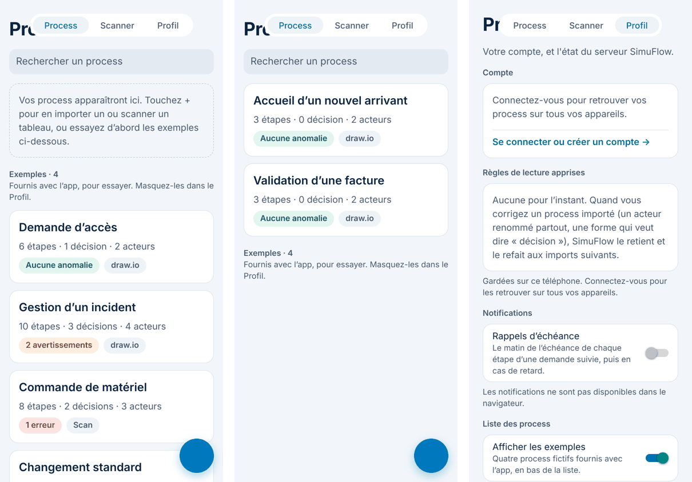

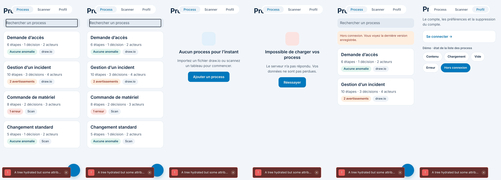

## Ajouter un process depuis un fichier · Disponible

Touchez le bouton **+** de la liste, puis **Fichier draw.io**, **Fichier BPMN**, **Fichier Visio** ou **Fichier JSON**, et choisissez le fichier dans Fichiers, iCloud Drive ou Drive. L'app vous montre ce qu'elle a lu : le nombre d'étapes et d'acteurs, les problèmes éventuels, et ce qu'elle a dû deviner (par exemple une flèche qui n'était accrochée à rien). Si le schéma a plusieurs pages, choisissez celle à importer. Vérifiez le nom, puis touchez **Importer** : le process s'ouvre et rejoint la liste.

Votre schéma n'a pas besoin d'être dessiné d'une façon particulière : l'app s'appuie d'abord sur les flèches. Une étape d'où partent plusieurs flèches nommées (« oui », « non »…) est une décision, même si c'est un rectangle ; l'étape où tout commence est le départ, celles où tout s'arrête sont les fins.

L'app trouve les acteurs de plusieurs façons : avec des couloirs (une bande par acteur), avec une légende de couleurs (une pastille de couleur suivie du nom de l'acteur), ou dans le texte des étapes (« Responsable : Comptabilité », « Assignee : … »). Elle garde le service plutôt que le nom des personnes.

**Un schéma BPMN** (fichier `.bpmn` de Camunda, bpmn.io, Bizagi, Signavio…) se lit de la même façon : les événements de début et de fin, les tâches, les passerelles (un choix devient une décision, avec le nom ou la condition de chaque branche), et les couloirs pour les acteurs. La mise en page d'origine est gardée. Les éléments que l'app ne lit pas encore (annotations, données, messages entre participants) sont signalés. Pour essayer : `demande-achat.bpmn`. Pour en savoir plus sur BPMN : [BPMN 2.0 en bref](bpmn.md).

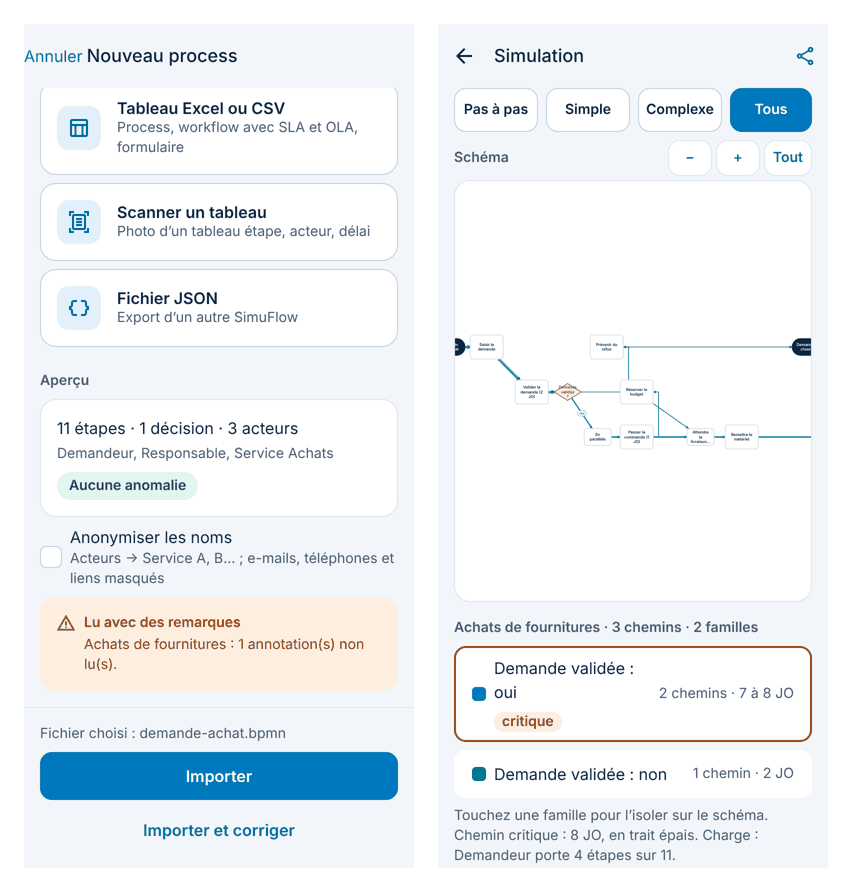

**Un schéma Visio** (fichier `.vsdx`, Visio 2013 et après) se lit aussi : chaque page reliée devient un process. Les formes reliées par des connecteurs deviennent les étapes, le losange une décision (le texte de chaque connecteur devient le nom de la branche), la forme « Début/Fin » le départ ou la fin, et les couloirs d'un diagramme fonctionnel croisé donnent les acteurs. La mise en page d'origine est gardée. Les titres et légendes sans connecteur sont signalés puis ignorés. Un ancien fichier `.vsd` doit d'abord être enregistré en `.vsdx` dans Visio. Pour essayer : `demande-conges.vsdx`.

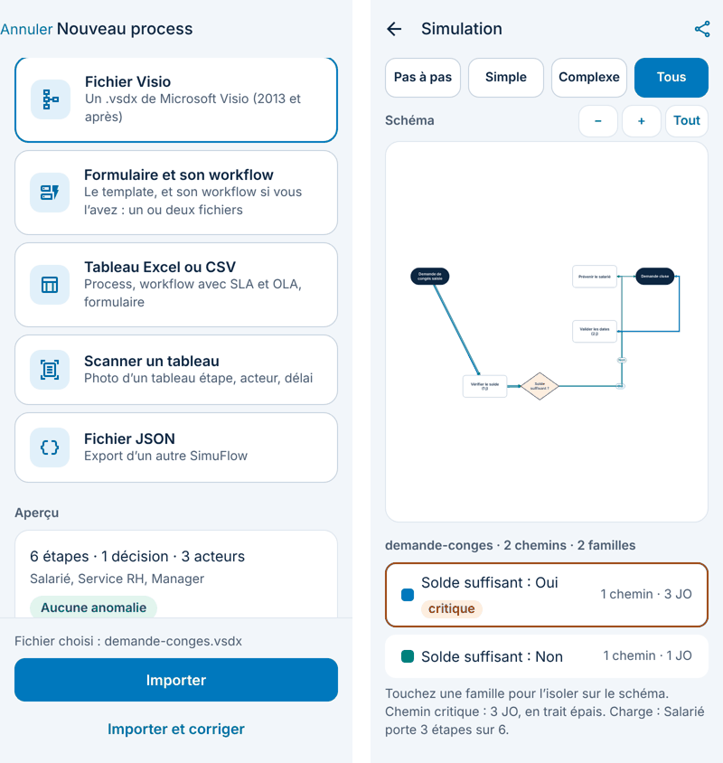

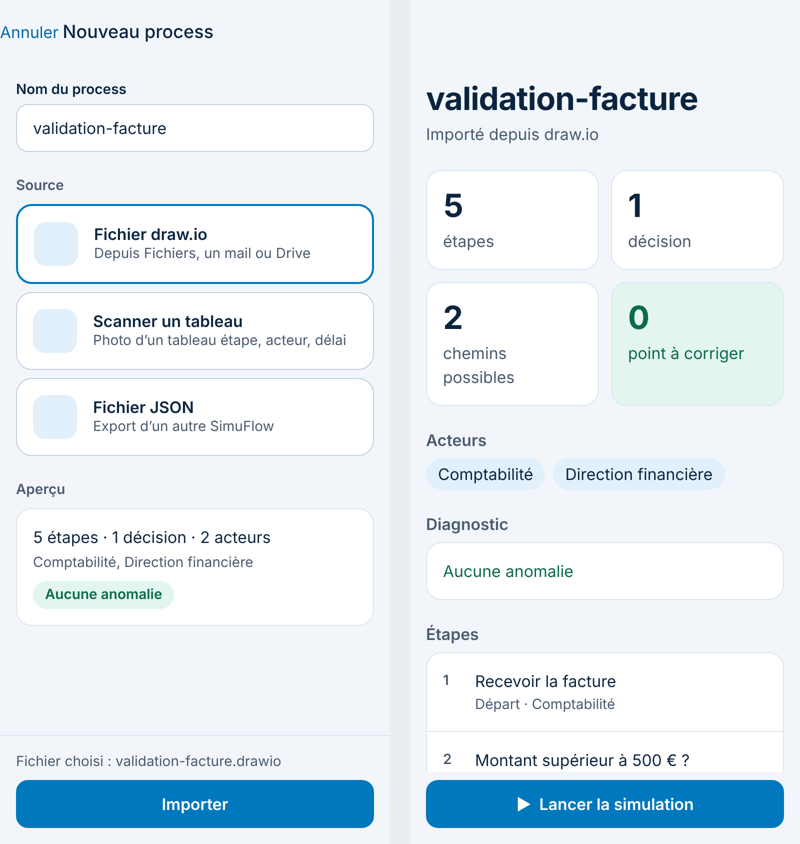

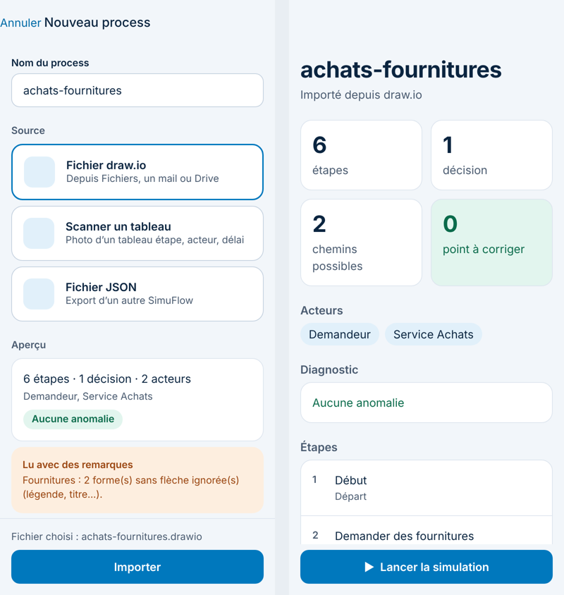

Vos process importés sont enregistrés sur le téléphone : vous les retrouvez à chaque ouverture de l'app. Si vous êtes connecté, ils sont aussi gardés sur votre compte (voir « Compte et serveur »). Pour en retirer un, ouvrez-le et touchez **Supprimer ce process**, tout en bas.

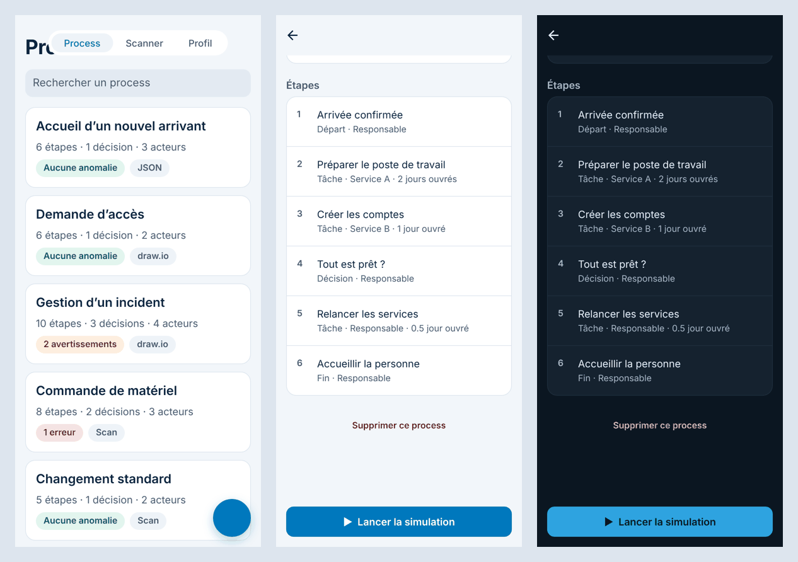

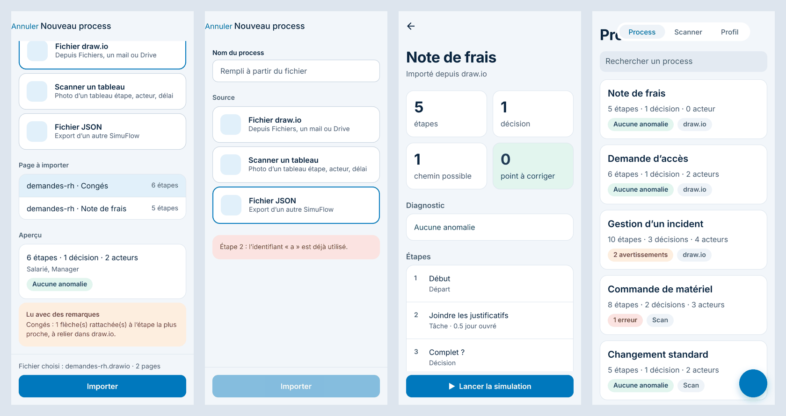

## Importer un tableau Excel ou CSV · En cours

Touchez **+**, puis **Tableau Excel ou CSV**, et choisissez un fichier .xlsx ou .csv. L'app le lit sur le téléphone, sans l'envoyer nulle part ni le garder, et vous montre ce qu'elle a compris de chaque onglet : un tableau de process (étape, acteur, délai), un workflow avec SLA et OLA (une ligne par situation), un template de formulaire, une simple liste, ou un onglet qu'elle ne reconnaît pas. Pas besoin de régler quoi que ce soit : elle trouve seule.

Un onglet qui décrit un process (des colonnes Étape, Acteur, Délai, Suite, comme pour le scanner) s'importe tout de suite : l'aperçu montre les étapes et les acteurs, touchez **Importer**. Si le classeur a plusieurs onglets de ce genre, choisissez celui à importer. Le process prend le titre écrit au-dessus du tableau, sinon le nom de l'onglet. Un ancien fichier .xls ou un classeur protégé par mot de passe est refusé avec un message qui explique quoi faire (l'enregistrer en .xlsx, retirer le mot de passe).

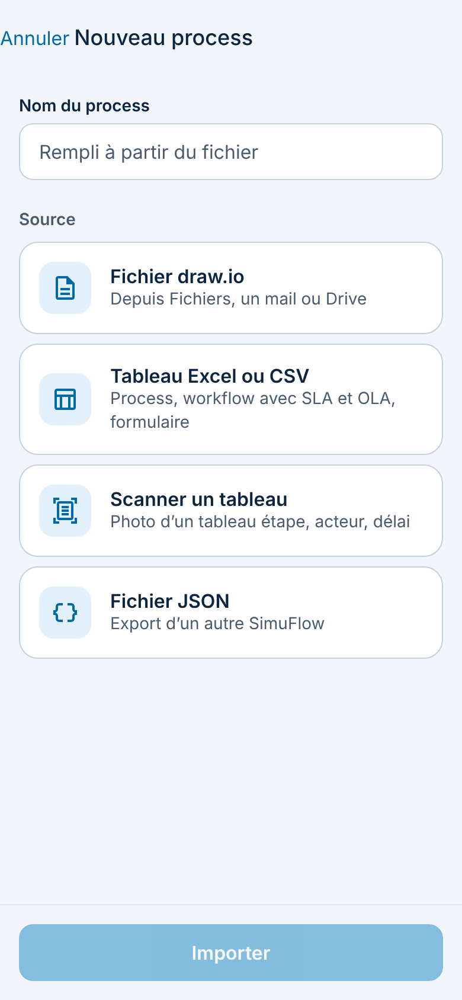

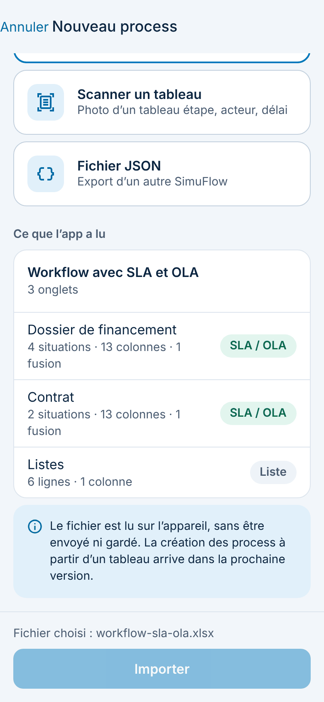

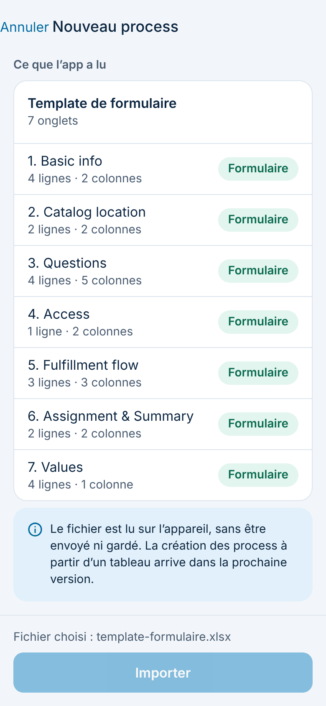

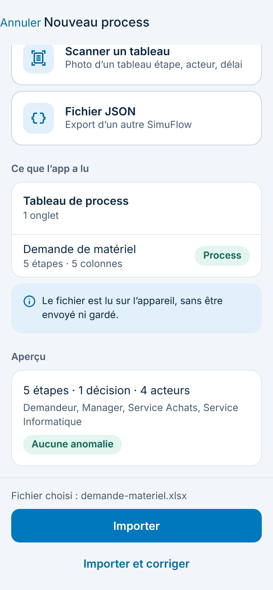

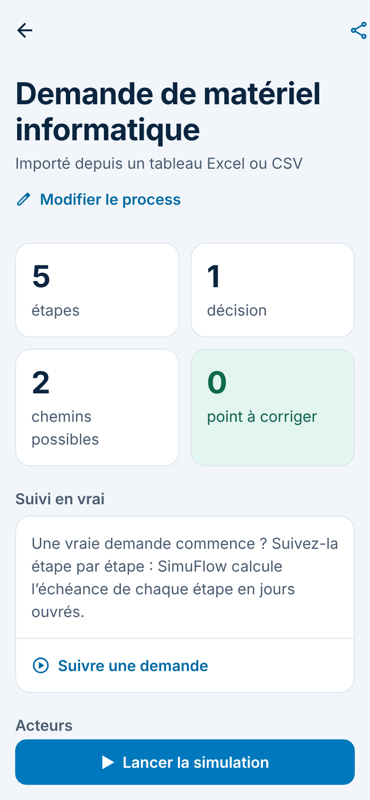

**Un tableau que l'app ne reconnaît pas ?** Si vos colonnes portent d'autres noms (« Intitulé », « Pilote », « Durée prévue »…), l'onglet est marqué « Non reconnu ». Touchez **Choisir les colonnes** sous l'onglet : la ligne des titres est proposée (changez-la avec **Précédente** et **Suivante** si votre tableau commence plus bas), puis, pour chaque colonne, touchez son rôle : **Étape**, **Acteur**, **Délai**, **Suite**, **N°**, ou **Ignorer**. Seule la colonne Étape est obligatoire. Touchez **Lire ce tableau** : l'aperçu apparaît, puis **Importer**. L'app retient ces titres : la prochaine fois qu'un tableau a une colonne « Pilote », elle la lit seule comme l'acteur. Ces règles apparaissent dans **Profil**, avec **Oublier** pour en retirer une. Pour essayer : `tableau-a-completer.xlsx`.

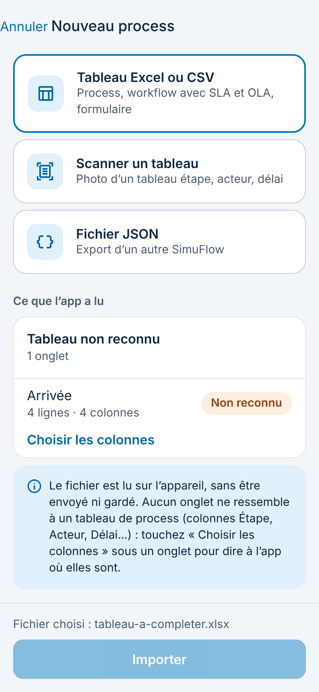

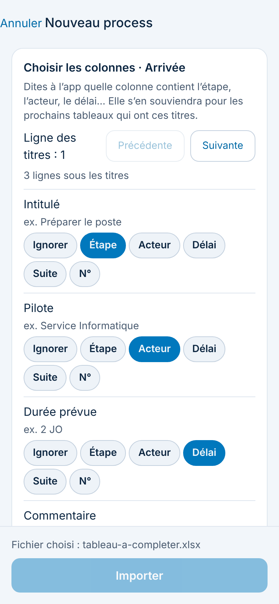

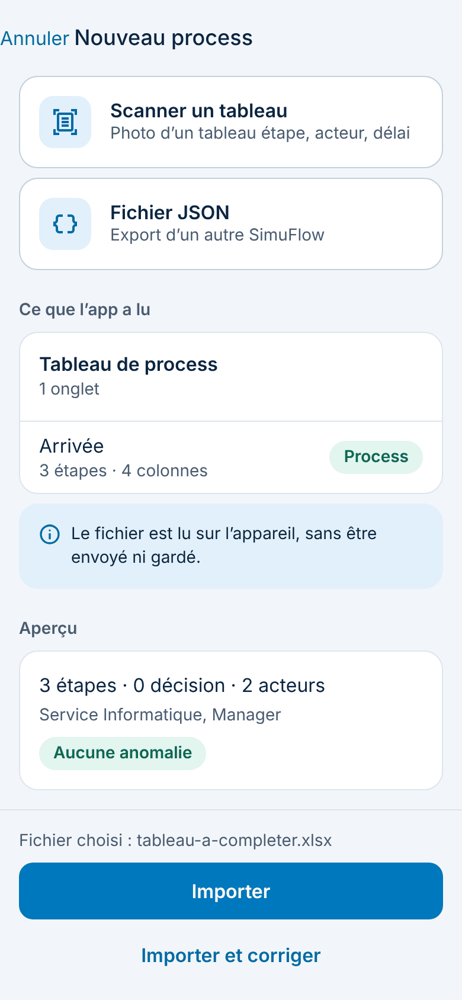

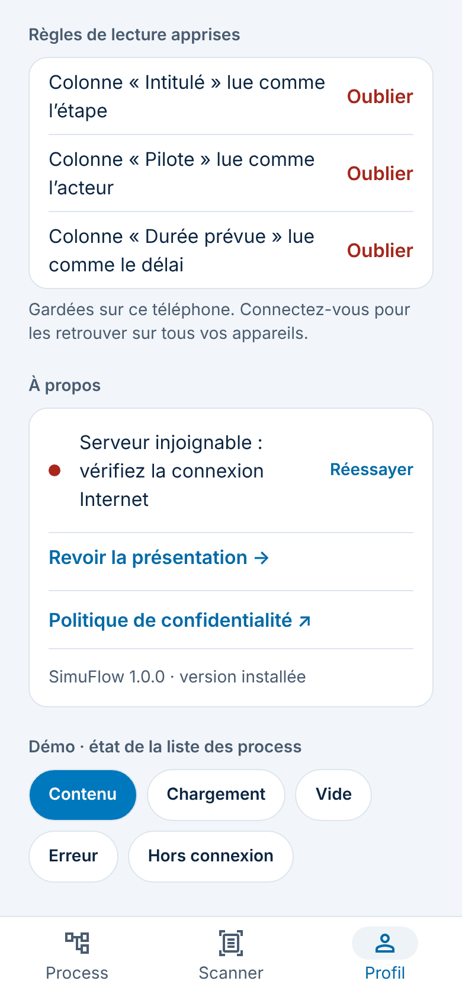

**Un workflow avec SLA et OLA devient des process.** Dans ce genre de classeur, chaque ligne est une situation : un choix du menu du formulaire de demande, avec son propriétaire, son SLA, et une ou deux tasks confiées à des groupes, chacune avec son OLA. Sous « Ce que l'app a lu », la liste **Situation à importer** les montre par famille : le SLA, les groupes avec leur OLA (« Groupe A (3 JO) → Groupe B (3 JO) »), la façon dont les tasks s'enchaînent (une étape, escalade si non résolu, étape 2 si accord, reprise en main, étape 2 si cas complexe) et une pastille : **Lue sans ambiguïté**, **À vérifier** ou **À corriger**. Touchez une situation : ses points à vérifier s'affichent dessous, avec l'onglet, la cellule et la question à poser au métier (« Le SLA doit-il couvrir les deux tasks ? »). L'app ne tranche pas à sa place. Touchez **Importer** : la situation devient un process prêt à simuler. Le demandeur remplit le formulaire, le ticket est créé pour le propriétaire (le SLA démarre), la task 1 part au groupe avec son OLA, puis deux questions : « Réponse dans l'OLA ? » (sans réponse, la task compte comme non résolue) et « Task résolue ? ». La suite dépend de la situation, et c'est toujours le propriétaire qui clôture. La simulation calcule le chemin le plus long en jours ouvrés, à comparer au SLA. Les lignes qui nomment une situation sans encore la décrire (ni SLA ni étape) sont comptées et ignorées. Pour essayer : `workflow-sla-ola.xlsx`.

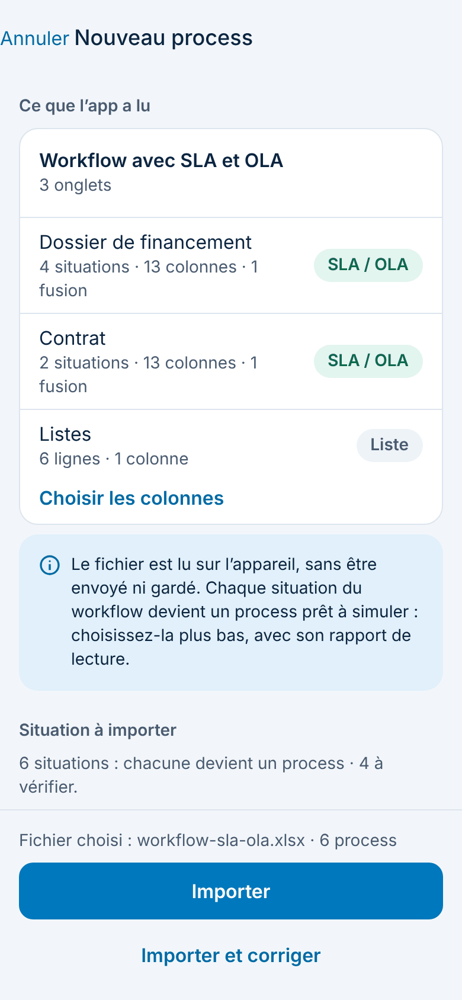

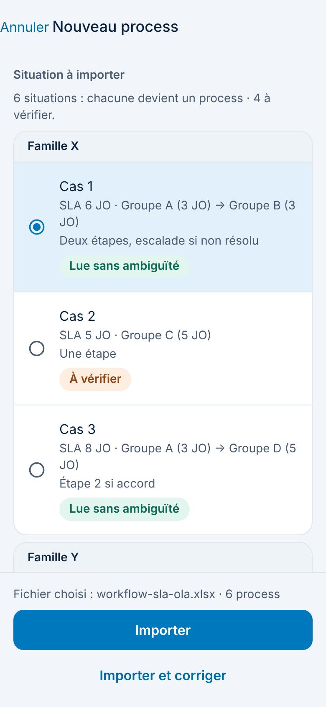

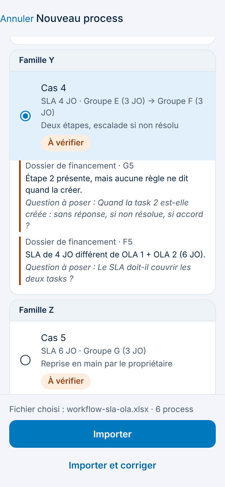

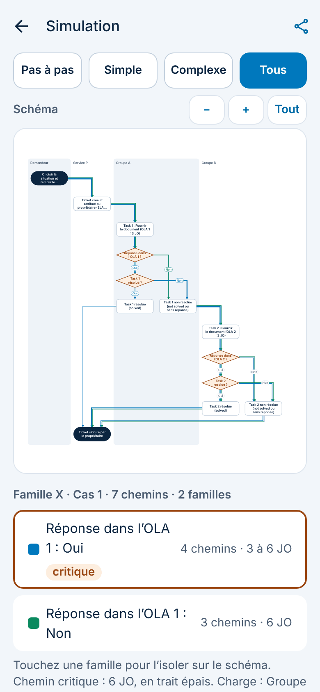

**Voir un formulaire avant qu'il existe.** Un template de création de formulaire (onglets Basic info, Questions, Fulfillment flow…) est reconnu tout seul. Touchez **Voir le formulaire** : l'app montre le formulaire tel que le demandeur le verra, question par question. Chaque question a le bon champ : texte, oui / non, menu déroulant, cases à cocher, date, pièce jointe avec la liste des documents attendus, ou un libellé avec ses champs à remplir. Les réponses obligatoires portent une étoile rouge, l'aide est écrite en italique dessous. Une question qui ne s'affiche que selon une autre réponse le dit (« S'affiche si … = Non »), même quand la condition n'est écrite que dans l'intitulé (« Si NON : … », « MOTIF 2 : … »). En bas : à qui le ticket sera attribué et les tasks prévues, puis les points à vérifier dans le template, avec la cellule et la question à poser. Pour essayer : `template-formulaire.xlsx`.

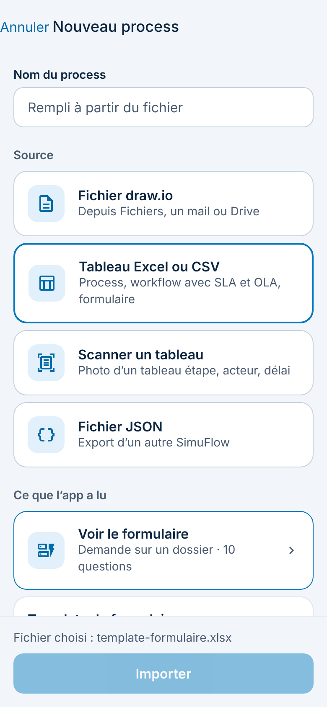

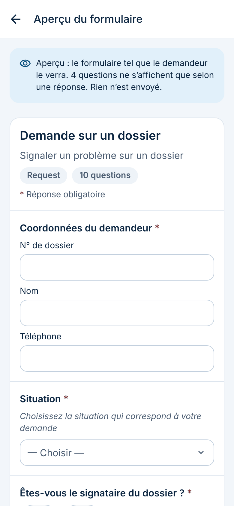

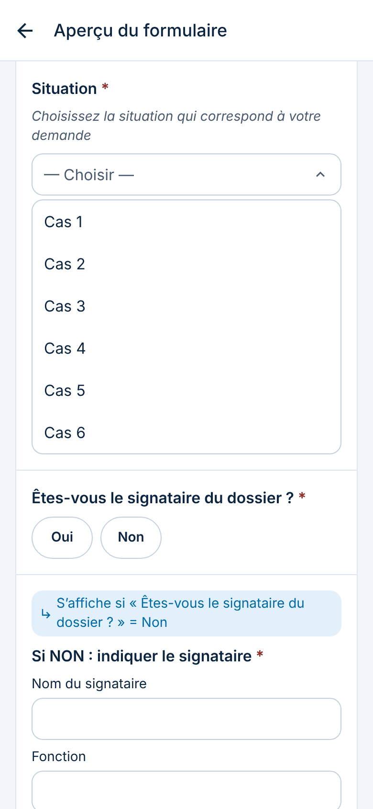

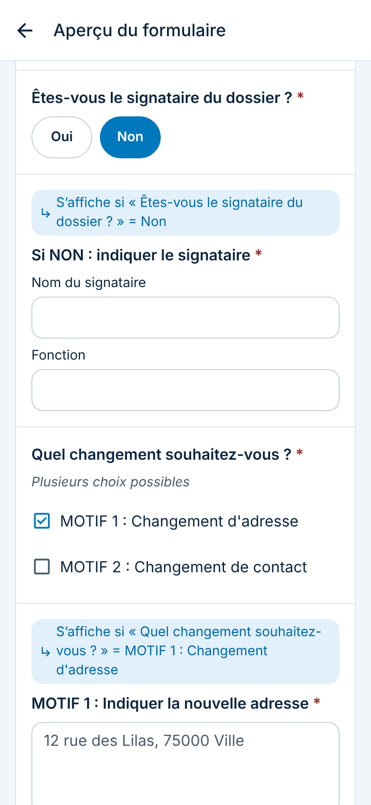

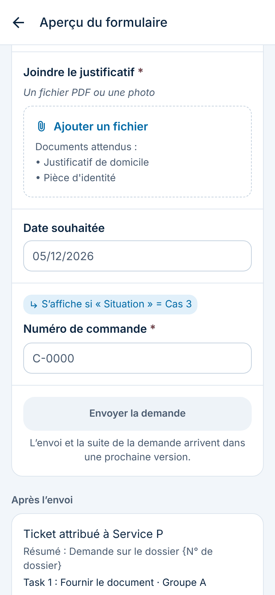

**Remplir le formulaire comme le demandeur.** Le formulaire se remplit pour de vrai. Au départ, seules les questions toujours posées s'affichent ; l'encadré du haut dit combien d'autres apparaîtront selon vos réponses, et **Montrer aussi les questions cachées** les montre en grisé pour relire tout le template. Répondez « Non » à « Êtes-vous le signataire ? » et la question « Si NON : indiquer le signataire » apparaît ; cochez MOTIF 1 et la question de MOTIF 1 apparaît. **Ajouter un fichier** ouvre vos fichiers ; seul le nom du fichier est gardé, et la croix le retire. Touchez **Envoyer la demande** : s'il manque une réponse obligatoire, ou si un e-mail, une adresse web ou une date est mal écrit, l'app remonte à la première question à corriger et écrit en rouge ce qui ne va pas. Quand tout est bon, **Demande prête** affiche le récapitulatif : chaque question posée et votre réponse. Rien n'est envoyé : c'est une simulation. **Modifier les réponses** revient au formulaire, **Nouvelle demande** le vide.

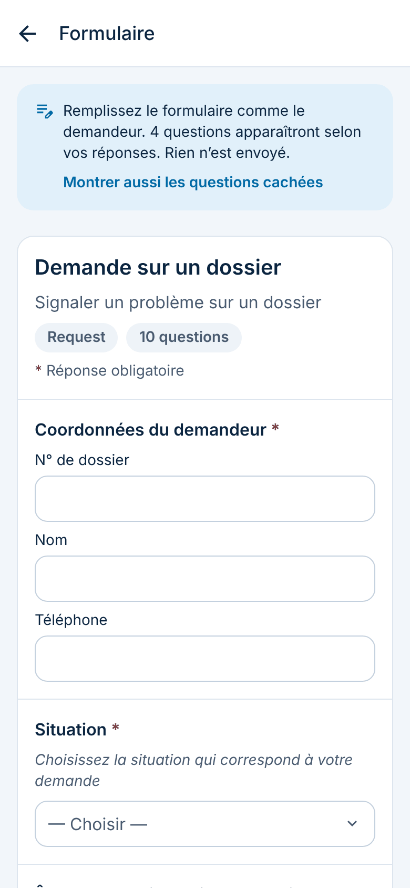

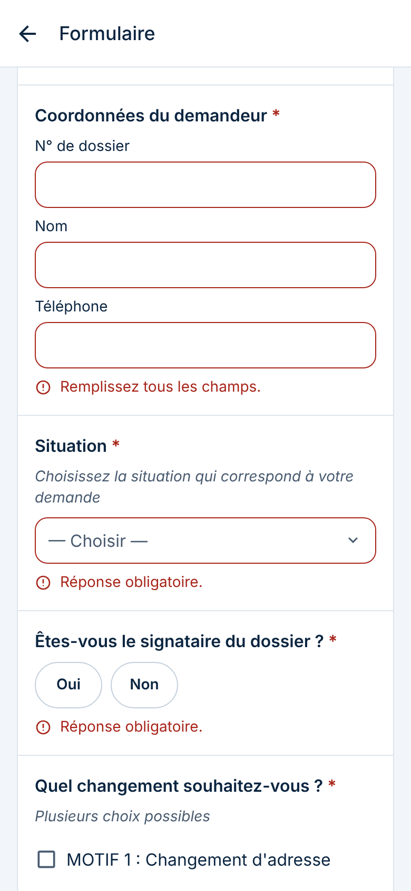

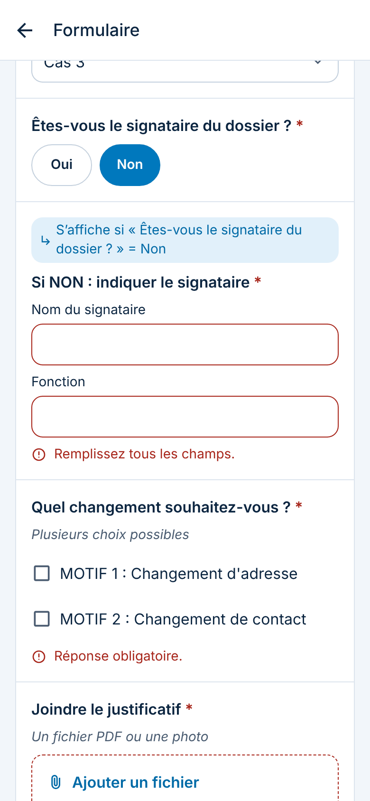

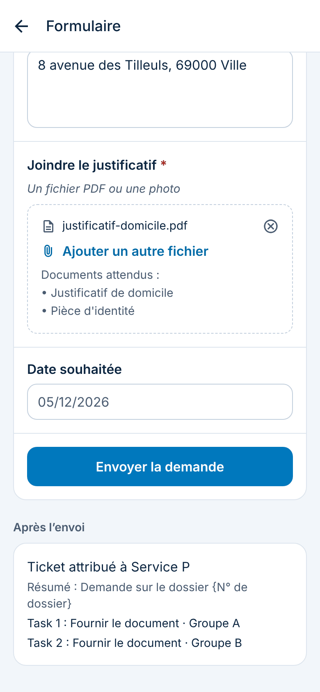

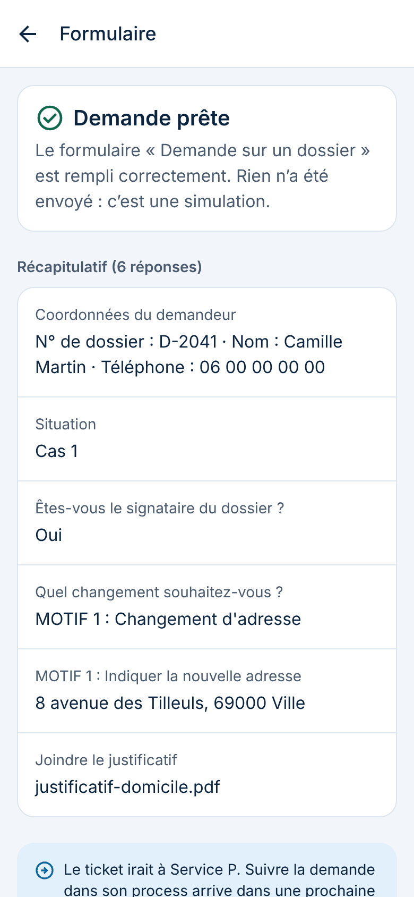

**Un formulaire plus juste.** Les templates mêlent souvent au formulaire des notes pour l'équipe qui le construira. L'app les corrige seule, quel que soit le template :

- « Nom / Prénom du contact » devient deux cases, **Nom du contact** et **Prénom du contact**.
- Un rappel comme « !!!!! Nbre de caractères maximum… » n'apparaît plus dans le formulaire. Les longueurs qu'il donne s'appliquent aux champs du même nom (« Nom du contact · 40 caractères au plus »), et le rappel est gardé dans **Points à vérifier dans le template**.
- Une pièce jointe qui liste plusieurs documents devient **une pièce jointe par document**, chacune obligatoire, sauf un document qui ne sert que dans un cas (« uniquement… », « si… », « facultatif »).
- Sous des cases à cocher, « Dans le cas de X » suivi de documents ajoute, quand X est coché, un titre « Documents à fournir : X » et **une pièce jointe obligatoire par document** (« ou par défaut » n'y change rien : chaque document est demandé).
- Un choix **« Autre »** ou **« … (Préciser) »** reçoit son complément, affiché quand il est coché : si les autres choix demandent des documents, **une pièce jointe et la description du document joint** (on ne sait pas quel fichier la personne mettra, elle le décrit) ; sinon, une case **« Précisez »**.

**Modifier le formulaire.** Ce que la lecture ne peut pas deviner se corrige à la main. Dans le formulaire, touchez **Modifier le formulaire** : chaque question est une ligne ; touchez-la pour changer son intitulé, son type (texte, champs à remplir, oui / non, menu, cases à cocher, pièce jointe, date, e-mail, titre), la rendre obligatoire ou non, écrire ses choix, ses champs ou ses documents (un par ligne), son aide, et quand elle s'affiche (« si "Êtes-vous le signataire ?" = Oui »). Pour les fichiers : **Ajouter une pièce jointe après** crée directement une question « Pièce jointe », et, sur une pièce jointe qui liste plusieurs documents, **Une pièce jointe par document** la découpe en un titre suivi d'une pièce jointe par document. **Compléter la question** ajoute un champ qui fait corps avec elle : une **description** sous une pièce jointe, une **pièce jointe** sous un texte, une date ou un choix, une **précision écrite** sous un oui / non, un menu ou des cases à cocher. Seuls les types qui vont ensemble sont proposés (jamais un oui / non avec un menu déroulant, par exemple). Le complément s'affiche toujours avec la question, ou seulement pour un choix précis (« Si « Autre » est choisi ») : il est alors obligatoire. Dans la liste, il apparaît en retrait sous sa question ; il se déplace et se supprime avec elle. **Monter**, **Descendre**, **Ajouter une question après** et **Supprimer** sont en bas ; une question supprimée retire aussi les conditions qui en dépendaient. **Enregistrer** remplace le formulaire affiché, et le formulaire gardé dans **Mes formulaires** s'il l'est. Le fichier Excel d'origine n'est pas touché.

**Anonymiser le formulaire.** Sous l'encadré du haut, cochez **Anonymiser le formulaire** : chaque groupe ou service cité (groupe du ticket, groupes des tasks, propriétaires et groupes du workflow lié) devient **Service A**, **Service B**…, dans le formulaire comme dans son workflow ; les e-mails, téléphones et liens sont masqués, et les mots écrits dans **Autres mots à masquer** deviennent « [masqué] ». Le choix qui mène à une situation reste relié à son process. Décochez pour revenir à la version d'origine. Si le formulaire est gardé, **Mes formulaires** suit.

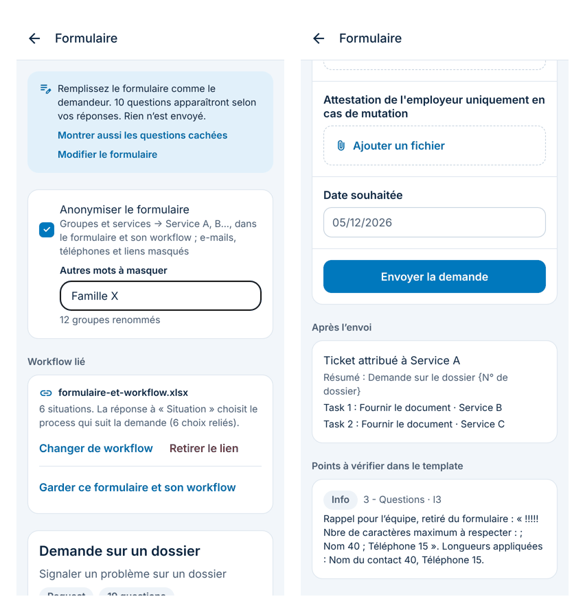

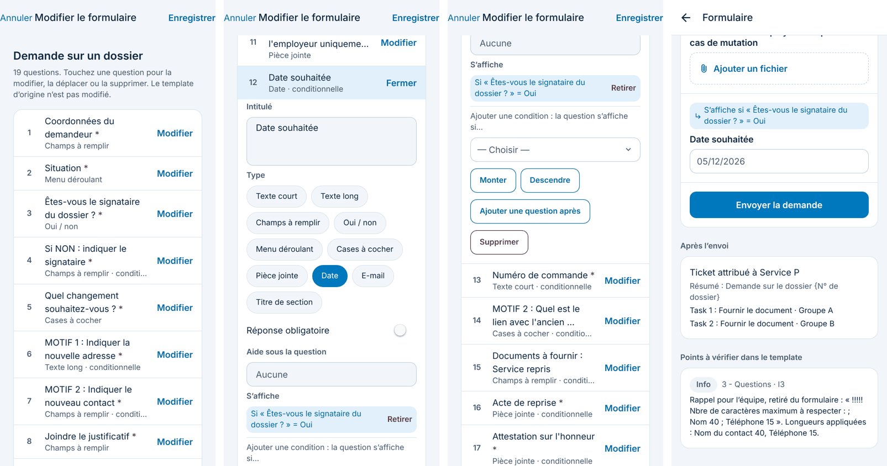

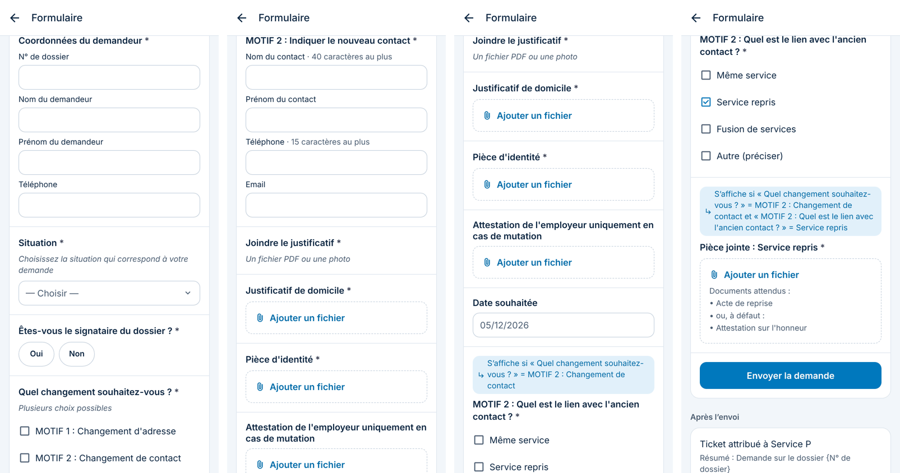

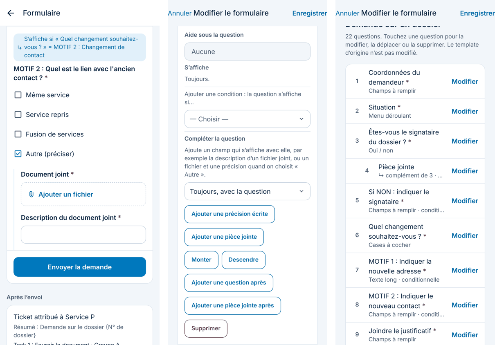

**Du formulaire au process.** L'app fait la différence toute seule :

- **Un formulaire seul** (un template, sans workflow) se simule en formulaire : la simulation s'arrête à « Demande prête ».
- **Un formulaire avec son workflow**, dans **un ou deux fichiers**. Dans **Nouveau process**, touchez **Formulaire et son workflow** et choisissez le template, et son workflow si vous l'avez (un classeur SLA / OLA, un schéma draw.io ou un tableau de process), ensemble, dans n'importe quel ordre : le formulaire s'ouvre tout de suite, prêt à remplir. Un seul classeur qui contient les deux marche aussi, depuis **Tableau Excel ou CSV** : le bouton du bas devient **Remplir le formulaire** (ses situations ne s'importent pas seules : c'est la réponse du formulaire qui choisit). Remplissez-le : sous « Demande prête », **La suite de la demande** montre la situation que votre réponse a choisie (« Cas 3 » mène à « Famille X · Cas 3 », avec son SLA, ses groupes et leurs OLA). Touchez **Simuler le parcours** pour la dérouler pas à pas, ou **Suivre la demande en vrai** : le suivi commence au ticket (le formulaire est déjà rempli), avec les échéances en jours ouvrés et vos réponses jointes.
- **Lier un workflow plus tard.** Dans l'encadré **Workflow lié** du formulaire, touchez **Lier un workflow** et choisissez un classeur SLA / OLA, un schéma draw.io ou un tableau de process. L'app trouve seule la question dont les choix sont les situations (« Situation : Cas 1, Cas 2… »). Avec un schéma, c'est ce process qui suit chaque demande. **Changer de workflow** et **Retirer le lien** sont là aussi.
- **Garder un formulaire.** **Garder ce formulaire** l'enregistre sur le téléphone, avec son workflow. Il se retrouve dans **Profil**, rubrique **Mes formulaires** : touchez-le pour le remplir à nouveau ou lui lier un workflow, **Retirer** pour l'effacer. Connecté, il est aussi gardé sur votre compte : vous le retrouvez sur vos autres appareils et dans la version web ; modifié ou retiré d'un côté, il l'est aussi de l'autre.

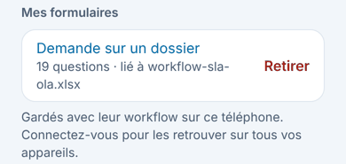

Pour essayer : `template-formulaire.xlsx` et `workflow-sla-ola.xlsx` choisis ensemble (deux fichiers), `formulaire-et-workflow.xlsx` (les deux dans un classeur) ou `template-formulaire.xlsx` (formulaire seul, puis **Lier un workflow** avec `workflow-sla-ola.xlsx`).

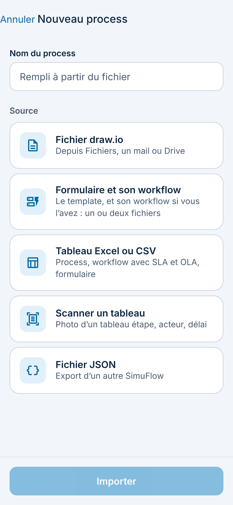

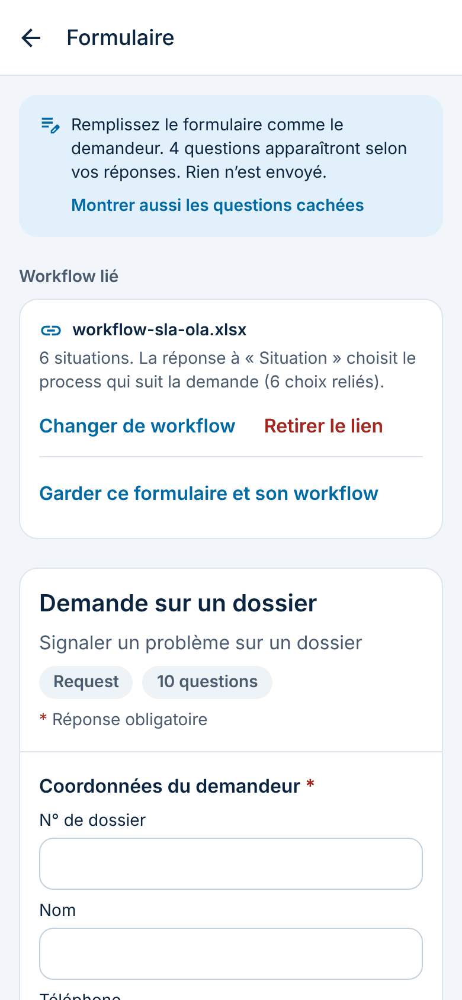

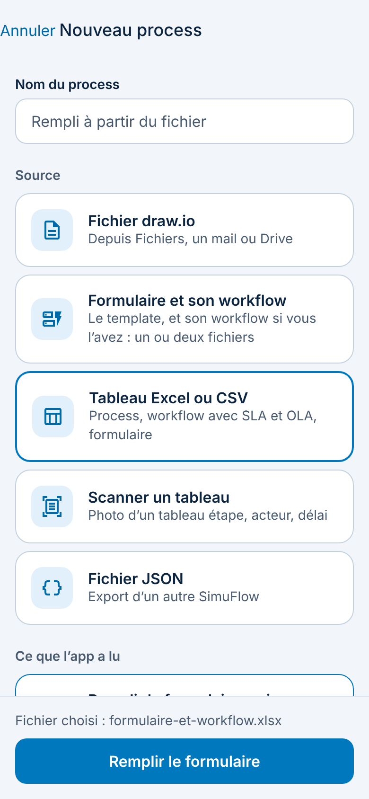

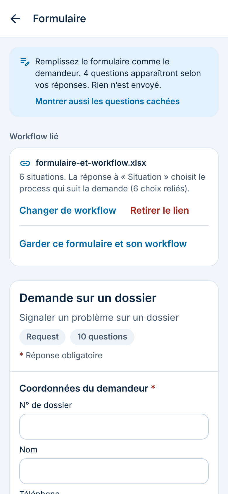

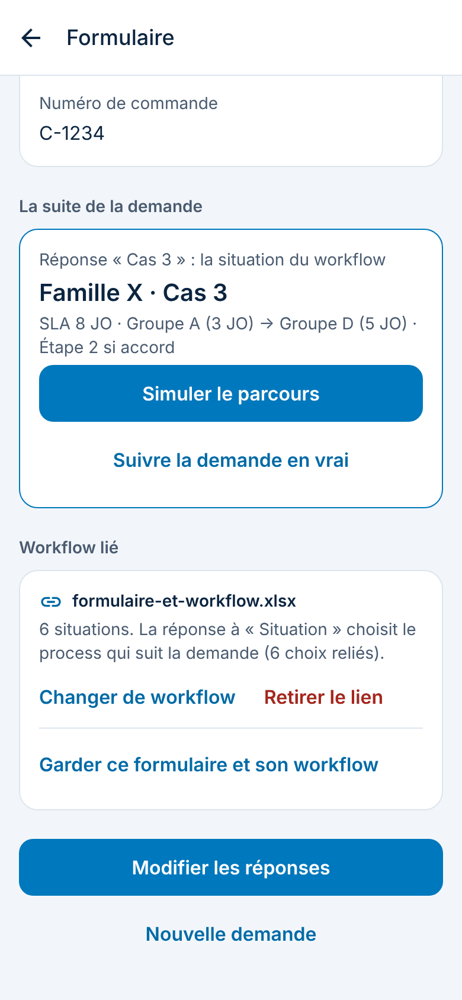

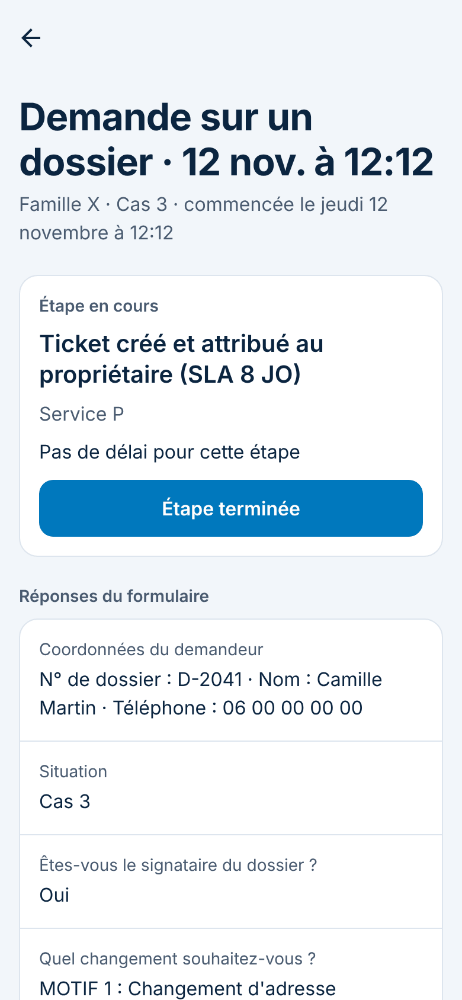

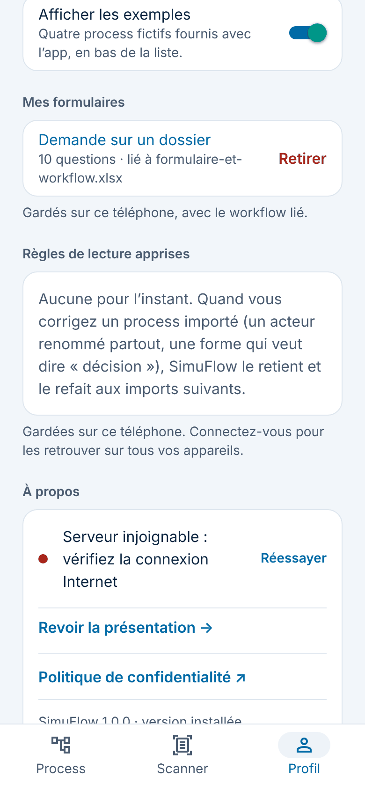

## Scanner un tableau · Disponible

**Scannez un tableau** avec l'appareil photo : une ligne par étape, avec l'acteur et le délai. L'app reconnaît les colonnes et crée le process.

Disponible : l'onglet **Scanner** ouvre l'appareil photo. La première fois, l'app demande l'autorisation et explique pourquoi. Cadrez le tableau entre les quatre coins, allumez la lampe si besoin, et touchez le gros bouton rond. Touchez **Reprendre la photo** pour recommencer. Pour essayer, le fichier `docs/exemples/tableaux-a-scanner.html` contient six tableaux fictifs à afficher sur un écran ou à imprimer. Juste après la photo, l'app recadre la photo sur la feuille ou l'écran photographié (sur iPhone, comme son appareil photo), puis lit le texte, sur le téléphone, sans Internet. Elle ne garde que le tableau : elle le repère à sa ligne de titres (Étape, Acteur, Délai, ou Tâche, Responsable, Durée…) et ignore le texte autour (titre de la page, onglets du navigateur, notes). Le tableau trouvé s'affiche en colonnes sous la photo (« Tableau trouvé : 4 étapes »). Sans ligne de titres, l'app le dit et montre tout le texte lu. La lecture marche sur iPhone et sur Android.

**Dans la version web** (navigateur ou web app), le bouton **Prendre ou choisir une photo** ouvre l'appareil photo du téléphone, ou, sur ordinateur, le choix d'une image (une capture d'écran marche aussi). Le texte est lu dans le navigateur, sans envoyer l'image. La première lecture prend quelques secondes de plus, le temps de charger le moteur de lecture. Elle est un peu moins fine que sur téléphone et ne recadre pas la photo : prenez le tableau bien de face et d'assez près, et touchez **Créer et corriger** pour vérifier ce qui a été lu.

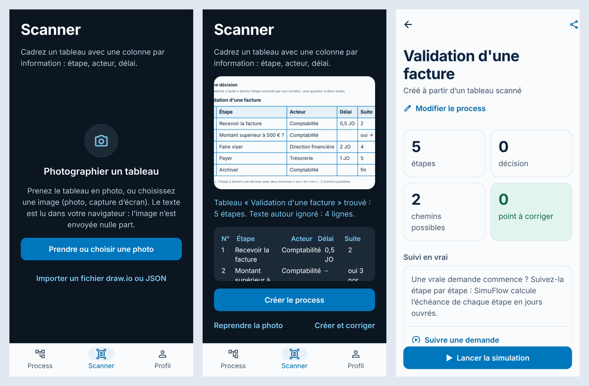

Touchez **Créer le process** : chaque ligne devient une étape, avec son acteur et son délai (« 2 JO », « 3 jours », « 4 h », « 1 sem. »). Les étapes se suivent dans l'ordre du tableau. Une colonne **Suite** peut donner l'étape suivante par son numéro, plusieurs cas (« oui → 3 ; non → 4 ») ou « fin ». Une étape avec plusieurs cas devient une décision. Le process prend le nom écrit au-dessus du tableau et s'ajoute à la liste. Touchez **Créer et corriger** pour ouvrir aussi l'éditeur, par exemple pour compléter un acteur manquant.

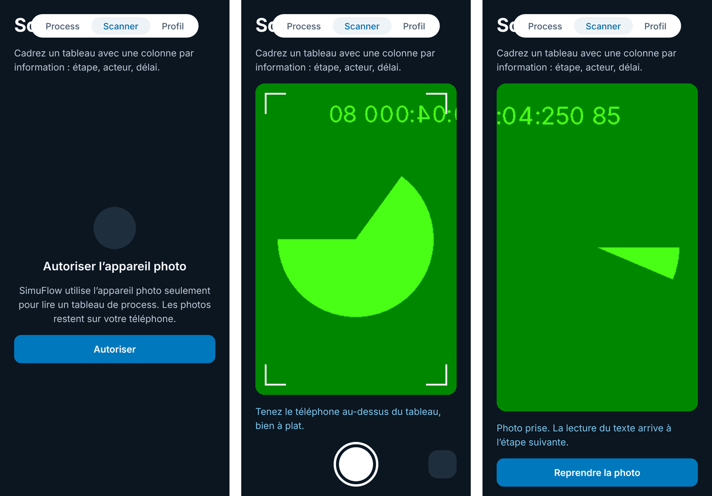

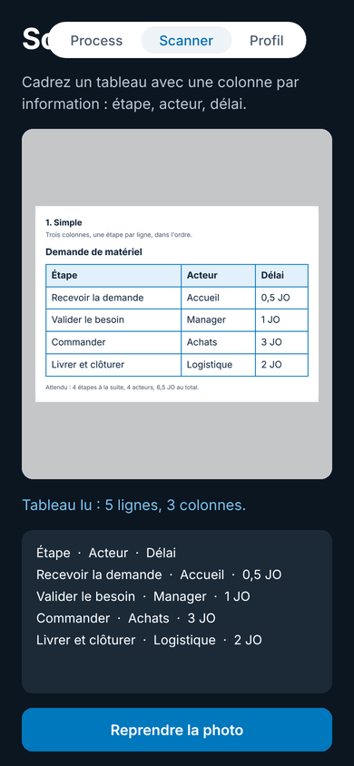

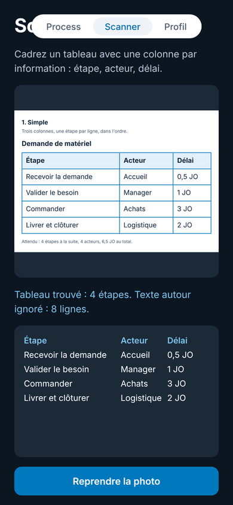

## Corriger un process · Disponible

Un process importé se corrige directement dans l'app, par exemple pendant sa validation. Ouvrez-le, touchez **Modifier le process**, puis touchez une étape : changez son titre, son rôle (départ, tâche, décision, fin), son acteur (tapez-le ou choisissez un acteur déjà présent) et son délai. Pour une étape qui mène à plusieurs suites, nommez chaque branche (« oui », « refus »…). Si une étape à plusieurs sorties est en fait un choix, touchez **C'est un choix** : elle devient une décision et ses branches sont nommées d'après l'étape suivante. En haut, le nombre de points à corriger change à mesure. Touchez **Enregistrer** : si vous êtes connecté, la version corrigée part aussi sur votre compte.

Vous pouvez aussi changer la forme du process :

- **Ajouter une étape après** une autre : elle se glisse entre l'étape et sa suite.
- **Ajouter un cas** à une décision : donnez-lui un nom et choisissez où il mène, une nouvelle étape ou une étape existante.
- **Relier à une autre étape** une tâche, par exemple pour revenir en arrière.
- **Retirer** une branche, ou **Supprimer l'étape** (l'app demande confirmation ; une étape de passage laisse ses voisines reliées).

Pour corriger dès l'import, touchez **Importer et corriger** au lieu d'**Importer** : l'éditeur s'ouvre tout de suite.

Le process corrigé garde la trace de la correction : sa fiche affiche « Corrigé dans l'app le … ». Sur le schéma, les étapes d'origine restent à leur place et les nouvelles se rangent sous l'étape qui y mène. Pour faire valider la nouvelle version, exportez-la (**Lancer la simulation**, puis le bouton d'export) en **draw.io** ou en **PDF** : la date de correction y figure aussi.

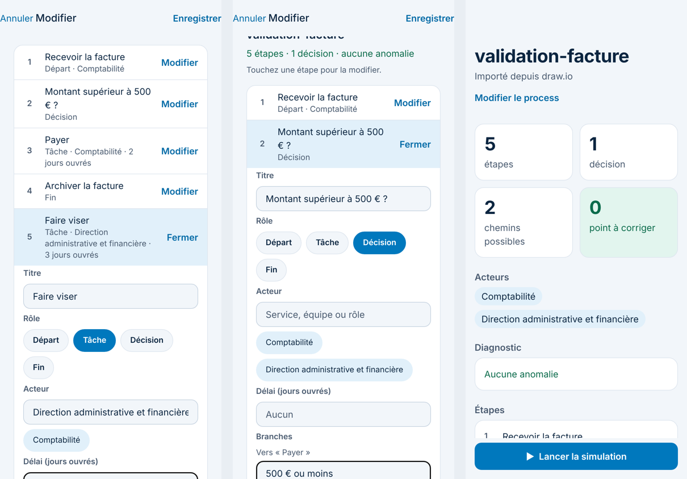

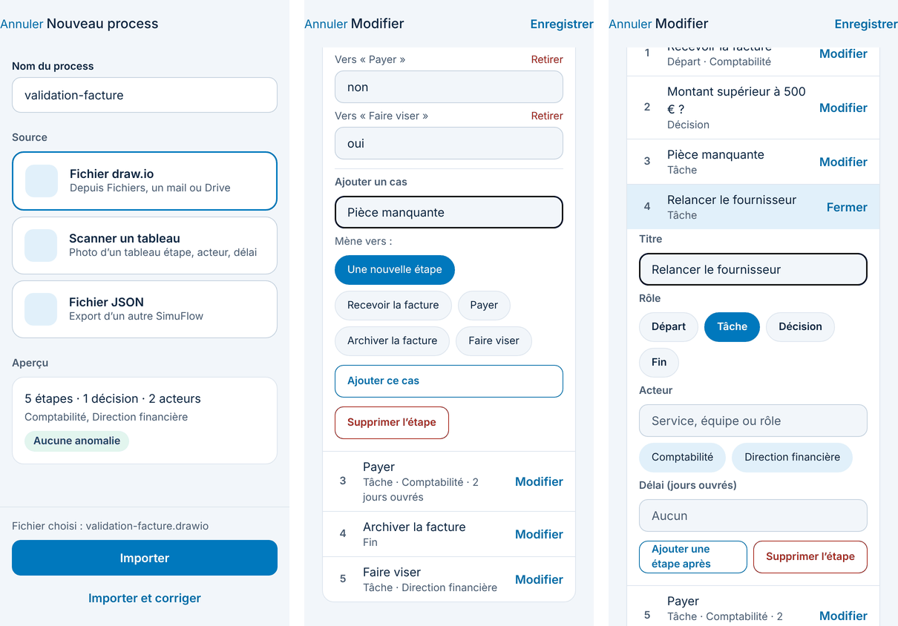

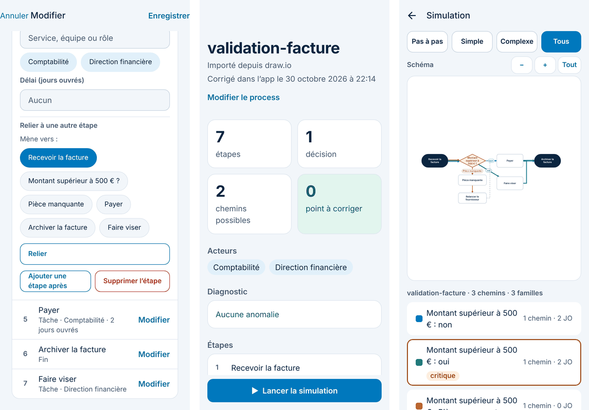

## L'app apprend de vos corrections · Disponible

Quand vous corrigez un process importé, SimuFlow retient ce qui vaut pour tout le schéma et le refait seul aux imports suivants :

- un **acteur renommé partout** (par exemple « Serv. compta » devient « Comptabilité » sur toutes ses étapes) ;
- une **forme qui a un sens chez vous** (par exemple, tous vos hexagones sont des décisions).

Une correction faite sur une seule étape reste ponctuelle : elle n'apprend rien. Les colonnes choisies pour un tableau Excel ou CSV deviennent aussi des règles (« Colonne « Pilote » lue comme l'acteur »). À l'import, l'aperçu indique **Corrigé d'après vos corrections précédentes** et dit ce qui a été appliqué. Retrouvez ces règles dans l'onglet **Profil**, et touchez **Oublier** pour en retirer une. Elles sont gardées sur le téléphone et, si vous êtes connecté, sur votre compte : vous les retrouvez sur vos autres appareils.

## Voir les problèmes · Disponible

L'app liste les anomalies du process, les plus graves en premier :

- une étape sans issue (impasse) ;
- une décision avec une seule sortie ;
- une branche sans libellé ;
- une étape que l'on ne peut jamais atteindre.

Touchez un process pour ouvrir sa fiche : nombre d'étapes, de décisions et de chemins possibles, les acteurs, le diagnostic et la liste des étapes. Le bouton « Voir » d'une anomalie descend jusqu'à l'étape concernée et la surligne. Les simples informations sont repliées ; touchez-les pour les afficher. Le bouton de partage envoie un résumé du process.

Plus tard, « Voir » montrera aussi l'endroit exact sur le schéma.

## Rejouer le process · Disponible

Ouvrez un process et touchez **Lancer la simulation**.

- **Pas à pas** : touchez « Étape suivante » pour avancer. À chaque décision, l'app vous demande quelle branche suivre. Vous pouvez revenir en arrière.
- **Simple** : le chemin le plus court jusqu'à la fin.
- **Complexe** : le chemin le plus long.

Le déroulé affiche chaque étape, son acteur et le délai cumulé en jours ouvrés. Si vous tombez sur une étape sans issue, l'app vous le dit.

Le **schéma** du process se construit en haut de l'écran au fil du parcours : chaque étape apparaît quand vous l'atteignez, et à une décision, les sorties possibles s'affichent en pointillés. À chaque étape, le schéma se recadre tout seul, en glissant, pour montrer l'étape en cours et toutes ses sorties possibles ; les nouvelles cases apparaissent en fondu. À la fin, il montre tout le chemin parcouru. Pincez avec deux doigts pour zoomer, glissez d'un doigt pour vous déplacer ; « − » et « + » zooment aussi, « Tout » montre le schéma entier. Un schéma draw.io garde sa mise en page ; pour un fichier JSON, l'app range les étapes en colonnes, une par acteur.

## Voir tous les cas · Disponible

Dans la simulation, touchez **Tous** : le schéma entier s'affiche, avec une couleur par famille de chemins (une famille regroupe les chemins qui donnent la même réponse à la première décision). Quand plusieurs familles passent par la même flèche, leurs traits sont côte à côte, comme sur un plan de métro.

Les flèches contournent les cases : une flèche ne passe jamais à travers une étape qui n'est pas la sienne, et deux flèches différentes ne se superposent pas. Chacune garde sa voie jusqu'à son arrivée.

En dessous, une légende donne pour chaque famille le nombre de chemins et leurs délais. La famille du chemin le plus long est marquée **critique**, et ce chemin est en trait épais. Touchez une famille pour l'isoler sur le schéma, touchez-la encore pour revoir tout. Une dernière ligne dit quel acteur porte le plus d'étapes.

## Exporter le schéma · Disponible

Dans la simulation, touchez le bouton de partage en haut à droite. Choisissez le format :

- **PDF** : le schéma en couleur, les familles de chemins avec leurs délais, et le diagnostic. À envoyer ou à imprimer.
- **draw.io** : un fichier à rouvrir et à retoucher dans draw.io, rangé en couloirs par acteur. Pratique après un scan de tableau. SimuFlow sait aussi le réimporter.
- **BPMN 2.0** : un fichier `.bpmn` à ouvrir dans Camunda Modeler, bpmn.io, Bizagi, Signavio… Le process y est dessiné à la norme : un couloir par acteur, de gauche à droite, avec les décisions (losanges) et le nom de chaque branche. Le délai est écrit dans le nom de l'étape (« Diagnostiquer (2 JO) »). SimuFlow sait aussi le réimporter, sans perte.
- **JSON** : pour l'importer dans un autre SimuFlow.

« Colorer les familles de chemins » met une couleur par famille sur le schéma, comme dans la vue Tous. Touchez **Partager** pour l'envoyer par mail, le ranger dans Fichiers ou l'envoyer par AirDrop.

## Anonymiser un process · Disponible

Pour montrer un process sans dévoiler de vrais noms, cochez **Anonymiser les noms**, à l'import (sous l'aperçu) ou à l'export (sous le choix du format). Un formulaire et son workflow s'anonymisent aussi, sur l'écran du formulaire (voir « Importer un tableau Excel ou CSV »).

- Chaque acteur devient **Service A**, **Service B**… partout où son nom apparaît : dans les étapes, sur les flèches et dans le nom du process.
- Les adresses e-mail, les numéros de téléphone et les liens sont masqués.
- Dans **Autres mots à masquer**, écrivez ce qui doit aussi disparaître, séparé par des virgules : le nom de l'entreprise, d'un client… Il est remplacé par « [masqué] ».

Les étapes, les flèches et les délais ne changent pas : la simulation reste la même. À l'import, c'est le process anonymisé qui est gardé. À l'export, seul le fichier partagé est anonymisé : votre process reste intact dans l'app.

## Compte et serveur · Disponible

SimuFlow a son serveur, hébergé à Paris. Dans **Profil**, la section **À propos** indique si l'app arrive à le joindre ; sinon, vérifiez la connexion Internet et touchez **Réessayer**.

**Créer un compte** : dans **Profil**, touchez **Se connecter ou créer un compte**, puis **Créer un compte**. Saisissez votre adresse e-mail et un mot de passe d'au moins 8 caractères, avec une minuscule, une majuscule, un chiffre et un symbole ; s'il en manque, l'app dit lesquels. Sous le bouton, une phrase rappelle où vos données sont gardées, avec le lien vers la politique de confidentialité. Si l'app vous le demande, ouvrez le lien reçu par e-mail, puis connectez-vous. Votre connexion est gardée dans le coffre chiffré du téléphone.

**Mot de passe oublié** : sur l'écran de connexion, touchez **Mot de passe oublié ?**, saisissez votre adresse et touchez **Recevoir un lien**. Ouvrez l'e-mail reçu **sur le téléphone** et touchez son lien : SimuFlow s'ouvre sur **Nouveau mot de passe**. Choisissez-en un et touchez **Enregistrer le mot de passe** : vous êtes connecté. Le lien est valable une heure et ne sert qu'une fois.

**Se connecter et se déconnecter** : vous restez connecté d'un lancement à l'autre. Le Profil affiche votre adresse et le bouton **Se déconnecter**. Si un champ est mal rempli, l'app le dit en clair.

**Supprimer son compte** : dans **Profil**, touchez **Supprimer mon compte**. L'app vous redemande de confirmer et dit ce qui sera effacé : votre compte et vos process, sur le serveur et sur ce téléphone.

**Retrouver ses process sur tous ses appareils** : connecté, chaque process importé est aussi enregistré sur votre compte. Connectez-vous sur un autre téléphone : il y apparaît. Supprimez-le d'un côté : il disparaît de l'autre. Sans réseau, rien n'est perdu : la liste affiche « Hors connexion » et vos process restent consultables ; l'app envoie les changements toute seule dès que le réseau revient. Le Profil indique l'heure de la dernière synchronisation, et **Synchroniser** la relance. Vos règles de lecture et vos formulaires gardés suivent de la même façon.

Quand vous vous déconnectez, les process de votre compte quittent ce téléphone ; ils vous attendent sur le serveur.

## Mises à jour sans réinstaller · Disponible

Les corrections et nouveautés qui ne touchent pas aux fonctions du téléphone (appareil photo, notifications…) arrivent toutes seules : l'app télécharge la nouvelle version en arrière-plan, et l'utilise au lancement suivant. En bas du **Profil**, la ligne de version indique « version installée », ou la date de la dernière mise à jour reçue.

## Suivre une vraie demande · Disponible

Une vraie demande commence ? Sur la fiche du process, section **Suivi en vrai**, touchez **Suivre une demande**. SimuFlow calcule l'échéance de chaque étape en **jours ouvrés** : du lundi au vendredi, de 9 h à 17 h, sans les jours fériés (Pâques, l'Ascension et la Pentecôte compris). Quand une étape est faite, touchez **Étape terminée** ; à une décision, choisissez la suite (« oui → Faire viser »). Une pastille dit si l'étape est **à l'heure**, si l'**échéance est proche**, ou de combien elle est **en retard**. Les étapes passées restent visibles, avec leur date. Les demandes suivies sont gardées sur le téléphone.

## Notifications · Disponible

Dans le **Profil**, la section **Notifications** a un interrupteur **Rappels d'échéance**. La première fois, le téléphone demande l'autorisation. Touchez **Envoyer une notification d'essai** : elle arrive 5 secondes plus tard, même téléphone verrouillé. Les notifications sont programmées par le téléphone lui-même, sans serveur. Pour chaque demande suivie, SimuFlow vous prévient **le matin du jour de l'échéance** (« Aujourd'hui : Commander, échéance à 14:00 ») et **à l'échéance** si l'étape n'est pas terminée (« En retard : Commander »). Quand vous touchez **Étape terminée**, les rappels passent à l'étape suivante. Touchez un rappel pour ouvrir la demande. Coupez **Rappels d'échéance** dans le Profil pour ne plus rien recevoir.

## Partager et valider · Prévue

Partagez un process avec vos collègues. Vous recevez une notification quand quelqu'un valide ou commente une étape.

## Mode sombre · Disponible

L'app suit le réglage de votre téléphone : claire le jour, sombre si vous avez choisi le mode sombre.

## Présentation au premier lancement · Disponible

À la première ouverture, quatre pages présentent SimuFlow : ce qu'elle fait, comment ajouter vos process, les rejouer et les corriger, et suivre une vraie demande. Dans le navigateur, une page de plus explique comment installer SimuFlow sur l'écran d'accueil. Touchez **Suivant**, ou **Passer** pour aller directement à la liste. Pour la revoir : **Profil**, puis **Revoir la présentation**, tout en bas.

## Icône et écran de démarrage · Disponible

Sur l'écran d'accueil du téléphone, SimuFlow a l'icône du logo, le chemin en S. À l'ouverture, le logo s'affiche sur un fond clair ou sombre selon votre téléphone, puis l'app apparaît en fondu (sans fondu si vous avez activé « Réduire les animations »).

## Animations douces · Disponible

Pendant le chargement, la liste « respire » doucement, puis les process apparaissent l'un après l'autre. Si vous avez activé « Réduire les animations » sur votre téléphone, rien ne bouge.

## Utiliser SimuFlow dans le navigateur · Disponible

SimuFlow s'ouvre aussi dans un navigateur, sur ordinateur ou sur téléphone, sans rien installer : https://mloick.github.io/SIMUFLOW/app/ (ou le bouton **Ouvrir l'app web** sur le site). Tout y est, sauf les **rappels**, qui ont besoin de l'app installée sur le téléphone. Sans compte, vos process restent dans le navigateur ; avec un compte, vous retrouvez les mêmes process sur le téléphone et sur l'ordinateur.

**L'ajouter à l'écran d'accueil**, comme une vraie app : à la première ouverture dans le navigateur, la présentation montre les gestes à faire, pour l'iPhone, Android ou l'ordinateur selon l'appareil. Sur iPhone, dans Safari, touchez **•••** puis **Partager** (ou directement le bouton **Partager**), puis **Sur l'écran d'accueil**. Sur Android, dans Chrome, menu **⋮** puis **Ajouter à l'écran d'accueil** (ou **Installer l'application**). L'icône SimuFlow apparaît avec son nom, et l'app s'ouvre en plein écran, sans la barre du navigateur.

## Vos données et le site · Disponible

SimuFlow a un site, https://mloick.github.io/SIMUFLOW/, qui présente l'app et sa **politique de confidentialité** : quelles données sont utilisées, où elles sont gardées, et comment les supprimer. En bref : sans compte, tout reste sur le téléphone ; avec un compte, votre adresse, vos process et vos règles de lecture sont gardés sur un serveur en Union européenne, visibles par vous seul ; les photos du Scanner ne quittent pas le téléphone. Dans l'app : **Profil**, puis **Politique de confidentialité**.

## Le Profil · Disponible

L'onglet **Profil** rassemble, de haut en bas : votre **compte** (connexion, synchronisation, suppression), les **notifications** (rappels d'échéance), la **liste des process** (afficher ou non les exemples), les **règles de lecture apprises**, et **À propos** : l'état du serveur, **Revoir la présentation**, la **Politique de confidentialité** et la version de l'app.

## Grands textes · Disponible

Si vous avez agrandi le texte de votre téléphone (Réglages > Accessibilité > Affichage et taille du texte > Police plus grande), l'app suit : les textes grandissent, et ce qui ne tient plus côte à côte passe l'un sous l'autre. Les chiffres du détail d'un process s'empilent, les quatre modes de la simulation passent sur deux lignes et le schéma se fait plus petit pour laisser la place au texte.

## Confort · Prévue

- Interface en français et en anglais.
- Lisible avec VoiceOver et TalkBack.
