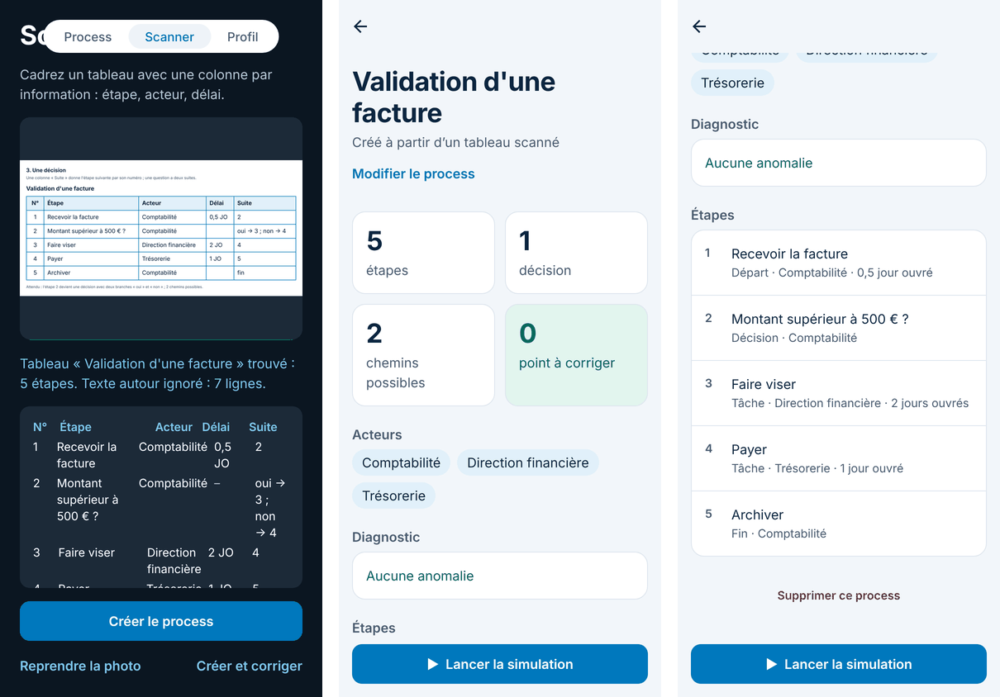
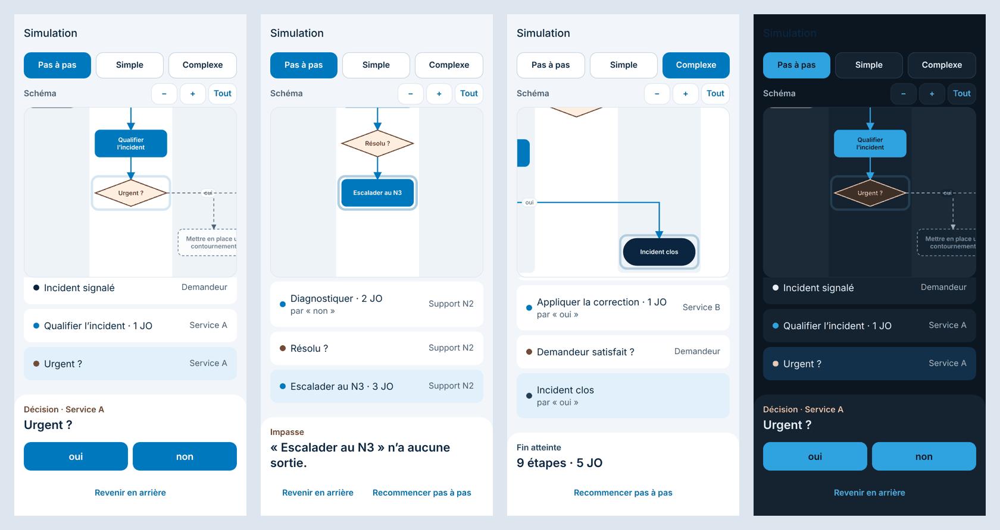
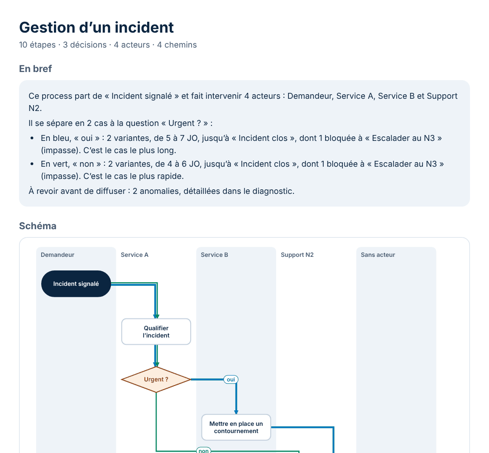
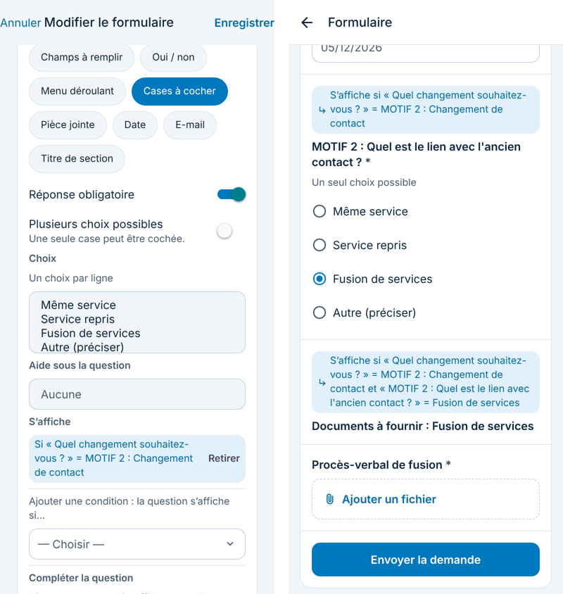
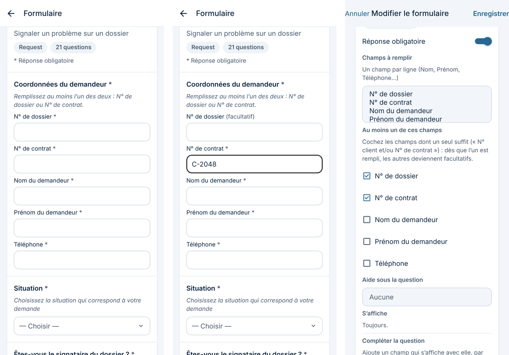

# SimuFlow en bref

SimuFlow vous aide à vérifier un process avant de le mettre en place : vous le voyez s'animer, étape par étape, et l'app vous signale ce qui cloche. Elle marche sur iPhone, sur Android et [dans le navigateur](https://mloick.github.io/SIMUFLOW/app/). Tous les exemples sont fictifs.

Chaque fonctionnalité porte son état : **Disponible** ou **Prévue**. Sous certaines captures, **Plus de captures** déplie les autres écrans.

**Sommaire**

1. [Ajouter un process](#1-ajouter-un-process) : fichier, tableau Excel, photo
2. [Voir et corriger](#2-voir-et-corriger) : liste, diagnostic, éditeur
3. [Simuler et partager](#3-simuler-et-partager) : pas à pas, tous les cas, export, anonymisation
4. [Suivre une vraie demande](#4-suivre-une-vraie-demande) : échéances et rappels
5. [Formulaires de demande](#5-formulaires-de-demande) : voir, remplir et relier un formulaire à son workflow
6. [Compte et données](#6-compte-et-données) : synchronisation, version web, confidentialité
7. [Confort](#7-confort) : mode sombre, grands textes, présentation
8. [Prévu](#8-prévu)

## 1. Ajouter un process

### Depuis un fichier · Disponible

Touchez **+** dans la liste, choisissez **draw.io**, **BPMN**, **Visio** ou **JSON**, puis le fichier. L'app montre ce qu'elle a lu (étapes, acteurs, problèmes, ce qu'elle a dû deviner) ; touchez **Importer**, ou **Importer et corriger** pour ouvrir l'éditeur tout de suite.

Le schéma n'a pas besoin d'un style particulier : l'app suit les flèches. Une étape d'où partent plusieurs flèches nommées est une décision, même dessinée en rectangle. Les acteurs viennent des couloirs, d'une légende de couleurs ou du texte des étapes (« Responsable : Comptabilité ») ; l'app garde le service plutôt que le nom des personnes. Un fichier BPMN (Camunda, bpmn.io, Bizagi, Signavio…) ou Visio (`.vsdx`) garde sa mise en page. Pour en savoir plus : [BPMN 2.0 en bref](bpmn.md).

Vos process importés restent sur le téléphone, et sur votre compte si vous êtes connecté. Pour en retirer un : **Supprimer ce process**, en bas de sa fiche.

Plus de captures

### Depuis un tableau Excel ou CSV · Disponible

Touchez **+**, puis **Tableau Excel ou CSV**. L'app lit le classeur sur le téléphone, sans l'envoyer nulle part, et dit ce que contient chaque onglet : tableau de process, workflow avec SLA et OLA, template de formulaire, liste, ou onglet non reconnu.

- **Un tableau de process** (Étape, Acteur, Délai, Suite) s'importe tel quel.
- **Un tableau aux colonnes inconnues** (« Pilote », « Durée prévue »…) : touchez **Choisir les colonnes** et donnez le rôle de chacune. L'app retient ces titres pour les tableaux suivants.
- **Un workflow avec SLA et OLA** : chaque ligne (une situation) devient un process prêt à simuler, avec une pastille **Lue sans ambiguïté**, **À vérifier** ou **À corriger**, et pour chaque doute la cellule et la question à poser au métier.
- **Un template de formulaire** : voir la [partie 5](#5-formulaires-de-demande).

Pour essayer : `demande-materiel.xlsx`, `tableau-a-completer.xlsx`, `workflow-sla-ola.xlsx` (dans `docs/exemples/`).

Plus de captures

### En photographiant un tableau · Disponible

L'onglet **Scanner** ouvre l'appareil photo. Cadrez un tableau (une ligne par étape, avec l'acteur et le délai) et prenez la photo. L'app recadre la feuille, lit le texte **sur le téléphone, sans Internet**, ne garde que le tableau et ignore le texte autour. Touchez **Créer le process** : chaque ligne devient une étape ; une colonne **Suite** (« oui → 3 ; non → 4 ») crée les décisions. **Créer et corriger** ouvre aussi l'éditeur.

Dans le navigateur, **Prendre ou choisir une photo** ouvre l'appareil photo ou une image (une capture d'écran marche aussi). La lecture se fait dans le navigateur, un peu moins finement. Pour essayer : `docs/exemples/tableaux-a-scanner.html`, six tableaux à afficher ou imprimer.

Plus de captures

## 2. Voir et corriger

### Vos process · Disponible

L'écran **Process** liste vos process, avec le nombre d'étapes, de décisions et d'acteurs, et une pastille : vert sans anomalie, orange pour des avertissements, rouge pour des erreurs. La recherche ignore les accents. Dessous, la section **Exemples** propose quatre process fictifs pour essayer ; coupez **Afficher les exemples** dans **Profil** pour les masquer.

Plus de captures

### Voir les problèmes · Disponible

La fiche d'un process donne ses chiffres clés (étapes, décisions, chemins possibles), ses acteurs et son **diagnostic**, les plus graves en premier : départ ou fin manquant, impasse, chemin qui ne peut jamais finir, étape inatteignable, décision à une seule sortie, branche sans nom. **Voir** descend jusqu'à l'étape concernée et la surligne. Le bouton de partage envoie un résumé.

### Corriger un process · Disponible

Touchez **Modifier le process**, puis une étape : changez son titre, son rôle (départ, tâche, décision, fin), son acteur, son délai et le nom de ses branches. Vous pouvez aussi **ajouter une étape après**, **ajouter un cas** à une décision, **relier à une autre étape** ou **supprimer l'étape**. Le nombre de points à corriger se met à jour en direct. La fiche garde la trace : « Corrigé dans l'app le … ».

Plus de captures

### L'app apprend de vos corrections · Disponible

Une correction qui vaut pour tout le schéma devient une règle, refaite seule aux imports suivants : un **acteur renommé partout** (« Serv. compta » devient « Comptabilité »), une **forme qui a un sens chez vous** (vos hexagones sont des décisions), ou une **colonne de tableau** (« Pilote » est l'acteur). L'aperçu d'import dit ce qui a été appliqué. Les règles sont dans **Profil**, avec **Oublier**.

Plus de captures

## 3. Simuler et partager

### Rejouer le process · Disponible

Sur la fiche, touchez **Lancer la simulation** :

- **Pas à pas** : à chaque décision, l'app demande quelle branche suivre ; on peut revenir en arrière.
- **Simple** : le chemin le plus court. **Complexe** : le plus long.

Le déroulé montre chaque étape, son acteur et le délai cumulé en jours ouvrés. Au-dessus, le **schéma se construit** au fil du parcours et se recadre seul ; pincez pour zoomer, **Tout** montre le schéma entier.

Plus de captures

### Voir tous les cas · Disponible

**Tous** affiche le schéma entier avec une couleur par famille de chemins, comme un plan de métro : les flèches contournent les cases et ne se superposent pas. La légende donne le nombre de chemins et les délais de chaque famille ; le **chemin critique** (le plus long) est en trait épais. Touchez une famille pour l'isoler.

Plus de captures

### Exporter le schéma · Disponible

Dans la simulation, le bouton de partage propose :

- **PDF** : un résumé « En bref » en quelques phrases (par où le process commence, ses cas, le plus rapide et le plus long, les impasses), le schéma en couleur, les familles de chemins et le diagnostic, à envoyer ou imprimer ;
- **draw.io** : à retoucher dans draw.io, un couloir par acteur ;
- **BPMN 2.0** : à ouvrir dans Camunda Modeler, bpmn.io, Bizagi, Signavio… ;
- **JSON** : pour un autre SimuFlow.

SimuFlow sait réimporter ses exports draw.io et BPMN sans perte.

Plus de captures

### Anonymiser · Disponible

Pour montrer un process sans vrais noms, cochez **Anonymiser les noms** à l'import ou à l'export. Chaque acteur devient **Service A**, **Service B**… ; les e-mails, téléphones et liens sont masqués, ainsi que les mots que vous écrivez dans **Autres mots à masquer**. Les étapes et les délais ne changent pas. À l'export, seul le fichier partagé est anonymisé.

## 4. Suivre une vraie demande

### Suivi en vrai · Disponible

Sur la fiche, **Suivre une demande** démarre un suivi. Chaque étape reçoit son échéance en **jours ouvrés** (du lundi au vendredi, de 9 h à 17 h, sans les jours fériés). Touchez **Étape terminée**, ou choisissez la branche à une décision. Une pastille dit si l'étape est **à l'heure**, **proche de l'échéance** ou **en retard**.

### Rappels d'échéance · Disponible

Dans **Profil**, activez **Rappels d'échéance**. Le téléphone vous prévient **le matin du jour de l'échéance**, puis **à l'échéance** si l'étape n'est pas finie ; toucher le rappel ouvre la demande. Tout est programmé sur le téléphone, sans serveur. **Envoyer une notification d'essai** en envoie une 5 secondes plus tard.

## 5. Formulaires de demande

### Voir, remplir et relier un formulaire · Disponible

Un **template de formulaire** (un classeur avec les onglets Basic info, Questions, Fulfillment flow…) est reconnu tout seul. **Voir le formulaire** le montre tel que le demandeur le verra, et il se **remplit pour de vrai** : les questions conditionnelles apparaissent selon les réponses, et l'envoi vérifie les réponses obligatoires et les formats avant d'afficher le récapitulatif. Rien n'est envoyé.

L'app nettoie seule les notes laissées pour l'équipe qui construira le formulaire (nom et prénom en deux cases, une pièce jointe par document, choix unique en boutons ronds, champs « et/ou » dont un seul suffit…). Le reste se corrige dans **Modifier le formulaire** : intitulé, type, choix, conditions, pièces jointes, compléments.

Relié à son **workflow** (classeur SLA / OLA, schéma draw.io ou tableau de process, dans le même fichier, en deux fichiers ou plus tard), la réponse choisit la situation : on la simule ou on la suit en vrai, avec les réponses jointes. **Garder ce formulaire** le range dans **Profil**, **Mes formulaires**, et sur votre compte. **Anonymiser le formulaire** remplace les groupes par **Service A**, **B**…

Pour essayer : `template-formulaire.xlsx`, seul ou avec `workflow-sla-ola.xlsx`, ou `formulaire-et-workflow.xlsx`.

Plus de captures : voir et remplir

Plus de captures : nettoyer et modifier

Plus de captures : workflow lié et formulaires gardés

## 6. Compte et données

### Compte et synchronisation · Disponible

Dans **Profil**, **Se connecter ou créer un compte**. Le mot de passe demande au moins 8 caractères, avec minuscule, majuscule, chiffre et symbole ; l'app dit ce qui manque. **Mot de passe oublié ?** envoie un lien valable une heure, qui rouvre l'app sur **Nouveau mot de passe**. La connexion est gardée dans le coffre chiffré du téléphone.

Connecté, vos process, règles de lecture et formulaires gardés vous suivent sur tous vos appareils. Sans réseau, rien n'est perdu : la liste affiche « Hors connexion » et l'app envoie les changements dès le retour du réseau. **Supprimer mon compte** efface le compte et ses données, sur le serveur et sur le téléphone. Le serveur est hébergé à Paris ; **À propos** dit s'il est joignable.

Plus de captures

### Dans le navigateur · Disponible

SimuFlow s'ouvre sans rien installer : https://mloick.github.io/SIMUFLOW/app/. Tout y est, sauf les rappels. On peut l'**ajouter à l'écran d'accueil** comme une vraie app : la présentation montre les gestes pour iPhone, Android ou ordinateur.

Plus de captures

### Vos données et le site · Disponible

Le site https://mloick.github.io/SIMUFLOW/ présente l'app et sa **politique de confidentialité**. En bref : sans compte, tout reste sur le téléphone ; avec un compte, votre adresse et vos données sont gardées en Union européenne, visibles par vous seul ; les photos du Scanner ne quittent jamais le téléphone.

Plus de captures

### Mises à jour sans réinstaller · Disponible

Les corrections qui ne touchent pas aux fonctions du téléphone arrivent toutes seules, au lancement suivant. La ligne de version, en bas du **Profil**, indique la dernière mise à jour reçue.

## 7. Confort

- **Mode sombre** · Disponible : l'app suit le réglage du téléphone.
- **Grands textes** · Disponible : si vous agrandissez le texte du téléphone, l'app suit et réorganise ce qui ne tient plus côte à côte.
- **Animations douces** · Disponible : la liste « respire » pendant le chargement ; rien ne bouge si « Réduire les animations » est activé.
- **Présentation au premier lancement** · Disponible : quatre pages, à revoir depuis **Profil**.
- **Icône et écran de démarrage** · Disponible : le logo en S, en clair ou en sombre.
- **Profil** · Disponible : compte, notifications, exemples, règles apprises, puis **À propos** (serveur, présentation, confidentialité, version).

Plus de captures

## 8. Prévu

- **Partager et valider** · Prévue : partager un process avec des collègues, et être prévenu quand quelqu'un valide ou commente une étape.
- **Voir sur le schéma** · Prévue : le bouton « Voir » d'une anomalie montrera aussi l'endroit exact sur le schéma.
- **Interface en anglais** · Prévue.
- **VoiceOver et TalkBack** · Prévue : une lecture complète par les lecteurs d'écran.
