# SimuFlow en bref

SimuFlow vous aide à vérifier un process avant de le mettre en place : vous le voyez s'animer, étape par étape, et l'app vous signale ce qui cloche.

Chaque fonctionnalité porte son état : **Disponible** ou **Prévue**.

## Voir vos process · Disponible (exemples)

L'écran Process liste vos process. Chaque carte indique le nombre d'étapes, de décisions et d'acteurs, et une pastille de couleur : vert s'il n'y a aucune anomalie, orange pour des avertissements, rouge pour des erreurs. Tapez quelques lettres dans la recherche pour retrouver un process, accents ou non.

La liste montre quatre process d'exemple, et ceux que vous importez apparaissent en premier.

## Ajouter un process depuis un fichier · Disponible

Touchez le bouton **+** de la liste, puis **Fichier draw.io** ou **Fichier JSON**, et choisissez le fichier dans Fichiers, iCloud Drive ou Drive. L'app vous montre ce qu'elle a lu : le nombre d'étapes et d'acteurs, les problèmes éventuels, et ce qu'elle a dû deviner (par exemple une flèche qui n'était accrochée à rien). Si le schéma a plusieurs pages, choisissez celle à importer. Vérifiez le nom, puis touchez **Importer** : le process s'ouvre et rejoint la liste.

Votre schéma n'a pas besoin d'être dessiné d'une façon particulière : l'app s'appuie d'abord sur les flèches. Une étape d'où partent plusieurs flèches nommées (« oui », « non »…) est une décision, même si c'est un rectangle ; l'étape où tout commence est le départ, celles où tout s'arrête sont les fins.

L'app trouve les acteurs de plusieurs façons : avec des couloirs (une bande par acteur), avec une légende de couleurs (une pastille de couleur suivie du nom de l'acteur), ou dans le texte des étapes (« Responsable : Comptabilité », « Assignee : … »). Elle garde le service plutôt que le nom des personnes.

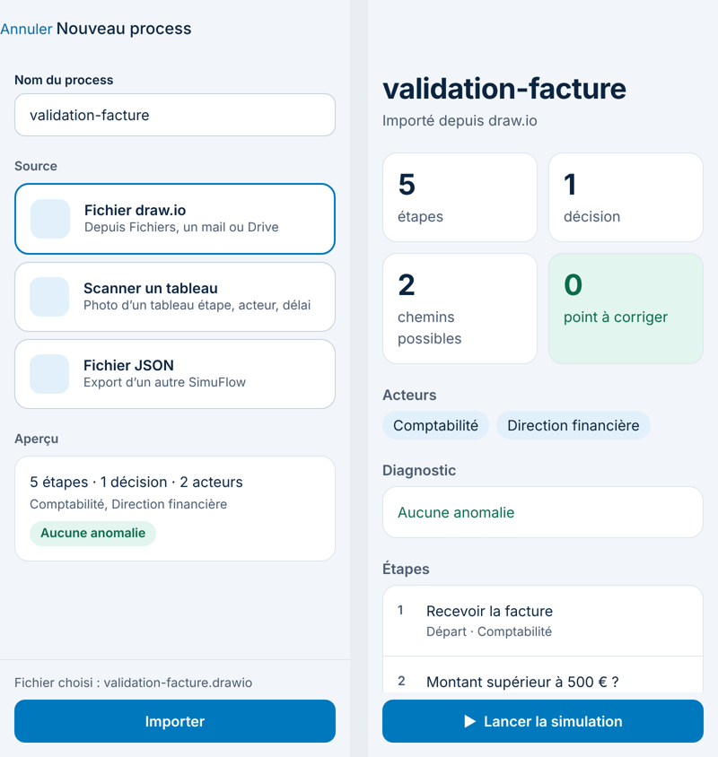

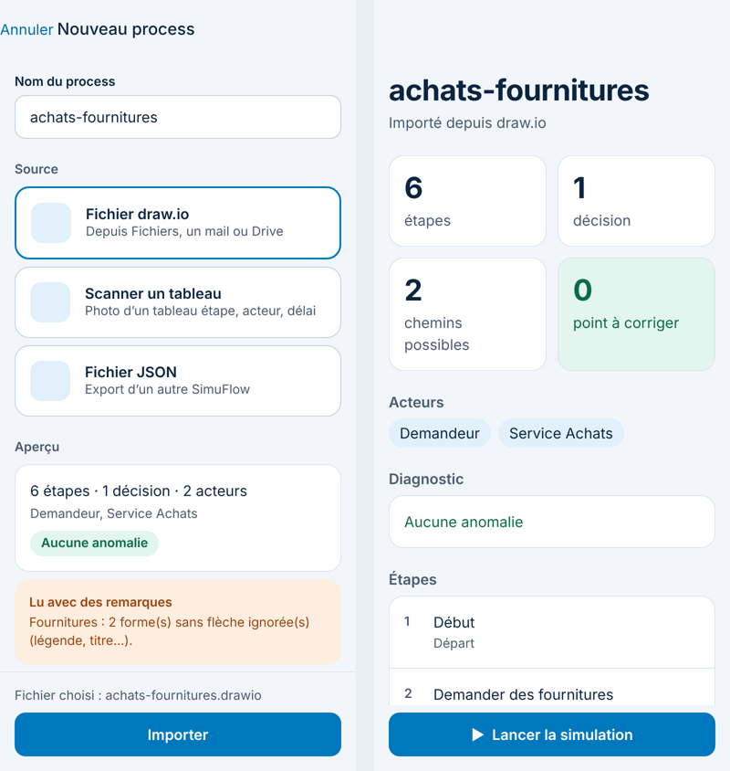

Vos process importés sont enregistrés sur le téléphone : vous les retrouvez à chaque ouverture de l'app. Si vous êtes connecté, ils sont aussi gardés sur votre compte (voir « Compte et serveur »). Pour en retirer un, ouvrez-le et touchez **Supprimer ce process**, tout en bas.

## Scanner un tableau · Disponible

**Scannez un tableau** avec l'appareil photo : une ligne par étape, avec l'acteur et le délai. L'app reconnaît les colonnes et crée le process.

Disponible : l'onglet **Scanner** ouvre l'appareil photo. La première fois, l'app demande l'autorisation et explique pourquoi. Cadrez le tableau entre les quatre coins, allumez la lampe si besoin, et touchez le gros bouton rond. Touchez **Reprendre la photo** pour recommencer. Pour essayer, le fichier `docs/exemples/tableaux-a-scanner.html` contient six tableaux fictifs à afficher sur un écran ou à imprimer. Juste après la photo, l'app recadre la photo sur la feuille ou l'écran photographié (sur iPhone, comme son appareil photo), puis lit le texte, sur le téléphone, sans Internet. Elle ne garde que le tableau : elle le repère à sa ligne de titres (Étape, Acteur, Délai, ou Tâche, Responsable, Durée…) et ignore le texte autour (titre de la page, onglets du navigateur, notes). Le tableau trouvé s'affiche en colonnes sous la photo (« Tableau trouvé : 4 étapes »). Sans ligne de titres, l'app le dit et montre tout le texte lu. La lecture marche sur iPhone et sur Android.

Touchez **Créer le process** : chaque ligne devient une étape, avec son acteur et son délai (« 2 JO », « 3 jours », « 4 h », « 1 sem. »). Les étapes se suivent dans l'ordre du tableau. Une colonne **Suite** peut donner l'étape suivante par son numéro, plusieurs cas (« oui → 3 ; non → 4 ») ou « fin ». Une étape avec plusieurs cas devient une décision. Le process prend le nom écrit au-dessus du tableau et s'ajoute à la liste. Touchez **Créer et corriger** pour ouvrir aussi l'éditeur, par exemple pour compléter un acteur manquant.

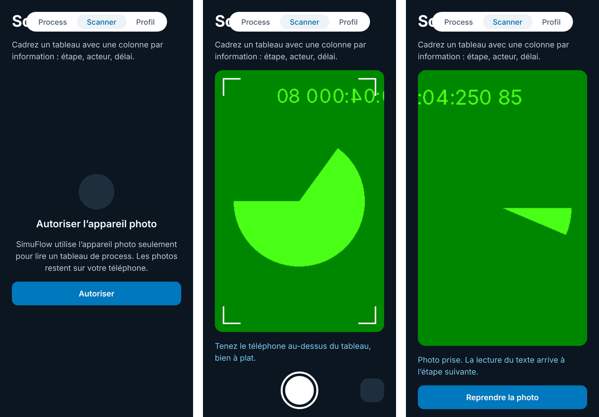

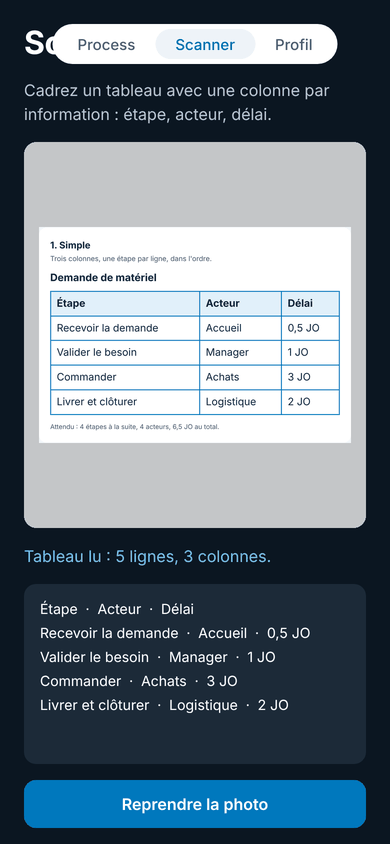

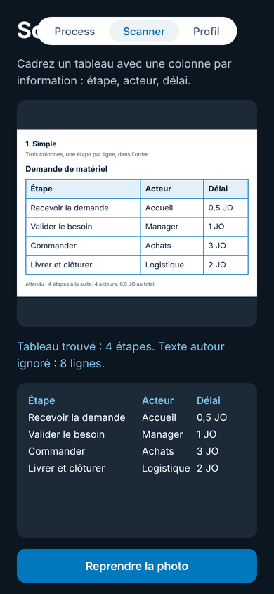

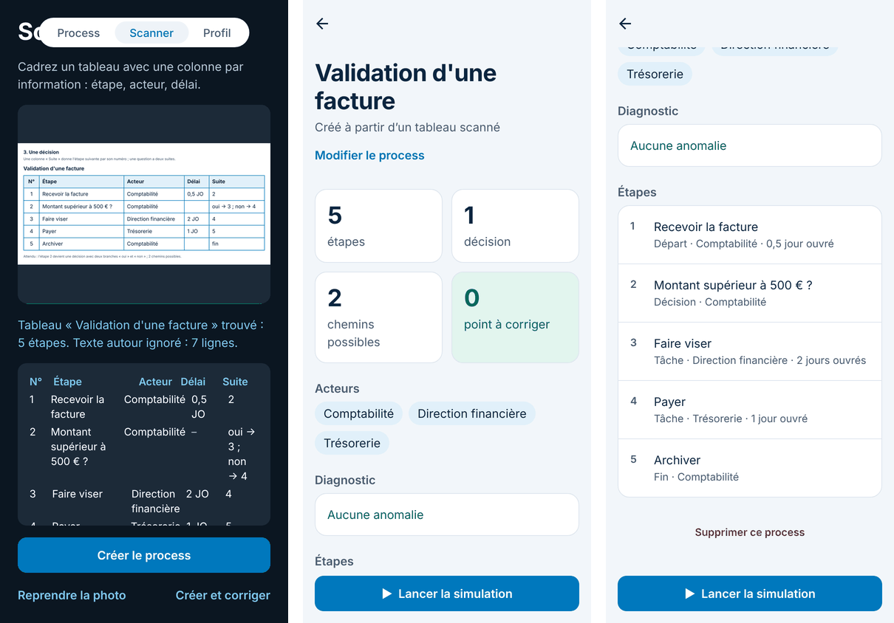

## Corriger un process · Disponible

Un process importé se corrige directement dans l'app, par exemple pendant sa validation. Ouvrez-le, touchez **Modifier le process**, puis touchez une étape : changez son titre, son rôle (départ, tâche, décision, fin), son acteur (tapez-le ou choisissez un acteur déjà présent) et son délai. Pour une étape qui mène à plusieurs suites, nommez chaque branche (« oui », « refus »…). Si une étape à plusieurs sorties est en fait un choix, touchez **C'est un choix** : elle devient une décision et ses branches sont nommées d'après l'étape suivante. En haut, le nombre de points à corriger change à mesure. Touchez **Enregistrer** : si vous êtes connecté, la version corrigée part aussi sur votre compte.

Vous pouvez aussi changer la forme du process :

- **Ajouter une étape après** une autre : elle se glisse entre l'étape et sa suite.
- **Ajouter un cas** à une décision : donnez-lui un nom et choisissez où il mène, une nouvelle étape ou une étape existante.
- **Relier à une autre étape** une tâche, par exemple pour revenir en arrière.
- **Retirer** une branche, ou **Supprimer l'étape** (l'app demande confirmation ; une étape de passage laisse ses voisines reliées).

Pour corriger dès l'import, touchez **Importer et corriger** au lieu d'**Importer** : l'éditeur s'ouvre tout de suite.

Le process corrigé garde la trace de la correction : sa fiche affiche « Corrigé dans l'app le … ». Sur le schéma, les étapes d'origine restent à leur place et les nouvelles se rangent sous l'étape qui y mène. Pour faire valider la nouvelle version, exportez-la (**Lancer la simulation**, puis le bouton d'export) en **draw.io** ou en **PDF** : la date de correction y figure aussi.

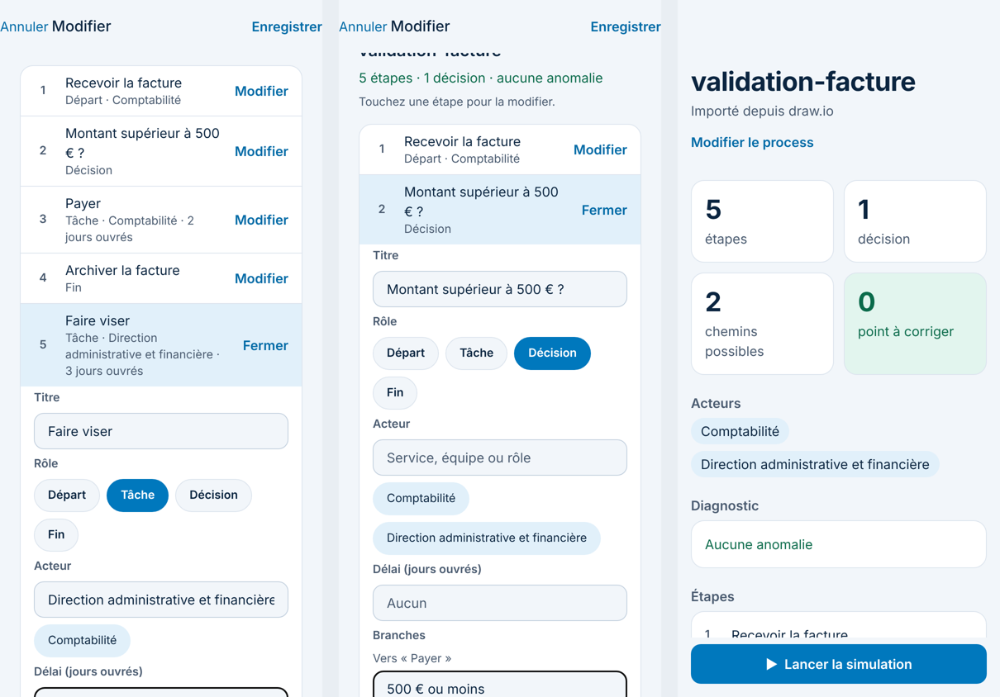

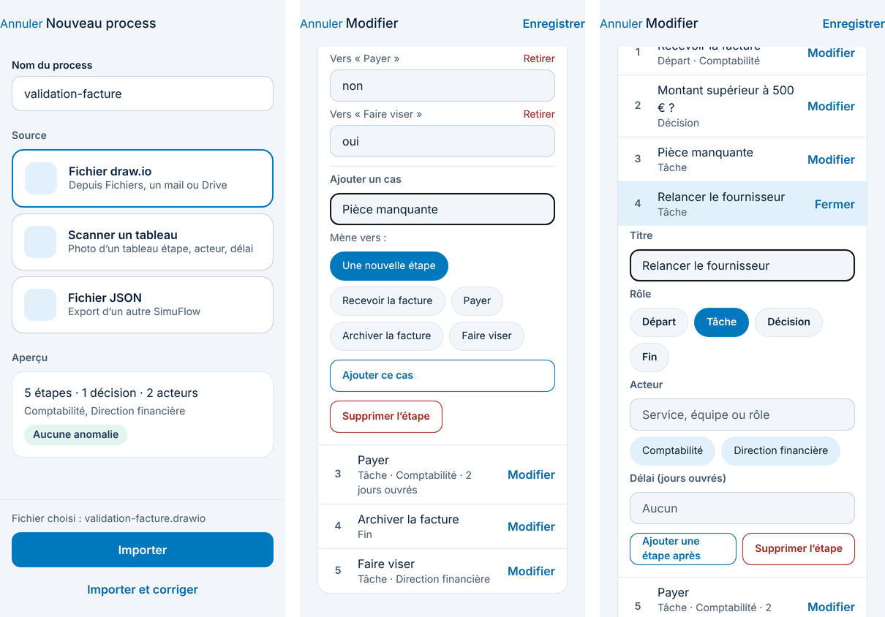

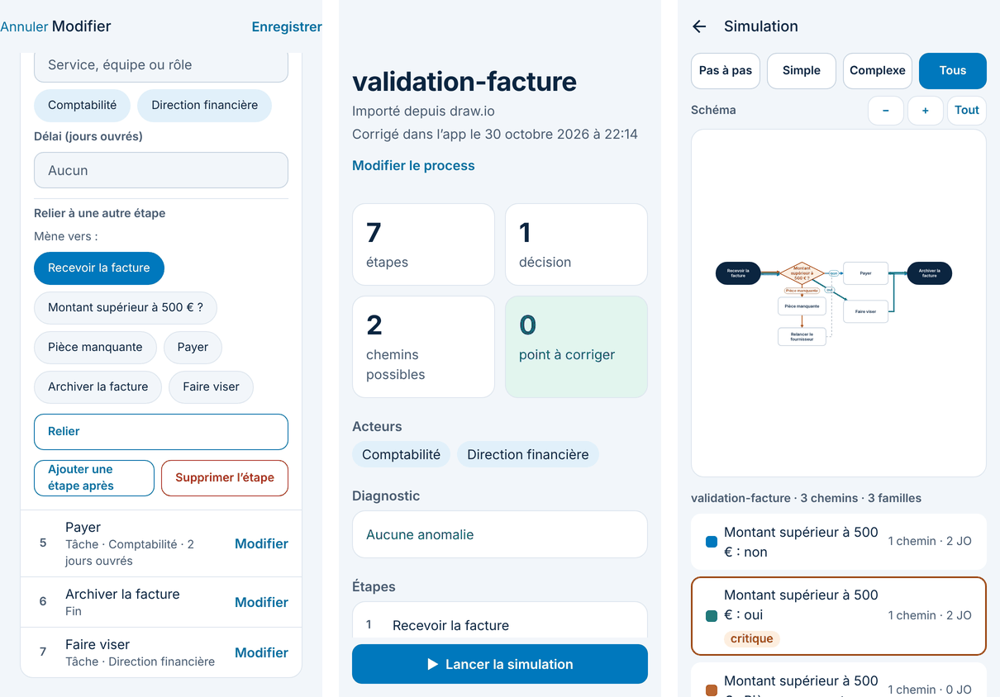

## L'app apprend de vos corrections · Disponible

Quand vous corrigez un process importé, SimuFlow retient ce qui vaut pour tout le schéma et le refait seul aux imports suivants :

- un **acteur renommé partout** (par exemple « Serv. compta » devient « Comptabilité » sur toutes ses étapes) ;
- une **forme qui a un sens chez vous** (par exemple, tous vos hexagones sont des décisions).

Une correction faite sur une seule étape reste ponctuelle : elle n'apprend rien. À l'import, l'aperçu indique **Corrigé d'après vos corrections précédentes** et dit ce qui a été appliqué. Retrouvez ces règles dans l'onglet **Profil**, et touchez **Oublier** pour en retirer une. Elles sont gardées sur le téléphone et, si vous êtes connecté, sur votre compte : vous les retrouvez sur vos autres appareils.

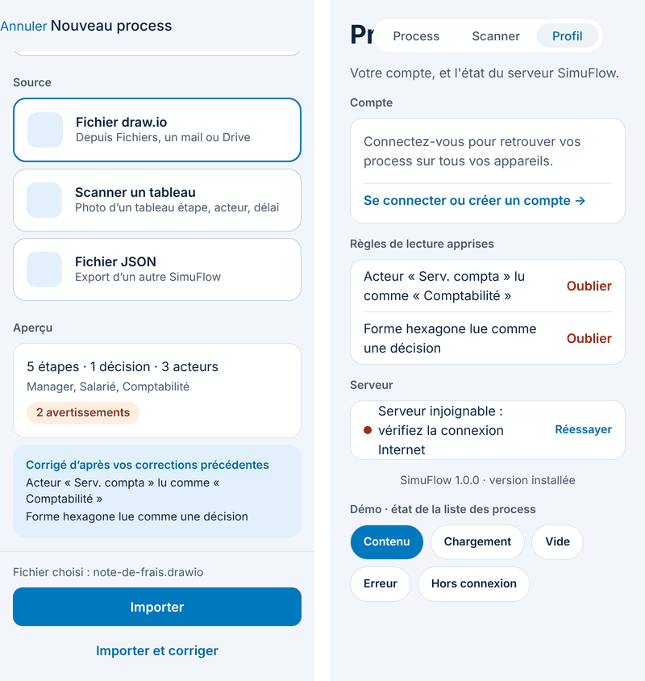

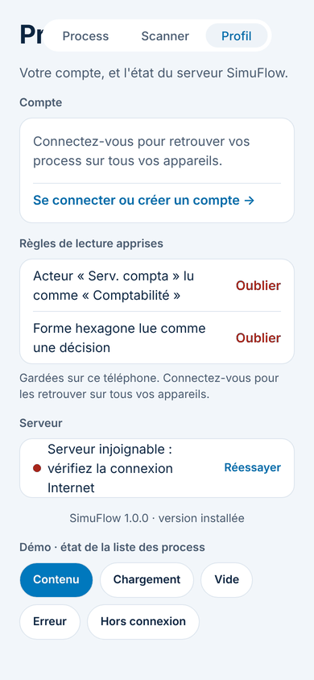

## Voir les problèmes · Disponible

L'app liste les anomalies du process, les plus graves en premier :

- une étape sans issue (impasse) ;
- une décision avec une seule sortie ;
- une branche sans libellé ;
- une étape que l'on ne peut jamais atteindre.

Touchez un process pour ouvrir sa fiche : nombre d'étapes, de décisions et de chemins possibles, les acteurs, le diagnostic et la liste des étapes. Le bouton « Voir » d'une anomalie descend jusqu'à l'étape concernée et la surligne. Les simples informations sont repliées ; touchez-les pour les afficher. Le bouton de partage envoie un résumé du process.

Plus tard, « Voir » montrera aussi l'endroit exact sur le schéma.

## Rejouer le process · Disponible

Ouvrez un process et touchez **Lancer la simulation**.

- **Pas à pas** : touchez « Étape suivante » pour avancer. À chaque décision, l'app vous demande quelle branche suivre. Vous pouvez revenir en arrière.
- **Simple** : le chemin le plus court jusqu'à la fin.
- **Complexe** : le chemin le plus long.

Le déroulé affiche chaque étape, son acteur et le délai cumulé en jours ouvrés. Si vous tombez sur une étape sans issue, l'app vous le dit.

Le **schéma** du process se construit en haut de l'écran au fil du parcours : chaque étape apparaît quand vous l'atteignez, et à une décision, les sorties possibles s'affichent en pointillés. À chaque étape, le schéma se recadre tout seul, en glissant, pour montrer l'étape en cours et toutes ses sorties possibles ; les nouvelles cases apparaissent en fondu. À la fin, il montre tout le chemin parcouru. Pincez avec deux doigts pour zoomer, glissez d'un doigt pour vous déplacer ; « − » et « + » zooment aussi, « Tout » montre le schéma entier. Un schéma draw.io garde sa mise en page ; pour un fichier JSON, l'app range les étapes en colonnes, une par acteur.

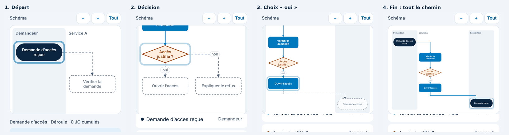

## Voir tous les cas · Disponible

Dans la simulation, touchez **Tous** : le schéma entier s'affiche, avec une couleur par famille de chemins (une famille regroupe les chemins qui donnent la même réponse à la première décision). Quand plusieurs familles passent par la même flèche, leurs traits sont côte à côte, comme sur un plan de métro.

Les flèches contournent les cases : une flèche ne passe jamais à travers une étape qui n'est pas la sienne, et deux flèches différentes ne se superposent pas. Chacune garde sa voie jusqu'à son arrivée.

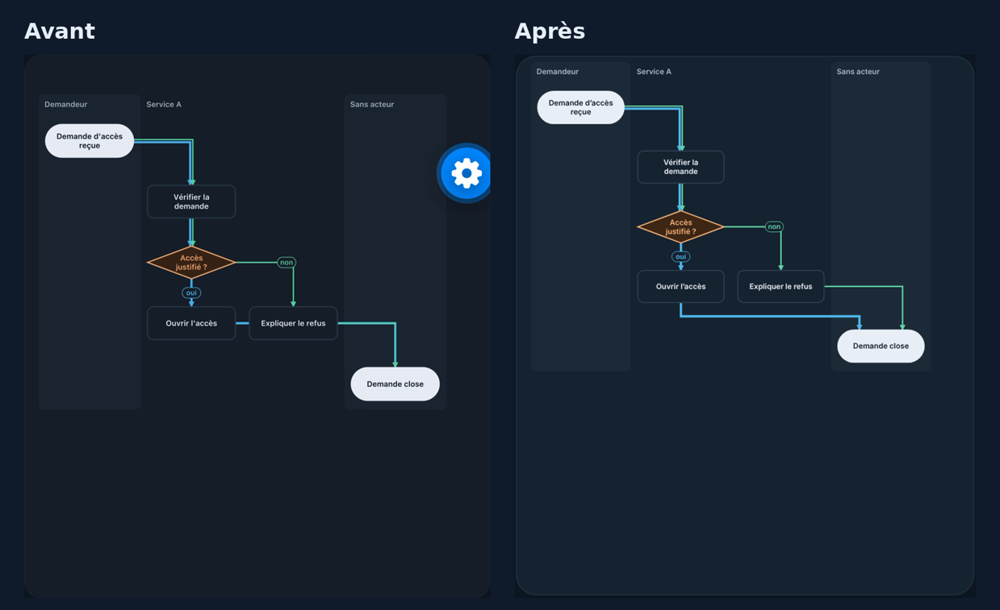

En dessous, une légende donne pour chaque famille le nombre de chemins et leurs délais. La famille du chemin le plus long est marquée **critique**, et ce chemin est en trait épais. Touchez une famille pour l'isoler sur le schéma, touchez-la encore pour revoir tout. Une dernière ligne dit quel acteur porte le plus d'étapes.

## Exporter le schéma · Disponible

Dans la simulation, touchez le bouton de partage en haut à droite. Choisissez le format :

- **PDF** : le schéma en couleur, les familles de chemins avec leurs délais, et le diagnostic. À envoyer ou à imprimer.
- **draw.io** : un fichier à rouvrir et à retoucher dans draw.io, rangé en couloirs par acteur. Pratique après un scan de tableau. SimuFlow sait aussi le réimporter.
- **JSON** : pour l'importer dans un autre SimuFlow.

« Colorer les familles de chemins » met une couleur par famille sur le schéma, comme dans la vue Tous. Touchez **Partager** pour l'envoyer par mail, le ranger dans Fichiers ou l'envoyer par AirDrop.

## Compte et serveur · Disponible

SimuFlow a son serveur, hébergé à Paris. Dans **Profil**, la section **Serveur** indique si l'app arrive à le joindre ; sinon, vérifiez la connexion Internet et touchez **Réessayer**.

**Créer un compte** : dans **Profil**, touchez **Se connecter ou créer un compte**, puis **Créer un compte**. Saisissez votre adresse e-mail et un mot de passe d'au moins 6 caractères. Si l'app vous le demande, ouvrez le lien reçu par e-mail, puis connectez-vous.

**Mot de passe oublié** : sur l'écran de connexion, touchez **Mot de passe oublié ?**, saisissez votre adresse et touchez **Recevoir un lien**. Ouvrez l'e-mail reçu **sur le téléphone** et touchez son lien : SimuFlow s'ouvre sur **Nouveau mot de passe**. Choisissez-en un et touchez **Enregistrer le mot de passe** : vous êtes connecté. Le lien est valable une heure et ne sert qu'une fois.

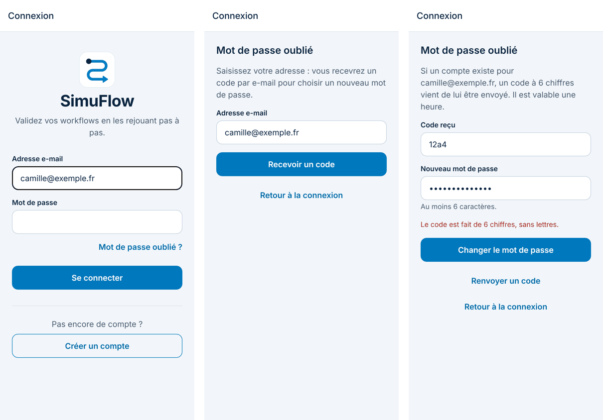

**Se connecter et se déconnecter** : vous restez connecté d'un lancement à l'autre. Le Profil affiche votre adresse et le bouton **Se déconnecter**. Si un champ est mal rempli, l'app le dit en clair.

**Supprimer son compte** : dans **Profil**, touchez **Supprimer mon compte**. L'app vous redemande de confirmer et dit ce qui sera effacé : votre compte et vos process, sur le serveur et sur ce téléphone.

**Retrouver ses process sur tous ses appareils** : connecté, chaque process importé est aussi enregistré sur votre compte. Connectez-vous sur un autre téléphone : il y apparaît. Supprimez-le d'un côté : il disparaît de l'autre. Sans réseau, rien n'est perdu : la liste affiche « Hors connexion » et vos process restent consultables ; l'app envoie les changements toute seule dès que le réseau revient. Le Profil indique l'heure de la dernière synchronisation, et **Synchroniser** la relance.

Quand vous vous déconnectez, les process de votre compte quittent ce téléphone ; ils vous attendent sur le serveur.

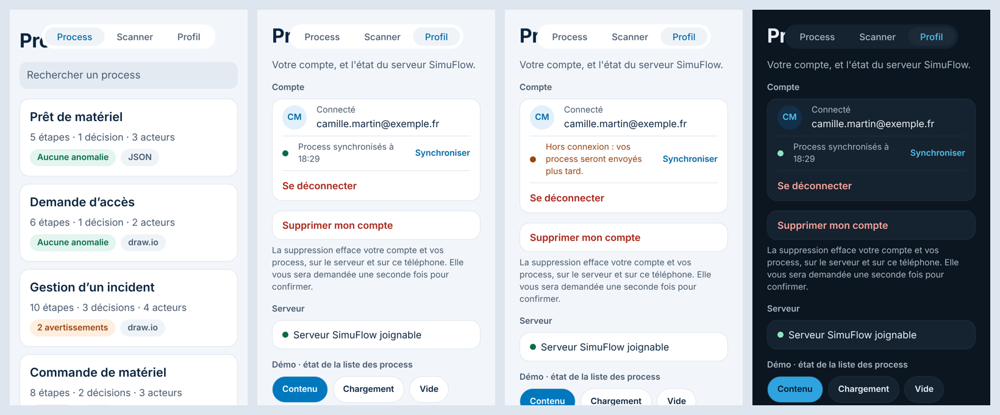

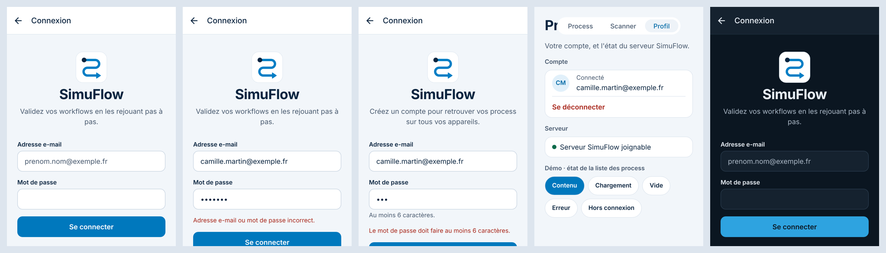

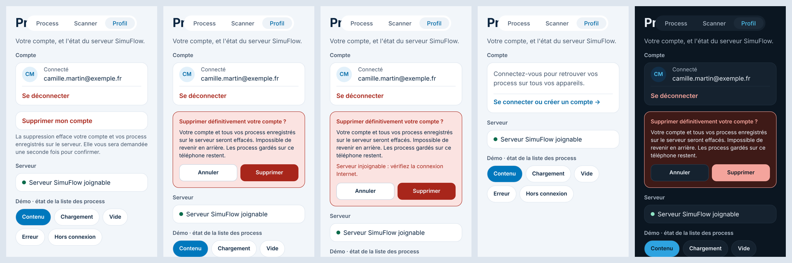

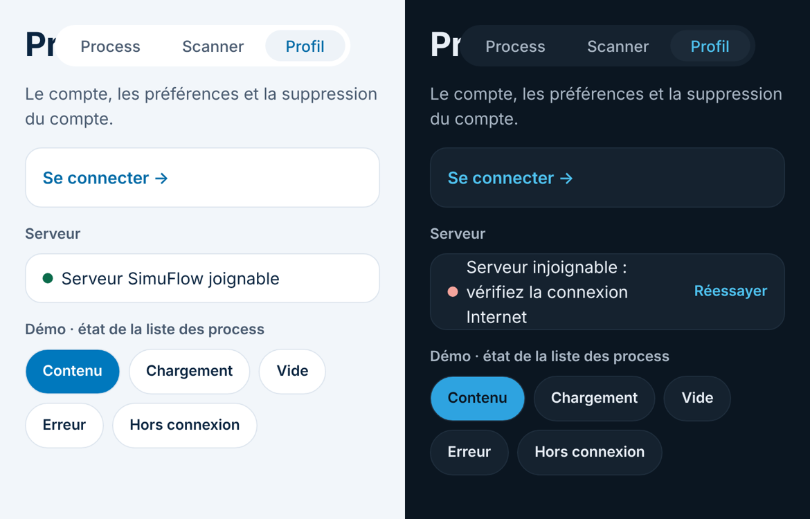

## Mises à jour sans réinstaller · Disponible

Les corrections et nouveautés qui ne touchent pas aux fonctions du téléphone (appareil photo, notifications…) arrivent toutes seules : l'app télécharge la nouvelle version en arrière-plan, et l'utilise au lancement suivant. En bas du **Profil**, la ligne de version indique « version installée », ou la date de la dernière mise à jour reçue.

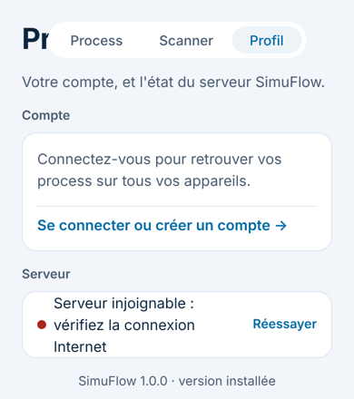

## Suivre une vraie demande · Disponible

Une vraie demande commence ? Sur la fiche du process, section **Suivi en vrai**, touchez **Suivre une demande**. SimuFlow calcule l'échéance de chaque étape en **jours ouvrés** : du lundi au vendredi, de 9 h à 17 h, sans les jours fériés (Pâques, l'Ascension et la Pentecôte compris). Quand une étape est faite, touchez **Étape terminée** ; à une décision, choisissez la suite (« oui → Faire viser »). Une pastille dit si l'étape est **à l'heure**, si l'**échéance est proche**, ou de combien elle est **en retard**. Les étapes passées restent visibles, avec leur date. Les demandes suivies sont gardées sur le téléphone.

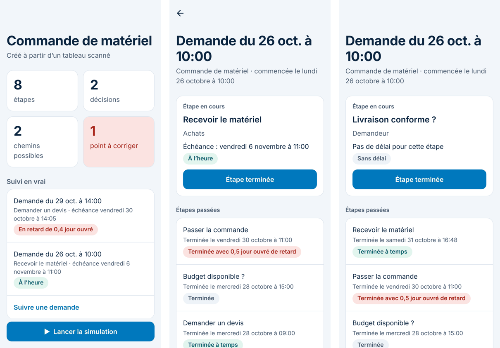

## Notifications · Disponible

Dans le **Profil**, la section **Notifications** a un interrupteur **Rappels d'échéance**. La première fois, le téléphone demande l'autorisation. Touchez **Envoyer une notification d'essai** : elle arrive 5 secondes plus tard, même téléphone verrouillé. Les notifications sont programmées par le téléphone lui-même, sans serveur. Pour chaque demande suivie, SimuFlow vous prévient **le matin du jour de l'échéance** (« Aujourd'hui : Commander, échéance à 14:00 ») et **à l'échéance** si l'étape n'est pas terminée (« En retard : Commander »). Quand vous touchez **Étape terminée**, les rappels passent à l'étape suivante. Touchez un rappel pour ouvrir la demande. Coupez **Rappels d'échéance** dans le Profil pour ne plus rien recevoir.

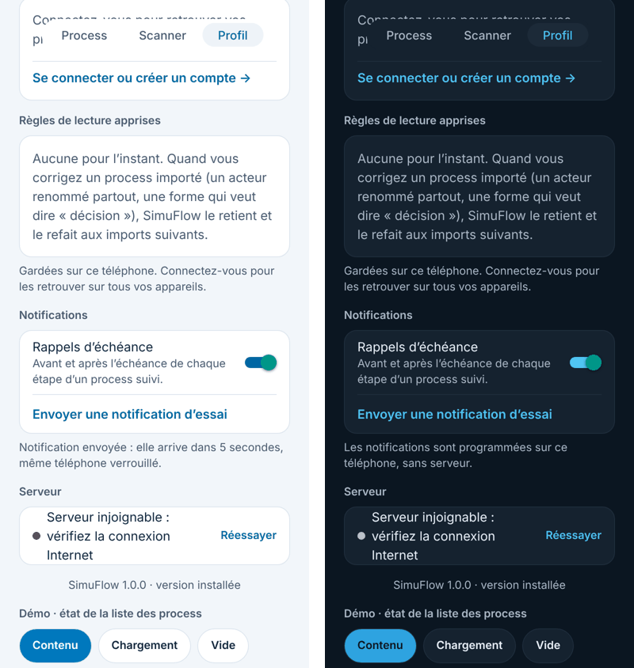

## Partager et valider · Prévue

Partagez un process avec vos collègues. Vous recevez une notification quand quelqu'un valide ou commente une étape.

## Mode sombre · Disponible

L'app suit le réglage de votre téléphone : claire le jour, sombre si vous avez choisi le mode sombre.

## Icône et écran de démarrage · Disponible

Sur l'écran d'accueil du téléphone, SimuFlow a l'icône du logo, le chemin en S. À l'ouverture, le logo s'affiche sur un fond clair ou sombre selon votre téléphone, puis l'app apparaît en fondu (sans fondu si vous avez activé « Réduire les animations »).

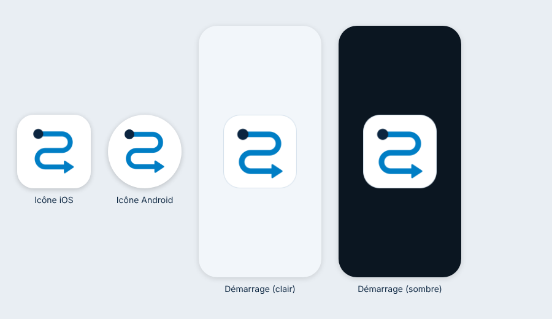

## Animations douces · Disponible

Pendant le chargement, la liste « respire » doucement, puis les process apparaissent l'un après l'autre. Si vous avez activé « Réduire les animations » sur votre téléphone, rien ne bouge.

## Confort · Prévue

- Interface en français et en anglais.
- Lisible avec VoiceOver et TalkBack, et avec une grande taille de texte.
