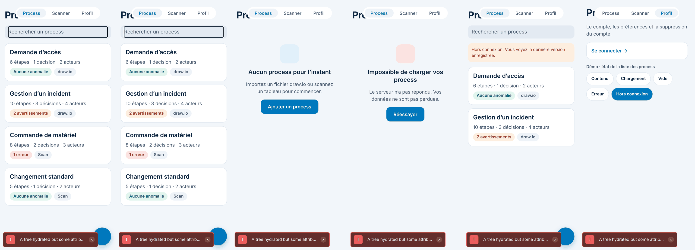
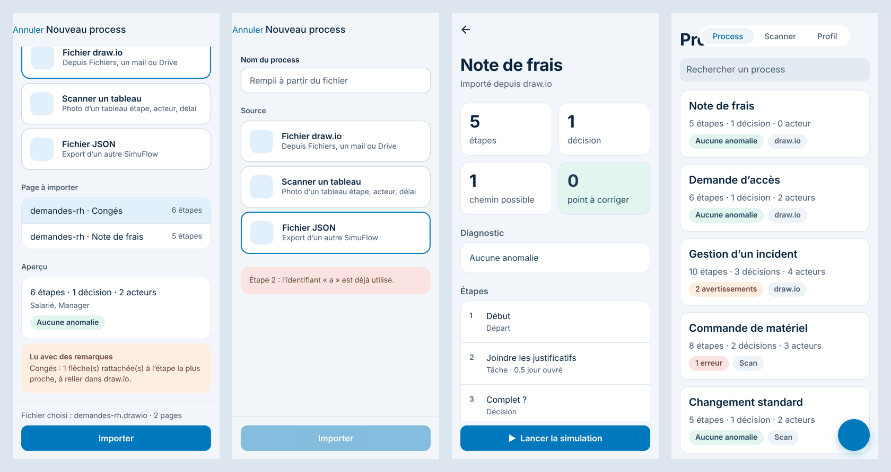
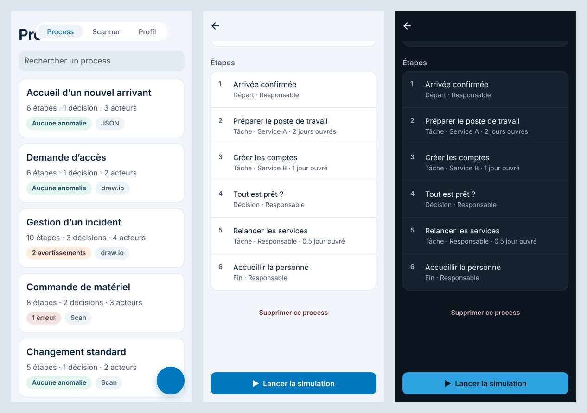
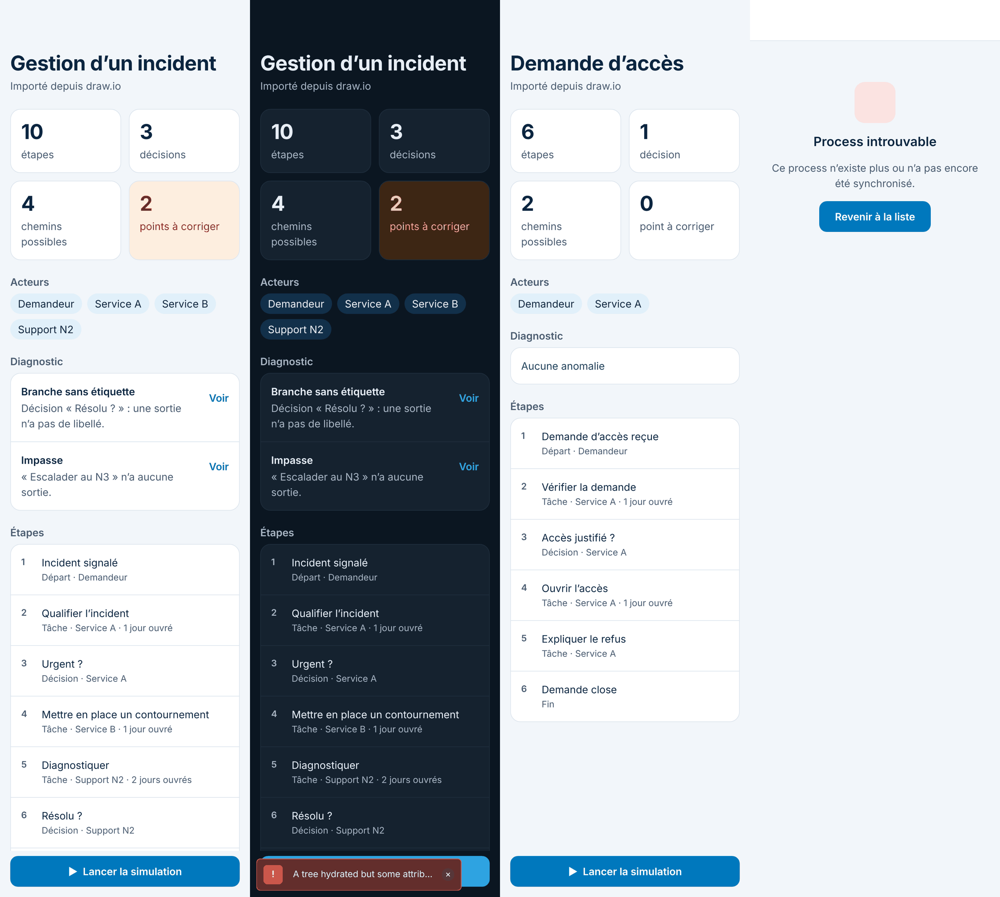
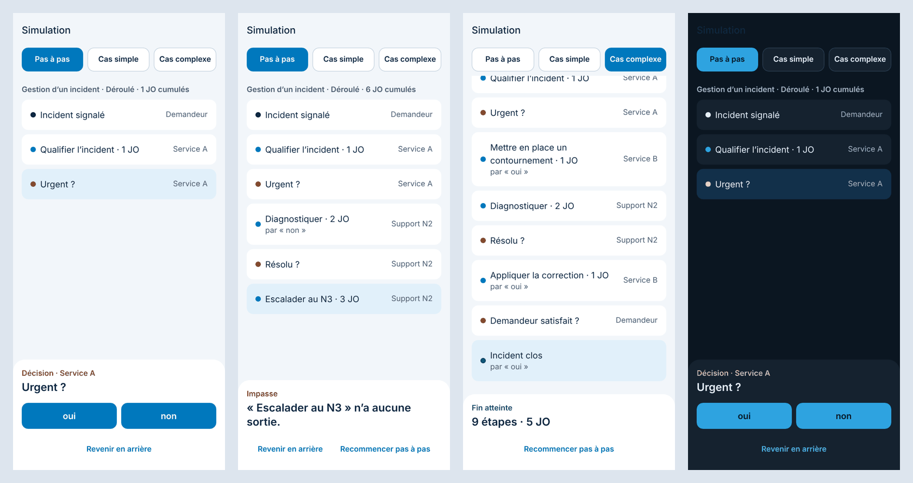
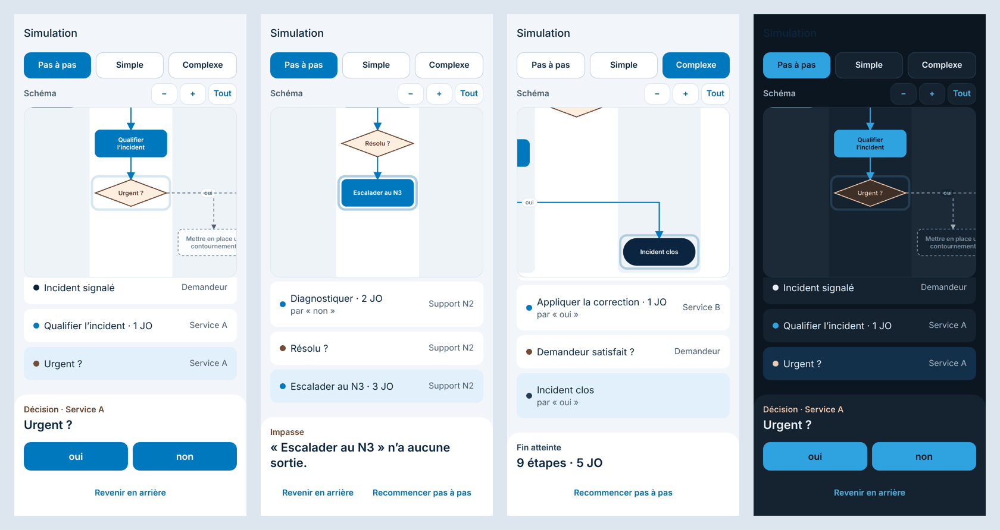
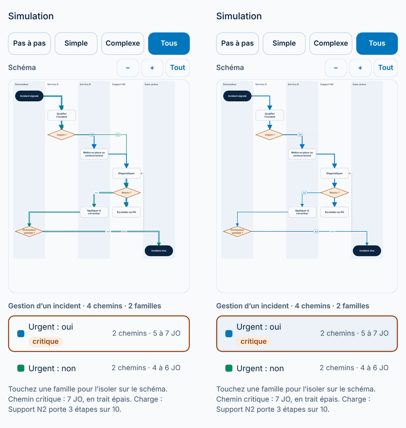
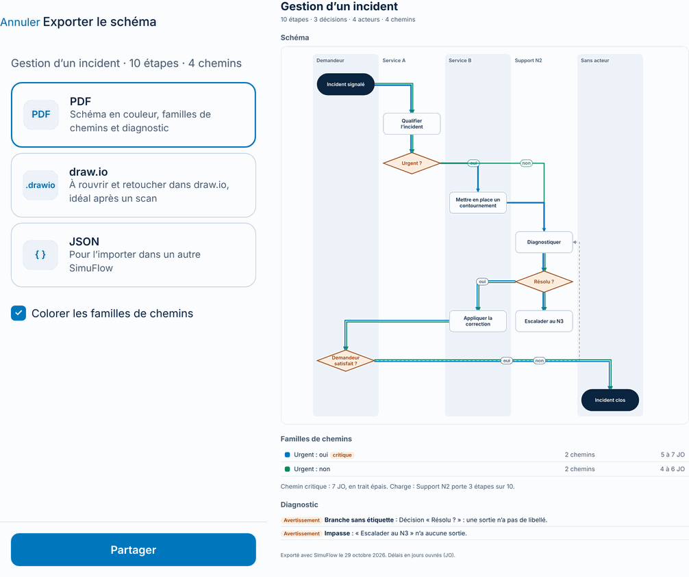

# Documentation technique

Ce document décrit le code tel qu'il est aujourd'hui, puis l'architecture visée. Il est mis à jour à chaque modification du code (voir « Mise à jour de la documentation » en bas).

## État actuel

Le squelette de navigation est en place : tous les écrans de la maquette existent et sont reliés entre eux. Le cœur du simulateur (`src/domain/`) est codé et testé : types d'un process, diagnostic des anomalies et calcul des chemins. Les écrans Liste des process, Détail d'un process, Importer et Simulation suivent la maquette : la liste affiche des process fictifs et ceux importés depuis un fichier draw.io ou JSON, enregistrés sur le téléphone ; les autres écrans n'affichent encore qu'un titre, une description et des liens.

| Élément | Version |
| --- | --- |
| Expo SDK | 58 |
| React Native | 0.88 |
| React | 19.3 |
| Expo Router | 58 (routes dans `src/app/`) |
| TypeScript | 6.0, mode `strict` |
| Jest | 30, préréglage `jest-expo` |
| react-native-svg | 15 (dessin du schéma) |
| expo-print, expo-sharing | 58 (export en PDF, feuille de partage) |

## Structure du dépôt

```text
src/
  app/          Écrans et navigation (Expo Router : un fichier = une route)
  components/   Composants réutilisables (texte et vue thémés, carte de process, schéma du process, pastille, bouton, squelette de chargement, message d'état, écran provisoire)
  constants/    Thème : couleurs, espacements, polices
  data/         Accès aux process : process fictifs et chargement simulé en attendant le backend, process importés enregistrés sur le téléphone (saved-file.ts)
  domain/       Cœur du simulateur en TypeScript pur : types, diagnostic, chemins, exemple fictif ; tests dans __tests__/
  import/       Lecture des fichiers draw.io et JSON en process ; schémas d'exemple dans __fixtures__/
  export/       Export d'un process en PDF (page HTML avec le schéma en SVG), draw.io et JSON ; tests dans __tests__/
  simulation/   Moteur de simulation pas à pas, mise en page du schéma et familles de chemins, en TypeScript pur ; tests dans __tests__/
  hooks/        Hooks partagés (thème, mode sombre)
  utils/        Petites fonctions : texte (pluriel, nombres à la française, recherche sans accents), lecture d'un fichier choisi (read-file.ts, et read-file.web.ts pour le web), partage d'un fichier exporté (share-file.ts, et share-file.web.ts)
assets/         Icônes, images, écran de démarrage
docs/           Documentation, maquette des écrans (maquette/), logo (logo/), captures de chaque étape (captures/) et fichiers d'exemple à importer (exemples/)
scripts/        Lancement iOS avec nettoyage (ios.sh, nettoyer-ios.sh), script du modèle Expo (reset-project)
app.json        Configuration Expo (nom, icônes, identifiant com.anonymous.simuflow sur iOS et Android, plugins)
```

## Commandes

| Commande | Rôle |
| --- | --- |
| `npm install` | Installer les dépendances |
| `npx expo run:ios` | Compiler l'app avec Xcode (build de développement) et l'ouvrir dans le Simulateur iOS |
| `npx expo run:ios --device` | Installer le build de développement sur un iPhone branché en USB |
| `npm run ios:simulateur` | Vérifie les versions des paquets, lance `npx expo run:ios`, puis efface les fichiers temporaires de compilation à l'arrêt (Ctrl+C) |
| `npm run ios:iphone` | Comme `npx expo run:ios --device`, avec le même nettoyage à l'arrêt |
| `npm run nettoyer` | Effacer seulement les fichiers temporaires de compilation iOS |
| `npx expo start` | Relancer le serveur de développement quand le build est déjà installé |
| `npm test` | Lancer les tests unitaires (Jest) |
| `npx tsc --noEmit` | Vérifier les types |
| `npx expo lint` | Analyser le code (ESLint) |
| `npx expo install <paquet>` | Ajouter une dépendance compatible avec le SDK |

Avant le premier `npx tsc --noEmit`, lancer une fois `npx expo start` : il génère `expo-env.d.ts` et les types des routes (`.expo/types/`), qui ne sont pas versionnés.

## Thème

Les couleurs viennent de la maquette et sont rangées dans `src/constants/theme.ts` :

- `Brand` : les deux couleurs du logo, bleu `#007ec5` et marine `#0b2540`.
- `Colors.light` et `Colors.dark` : la même liste de couleurs nommées par leur rôle (`background`, `surface`, `surfaceMuted`, `field`, `text`, `textSecondary`, `link`, `primary`, `onPrimary`, `primaryBackground`, `border`, et les couleurs du diagnostic `success`, `warning`, `danger` avec leur fond).
- `Radius` (arrondis), `Spacing` (espacements), `Fonts` (polices système).

Le hook `useTheme()` (`src/hooks/use-theme.ts`) renvoie la palette du mode actif du téléphone, clair ou sombre. `ThemedText` et `ThemedView` l'utilisent, ainsi que la barre d'onglets et les en-têtes de navigation (thème construit dans `src/app/_layout.tsx`). Un écran ne doit jamais écrire une couleur en dur : il prend `useTheme().text`, `useTheme().surface`, etc.

Chaque couleur de texte respecte un contraste d'au moins 4,5:1 sur son fond (règle WCAG AA). C'est pourquoi `primary` en mode clair (`#0078bd`) est un peu plus foncé que le bleu du logo : le texte blanc des boutons reste lisible.

## Cœur du simulateur

`src/domain/` ne dépend ni de React Native ni du format d'import : ce sont des fonctions TypeScript qui prennent un process et renvoient un résultat. Les règles sont reprises du prototype web (dossier de référence).

**Modèle** (`types.ts`). Un `Process` est un graphe : des `Step` (étapes) reliées par des `Link` (liens orientés). Une étape a un rôle (`start`, `task`, `decision`, `end`), un titre, un acteur et un délai en jours ouvrés, tous deux facultatifs. Un lien peut porter un libellé (« oui », « non »).

**Index** (`graph.ts`). `buildGraph` range les liens sortants et entrants de chaque étape et repère les départs et les fins. Sans étape `start`, les départs sont les étapes où rien n'arrive mais d'où un lien part. Deux parcours en largeur servent au diagnostic : les étapes atteignables depuis un départ, et celles d'où l'on peut atteindre une fin (parcours à rebours).

**Diagnostic** (`diagnostic.ts`). `diagnose` renvoie la liste des anomalies, triées de la plus grave à la moins grave. `describeIssue` donne le message en français.

| Code | Gravité | Signification |
| --- | --- | --- |
| `no-start` | erreur | aucun point de départ |
| `no-end` | erreur | aucune étape de fin |
| `decision-single-exit` | erreur | décision avec une seule sortie |
| `dead-end` | avertissement | impasse : étape sans suite qui n'est pas une fin |
| `cannot-finish` | avertissement | aucune fin atteignable (boucle sans sortie) |
| `unreachable` | avertissement | étape jamais atteinte depuis le départ |
| `unlabeled-branch` | avertissement | branche de décision sans libellé |
| `duplicate-label` | avertissement | deux branches au même libellé |
| `isolated-step` | avertissement | étape reliée à aucune autre |
| `empty-title` | avertissement | étape sans titre |
| `dangling-link` | avertissement | lien vers une étape qui n'existe pas |
| `multiple-starts` | info | plusieurs départs : la simulation part du premier |
| `ambiguous-exits` | info | plusieurs sorties sans libellé hors décision : choix ou parallèle ? |

**Chemins** (`paths.ts`). Un chemin va d'un départ à une étape terminale (une fin, ou une étape sans suite) ; son délai est la somme des délais de ses étapes.

- `shortestPath` (cas simple) : parcours en largeur, qui trouve la fin la plus proche en nombre d'étapes.
- `longestPath` (cas complexe) : parcours en profondeur de tous les chemins sans repasser par une même étape, en gardant le plus long.
- `countPaths` : nombre de chemins sans boucle, plafonné à 2 000.

Les parcours en profondeur s'arrêtent après 300 000 visites, pour qu'un gros schéma plein de boucles ne bloque pas le téléphone.

**Tests** (`__tests__/`). Jest, avec le préréglage `jest-expo`. Les tests partent d'un process fictif, la demande de matériel de bureau (`exemples.ts`), et y créent chaque anomalie une par une.

## Import de fichiers

`src/import/` transforme un fichier en process (`Process` du cœur), sans dépendre de l'écran. `importProcessFile(nomDuFichier, contenu)` choisit le lecteur d'après l'extension ou le premier caractère, et renvoie les process trouvés et une liste de remarques. Un fichier illisible lève une `ImportError` avec un message en français, prêt à afficher.

**draw.io** (`drawio.ts`, repris du prototype web). Un fichier draw.io est du XML : une balise `<diagram>` par page, contenant un `<mxGraphModel>` en clair ou compressé (base64 d'un flux *deflate* du XML encodé en URL). Le XML est lu avec `@xmldom/xmldom` et la décompression faite avec `fflate`, deux bibliothèques en JavaScript pur, sans code natif. Pour chaque page :

- chaque `<mxCell>` est une forme (`vertex`) ou une flèche (`edge`) ; une forme enveloppée dans `<object>` ou `<UserObject>` prend son libellé là ;
- les coordonnées sont rendues absolues (une forme dans un couloir est placée par rapport à lui) ;
- les couloirs (style `swimlane`, `pool`, ou grand cadre qui contient des formes) deviennent l'**acteur** des étapes qu'ils contiennent ;
- les zones de texte non reliées sont des notes, et les formes sans aucune flèche des annotations : elles sont ignorées ;
- le rôle d'une étape vient de sa forme (losange = décision, ellipse = départ ou fin) ou de son texte (« Début », « Fin », « Close »…) ;
- le délai est lu dans le texte (« 2 JO », « 1,5 jour ouvré », « 3 BD ») ;
- le libellé d'une flèche est son texte ou celui de l'étiquette posée dessus ; une flèche dessinée à l'envers est retournée ; une flèche dont un bout n'est accroché à rien est rattachée à l'étape la plus proche, avec une remarque.

Les étapes sont rangées dans l'ordre de lecture (de haut en bas, puis de gauche à droite) et gardent leur position (`layout`) pour un futur affichage du schéma. Un fichier de plusieurs pages donne un process par page, nommé « Fichier · Page ».

**JSON** (`json.ts`). Le format SimuFlow : `{ "format": "simuflow", "version": 1, "name", "steps": [{ "id", "kind", "title", "actor", "duration" }], "links": [{ "from", "to", "label" }] }`. Seuls `steps` et les `id` sont obligatoires ; le rôle vaut `task` par défaut. Chaque erreur dit où elle est (« Étape 2 : l'identifiant « a » est déjà utilisé. »). `processToJson` fait l'inverse, pour exporter un process.

**Tests.** Un schéma fictif de demande de congés (`__fixtures__/conges.ts`), avec deux couloirs, une décision, une note, une étiquette de flèche posée à part et une flèche mal accrochée, en clair et compressé.

## Navigation

Expo Router associe chaque fichier de `src/app/` à un écran.

| Fichier | Route | Écran |
| --- | --- | --- |
| `_layout.tsx` | | Pile de navigation principale (thème clair ou sombre, écran de démarrage) |
| `(tabs)/_layout.tsx` | | Barre d'onglets native : Process, Scanner, Profil |
| `(tabs)/index.tsx` | `/` | Liste des process |
| `(tabs)/scanner.tsx` | `/scanner` | Scanner de tableau |
| `(tabs)/profil.tsx` | `/profil` | Profil et compte |
| `process/[id].tsx` | `/process/:id` | Détail d'un process |
| `simulation/[id].tsx` | `/simulation/:id` | Simulation pas à pas |
| `import.tsx` | `/import` | Import d'un process (fenêtre modale) |
| `export/[id].tsx` | `/export/:id` | Export du schéma (fenêtre modale) |
| `connexion.tsx` | `/connexion` | Connexion (fenêtre modale) |

Sauf la liste, le détail des process, l'import, la simulation et l'export, les écrans utilisent pour l'instant `PlaceholderScreen` (`src/components/placeholder-screen.tsx`) : un titre, une description et des liens. Ils seront remplacés un par un par les écrans de la maquette. Les routes sont typées (`typedRoutes`) : un lien vers un écran qui n'existe pas est signalé par TypeScript. Les onglets utilisent les icônes système (SF Symbols sur iOS, Material Symbols sur Android). L'app vise iOS et Android ; la version web n'est pas prise en charge.

## Écran Liste des process

`src/app/(tabs)/index.tsx` reprend l'écran 2 de la maquette : titre, champ de recherche, une carte par process et un bouton « + » qui ouvre l'import. Chaque carte (`process-card.tsx`) affiche le nombre d'étapes, de décisions et d'acteurs, une pastille de diagnostic (erreurs d'abord, puis avertissements, sinon « Aucune anomalie ») et la source (draw.io ou Scan). Ces chiffres viennent de `summarize` (`src/domain/summary.ts`), qui appelle le diagnostic. Toute la carte ouvre le détail.

**Données.** `useProcessList()` (`src/data/process-store.ts`) charge les quatre process fictifs de `demo-processes.ts` après un délai simulé de 0,7 s. Deux d'entre eux contiennent des anomalies exprès. Le backend remplacera `fetchProcesses` sans toucher à l'écran.

**Les 5 états** (maquette, écran 10) :

| État | Affichage |
| --- | --- |
| Chargement | Squelette de la forme des cartes, sans spinner (`list-skeleton.tsx`) |
| Vide | Message et bouton « Ajouter un process » (`state-message.tsx`) |
| Erreur | Message et bouton « Réessayer », qui relance le chargement |
| Hors connexion | Bandeau orange au-dessus de la dernière version enregistrée |
| Contenu | Les cartes ; si la recherche ne trouve rien, une phrase le dit |

En mode développement, l'onglet Profil propose « Démo · état de la liste des process » pour forcer chacun de ces états. Le choix est gardé en mémoire avec `useSyncExternalStore` et n'existe pas dans l'app publiée (`__DEV__`).

**Animations** (Reanimated). Deux animations, toutes deux coupées quand « Réduire les animations » est activé dans les réglages du téléphone (`useReducedMotion`) :

- le squelette de chargement « respire » : son opacité va et vient entre 1 et 0,5 en boucle (`withRepeat` + `withTiming`, 0,8 s) ;
- à l'arrivée de la liste, les cartes apparaissent l'une après l'autre en glissant vers le haut (`FadeInDown`, 0,3 s, 60 ms d'écart entre deux cartes).

**Recherche.** Elle ignore les accents et les majuscules (`normalizeForSearch`, `src/utils/format.ts`) : « materiel » trouve « Commande de matériel ».



**Accessibilité.** Chaque carte est un bouton dont VoiceOver et TalkBack lisent tout le contenu en une phrase. Le champ de recherche et le bouton « + » ont un libellé. Le squelette est annoncé « Chargement des process », le bandeau hors connexion comme une alerte. Les zones à toucher font au moins 44 points.

## Écran Importer

`src/app/import.tsx` reprend l'écran 5 de la maquette, en fenêtre modale ouverte par le bouton « + » de la liste.

1. **Source** : « Fichier draw.io » et « Fichier JSON » ouvrent le sélecteur de fichiers du téléphone (`expo-document-picker`, qui accède à Fichiers, iCloud Drive, Drive, pièces jointes enregistrées). « Scanner un tableau » ouvre l'onglet Scanner. Le sélecteur copie le fichier dans le cache de l'app ; `readPickedFile` (`src/utils/read-file.ts`) en lit le texte avec `File` d'`expo-file-system`. Un fichier de plus de 5 Mo est refusé.
2. **Lecture** : `importProcessFile` (voir « Import de fichiers »). Si le fichier est illisible, son message d'erreur s'affiche en rouge sous les sources, et rien n'est ajouté.
3. **Page à importer** : si le fichier draw.io a plusieurs pages, une liste à choix unique permet d'en garder une.
4. **Aperçu** : nombre d'étapes, de décisions et d'acteurs, pastille de diagnostic, et remarques de la lecture (par exemple une flèche rattachée).
5. **Nom du process** : rempli à partir du fichier, modifiable. Vide, il passe en rouge avec « Le nom est obligatoire. ».
6. **Importer** (grisé tant qu'aucun fichier n'est lu) : `addImportedProcess` (`src/data/process-store.ts`) ajoute le process en tête de liste, puis l'écran Détail du process s'ouvre à la place de la modale.

`docs/exemples/` contient deux fichiers fictifs pour essayer : `demandes-rh.drawio` (deux pages, Congés et Note de frais) et `accueil-arrivant.json`. Pour les mettre sur l'iPhone : AirDrop, ou les enregistrer dans Fichiers.



**Accessibilité.** Chaque source est un bouton qui lit son titre et sa description, et annonce s'il est choisi. Les pages forment un groupe de boutons radio. Le champ du nom annonce l'erreur, et le message d'erreur du fichier est lu dès qu'il apparaît. Le bouton Importer est annoncé comme désactivé tant qu'il n'y a pas de fichier.

### Process importés enregistrés sur le téléphone

`src/data/process-store.ts` garde la liste des process importés dans un petit magasin lu avec `useSyncExternalStore`, et l'enregistre à chaque changement (ajout, suppression) :

- sur iOS et Android, dans le fichier `process-importes.json` du dossier Documents de l'app (`src/data/saved-file.ts`, avec `File` et `Paths.document` d'`expo-file-system`). Le système ne vide pas ce dossier ; le fichier disparaît seulement si l'app est désinstallée ;
- sur le web, dans le stockage local du navigateur (`saved-file.web.ts`).

Le fichier contient `{ "format": "simuflow-imports", "version": 1, "processes": [...] }`. Il est relu au démarrage de l'app : un fichier abîmé ou d'un autre format donne une liste vide, et une entrée qui n'a pas la forme d'un process est ignorée (`parseSaved`). Si l'écriture échoue, l'app continue et le signale dans la console.

Un process importé a un bouton « Supprimer ce process » en bas de son détail. Il demande une confirmation (`Alert`), retire le process de la liste et du fichier, puis revient à la liste. Les process d'exemple n'ont pas ce bouton.



Ce stockage est local à un téléphone. Le partage entre téléphones passera par le backend (étapes 7 et 8).

## Écran Détail d'un process

`src/app/process/[id].tsx` reprend l'écran 3 de la maquette. Il lit le process avec `getProcess(id)` (`src/data/process-store.ts`) ; un identifiant inconnu affiche « Process introuvable » avec un bouton de retour.

- **En-tête** : retour « Process » et bouton de partage (`Share` de React Native, qui envoie un résumé en texte).
- **Chiffres** : étapes, décisions, chemins possibles (`countPaths`, affiché « 2000+ » au-delà du plafond) et points à corriger (erreurs + avertissements). Cette dernière tuile est rouge s'il y a une erreur, orange s'il n'y a que des avertissements, verte sinon.
- **Acteurs** : une pastille par acteur distinct.
- **Diagnostic** : erreurs et avertissements, avec un titre court et une phrase qui nomme l'étape (`explainIssue`, `src/domain/diagnostic.ts`). Les informations sont repliées sous « N informations repliées ».
- **Étapes** : la liste dans l'ordre du process, avec rôle, acteur et délai. « Voir » fait défiler jusqu'à l'étape concernée et la surligne : chaque ligne mémorise sa position (`onLayout`), puis `scrollTo` y descend.
- **Bouton « Lancer la simulation »**, fixé en bas, qui ouvre `/simulation/[id]`.



**Accessibilité.** Chaque tuile, anomalie et étape est lue d'un bloc. « Voir » annonce l'anomalie qu'il montre (« Voir l'étape : Impasse »). Le repli des informations annonce s'il est ouvert ou fermé.

## Écran Simulation

### Moteur (`src/simulation/engine.ts`)

`createSimulation(process)` prépare le graphe une fois (`buildGraph`) et renvoie des fonctions qui prennent un état et renvoient le nouvel état, sans rien modifier. L'écran garde l'état avec `useState`, le moteur calcule. L'état contient :

- `trail` : les étapes parcourues, dans l'ordre, chacune avec le lien emprunté pour y arriver (même forme que les chemins de `paths.ts`) ;
- `days` : le délai cumulé, en jours ouvrés ;
- `status` : `running` (il reste des sorties), `finished` (une fin est atteinte), `stuck` (impasse : une étape sans sortie qui n'est pas une fin) ou `no-start` (aucun départ).

Fonctions : `start()` part du premier départ ; `choices(état)` donne les sorties de l'étape courante ; `step(état, lien)` avance par la sortie choisie (une sortie qui ne part pas de l'étape courante est ignorée) ; `back(état)` revient d'une étape ; `replay(chemin)` rejoue un chemin déjà calculé. Une boucle du schéma peut être parcourue plusieurs fois : c'est l'utilisateur qui choisit. Six tests couvrent le départ, l'avance, le retour, le rejeu, l'impasse et le process sans départ.

### Écran (`src/app/simulation/[id].tsx`)

Il reprend l'écran 4 de la maquette, ouvert par « Lancer la simulation » depuis le détail.

- **Quatre modes** en onglets : « Pas à pas » ; « Simple », qui rejoue le chemin le plus court (`shortestPath`) ; « Complexe », le plus long sans repasser par une étape (`longestPath`) ; « Tous », la vue de tous les cas (voir plus bas). « Simple » et « Complexe » rejouent le chemin étape par étape (une toutes les 450 ms) pour que le schéma se construise sous les yeux ; avec « Réduire les animations », le chemin s'affiche d'un coup.
- **Schéma** en haut de l'écran (voir ci-dessous).
- **Déroulé** : une ligne par étape parcourue, avec une pastille de couleur selon le rôle (départ, tâche, décision, fin), le délai, l'acteur et la sortie empruntée (« par « oui » »). La ligne en cours est surlignée, le total des jours est dans le titre, et la liste défile jusqu'à la dernière étape. Chaque nouvelle ligne apparaît en glissant (Reanimated `FadeInDown`), sauf avec « Réduire les animations ».
- **Panneau du bas** : le rôle, l'acteur et le titre de l'étape en cours, puis « Étape suivante » s'il n'y a qu'une sortie, ou un bouton par sortie à une décision. À la fin : « Fin atteinte » avec le nombre d'étapes et de jours. Dans une impasse : « Impasse » et le nom de l'étape. « Revenir en arrière » et « Recommencer pas à pas » selon le cas.
- Un process sans départ affiche « Rien à simuler ».

Les délais s'écrivent à la française (« 0,5 JO ») grâce à `formatNumber` (`src/utils/format.ts`), aussi utilisé par `plural` : le détail d'un process en profite.





**Accessibilité.** Les modes sont des onglets qui annoncent celui qui est choisi. Chaque ligne du déroulé est lue d'un bloc (titre, sortie, acteur, délai, « étape en cours »). À chaque nouvelle étape, le lecteur d'écran l'annonce (`AccessibilityInfo.announceForAccessibility`). Les boutons de sortie disent où ils mènent (« Choisir oui : aller à … »).

### Schéma qui se construit (`src/simulation/layout.ts`, `src/components/process-diagram.tsx`)

**Mise en page.** `layoutProcess(process)` donne la position de chaque étape et le tracé de chaque flèche :

- si toutes les étapes ont une position (`layout`, lue dans le fichier draw.io), elle est gardée : le schéma ressemble à l'original ;
- sinon (fichier JSON, et plus tard tableau scanné), elle est calculée. Chaque acteur a sa colonne (un couloir, dans l'ordre d'apparition), et chaque étape sa ligne : son **niveau** est la longueur du plus long chemin qui y mène depuis le départ (`computeRanks`). Les boucles sont repérées par un parcours en profondeur (une flèche qui revient vers une étape en cours de visite) et ne comptent pas, sinon les niveaux grimperaient sans fin. Deux étapes d'un même niveau et d'un même acteur sont mises côte à côte.
- Les flèches descendent à angle droit : elles sortent par le côté si l'étape d'arrivée est à gauche ou à droite (les sorties d'une décision ne se superposent pas), sinon par le bas. Une flèche qui remonte (boucle) passe par la droite. Le libellé se pose au milieu de la flèche (`midpoint`).

Huit tests vérifient les niveaux, les couloirs, les boucles, les étapes côte à côte, les positions draw.io et la géométrie.

**Dessin.** `ProcessDiagram` dessine en SVG (`react-native-svg`) uniquement ce qui a été parcouru : les étapes visitées, les flèches empruntées en bleu, et, en mode pas à pas, les sorties possibles en pointillés avec leur étape d'arrivée « en fantôme ». Les formes suivent le rôle : rectangle pour une tâche, losange pour une décision, pilule pour le départ et la fin. Le titre est coupé sur trois lignes au plus. L'étape en cours a un halo qui pulse (Reanimated, `useAnimatedProps` sur un `Rect` animé), coupé avec « Réduire les animations ».

**Vue.** Le schéma est dans deux défilements imbriqués (vertical et horizontal), à au moins 80 % de sa taille pour rester lisible. À chaque étape, la vue se recentre sur l'étape en cours. Les boutons « − » et « + » zooment (de 30 à 200 %), « Tout » fait tenir le schéma en largeur. Pour le lecteur d'écran, le schéma est une image décrite (« 4 étapes affichées sur 10. Étape en cours : … ») ; le déroulé en dessous porte le détail.

### Tous les cas (`src/simulation/families.ts`, maquette écran 11)

**Calcul.** `allPaths(process)` liste tous les chemins sans boucle, de chaque départ jusqu'à une fin (ou jusqu'à une étape dont toutes les sorties reviennent en arrière), par un parcours en profondeur. Au-delà de 500 chemins, la liste s'arrête et le signale (`capped`). `overviewOf(process)` range ces chemins en **familles** : la famille d'un chemin est la sortie qu'il prend à la première étape qui en a plusieurs, nommée d'après la question et la réponse (« Urgent ? » + « oui » donne « Urgent : oui »). Sans aucune décision, il n'y a qu'une famille, « Chemin unique ». Pour chaque famille : ses chemins, ses délais mini et maxi, ses étapes et ses flèches. Le **chemin critique** est le plus long en jours ouvrés ; sa famille est marquée critique s'il y a plusieurs familles. La **charge** compte les étapes de chaque acteur. Six tests couvrent les chemins, les familles, le critique, la charge, le process sans décision, les boucles et le plafond.

**Dessin.** En mode « Tous », `ProcessDiagram` reçoit `overview` au lieu de `progress` : tout le schéma est dessiné, en largeur entière, dans un cadre plus haut (il n'y a pas de panneau en bas). Chaque famille a sa couleur (`FamilyColors` dans `src/constants/theme.ts`, six couleurs en clair et en sombre, lues par `useFamilyColors()`). Une flèche partagée par plusieurs familles reçoit un trait par famille, côte à côte : `offsetPolyline` (`layout.ts`) décale la ligne brisée sur le côté en gardant ses angles droits. Une flèche qu'aucun chemin n'emprunte reste en pointillés gris. Les tâches sont claires (fond blanc, bordure) pour laisser la couleur aux chemins. Le chemin critique est en trait épais. Une pointe de flèche (`Marker`) est créée par couleur utilisée.

**Légende.** Sous le schéma : le nombre de chemins et de familles, puis une ligne par famille (pastille de couleur, nom, badge « critique », nombre de chemins, délais). Toucher une ligne isole la famille : ses traits restent, le reste est estompé. Une phrase rappelle le chemin critique et l'acteur le plus chargé. Chaque ligne est un bouton qui annonce son état (choisi ou non), ses chiffres et ce que fait le toucher.



### Export (`src/export/`, `src/app/export/[id].tsx`, maquette écran 12)

Le bouton de partage en haut à droite de la simulation ouvre la modale « Exporter le schéma ». On choisit un format, on coche ou non « Colorer les familles de chemins », puis « Partager » prépare le fichier et ouvre la feuille de partage du téléphone (Mail, Fichiers, AirDrop…). Les couleurs des familles sont celles du mode clair (`FamilyColors.light`), car le fichier est fait pour une page blanche.

- **PDF** : `processToPdfHtml(process, options)` (`pdf.ts`) écrit une page HTML : le nom et les chiffres du process, le schéma, le tableau des familles (chemins, délais, badge « critique »), le chemin critique et l'acteur le plus chargé, puis le diagnostic (titre et phrase de chaque anomalie, comme dans le détail). Le schéma est une image SVG en texte, produite par `diagramSvg(layout, strokes)` (`svg.ts`) avec la même mise en page et les mêmes traits côte à côte que dans l'app. `expo-print` (`printToFileAsync`, format A4) transforme la page en PDF, que l'on renomme d'après le process.
- **draw.io** : `processToDrawio(process, layout, options)` (`drawio.ts`) écrit un fichier `.drawio` non compressé. Chaque acteur devient un couloir (`swimlane`) qui contient ses étapes ; un process venu de draw.io garde ses positions. Chaque étape a sa forme (rectangle arrondi, losange, ellipse pour le départ et la fin), son délai dans son texte (« 2 JO ») et son acteur dans une propriété `acteur`. Les flèches gardent leur libellé et les coins du tracé de l'app ; avec les familles, chaque flèche prend la couleur de sa famille (gris si plusieurs familles la partagent, épaisse sur le chemin critique). L'import lit cette propriété `acteur` quand une étape n'est dans aucun couloir : un fichier exporté se réimporte sans perte, ce que vérifient les tests.
- **JSON** : `processToJson` (`src/import/json.ts`), au format que l'import relit.

`exportFileName` tire le nom du fichier du nom du process (« Gestion d’un incident » → `gestion-d-un-incident.pdf`). `src/utils/share-file.ts` écrit le fichier dans le cache de l'app (`Paths.cache`), puis appelle `Sharing.shareAsync`. Sur iOS, on ne passe pas de type MIME : il ajouterait une seconde extension (`.drawio.xml`). Sur le web, `share-file.web.ts` télécharge le fichier, et le PDF s'ouvre dans une fenêtre d'impression (« Enregistrer en PDF »). Neuf tests couvrent l'aller-retour draw.io (avec et sans couloirs, caractères spéciaux), les couleurs, le contenu du PDF, le nom du fichier et le JSON.

**Accessibilité.** Les formats sont des boutons radio, la case « Colorer » est une case à cocher qui annonce son état, et une erreur de partage s'affiche dans un encadré annoncé (`alert`).



Pas encore fait : « Suivre les deux branches » (écran 4).

## Accessibilité : vérifications

À refaire à chaque nouvel écran, et pour l'audit croisé du TP.

| Point vérifié | Comment | État |
| --- | --- | --- |
| Contrastes | Chaque couleur de texte sur son fond, en clair et en sombre, calculée selon WCAG : tous au-dessus de 4,5:1 (le plus bas : texte blanc sur bouton bleu, 4,75:1) | OK |
| Lecteur d'écran | Cartes, tuiles, anomalies et étapes lues d'un bloc ; boutons et champ de recherche nommés ; titres marqués comme en-têtes | OK |
| Zones à toucher | Au moins 44 × 44 points (boutons, « Voir », options de démo, bouton « + », sources et pages de l’import, modes et boutons de la simulation) | OK |
| Grande taille de texte | Aucune hauteur fixe sur les textes : les cartes et les tuiles s'agrandissent avec la taille de texte du téléphone | À vérifier sur l'iPhone |
| Animations | Coupées avec « Réduire les animations » | OK |
| Mode sombre | Toutes les couleurs viennent de `useTheme()` | OK |

Pour tester sur l'iPhone : Réglages > Accessibilité > VoiceOver ; Réglages > Accessibilité > Affichage et taille du texte > Police plus grande ; Réglages > Accessibilité > Mouvement > Réduire les animations.

## Build de développement

L'app se teste avec un build de développement compilé par Xcode, et non avec Expo Go : le futur module natif de lecture de texte (Kotlin et Swift) ne peut pas tourner dans Expo Go. `npx expo run:ios` génère le dossier `ios/` (génération native continue), le compile et lance l'app. Les dossiers `ios/` et `android/` ne sont pas versionnés : la configuration native passe par `app.json` et les plugins de configuration.

### Nettoyage après compilation

Avant de compiler, `scripts/ios.sh` lance `npx expo install --check` et s'arrête si des paquets ne correspondent pas aux versions attendues par le SDK Expo (vérification sautée sans réseau). Sans ce contrôle, la compilation réussit mais l'app plante au lancement : les modules natifs Expo sont précompilés, et un module construit pour une version plus récente d'`ExpoModulesCore` ne trouve pas ses symboles (« Symbol not found … ExpoModulesCore » dans le rapport de crash). Correction : `npx expo install --fix`, puis `cd ios && pod install`.

Une compilation Xcode laisse plusieurs Go de fichiers intermédiaires. `scripts/ios.sh` lance ensuite `npx expo run:ios` (avec les options passées, par exemple `--device`) et, quand le serveur s'arrête, appelle `scripts/nettoyer-ios.sh`. Ce script, qui ne fait rien hors de macOS, supprime :

- `~/Library/Developer/Xcode/DerivedData/SimuFlow-*` : les fichiers compilés par Xcode pour ce projet ;
- le contenu de `ios/build`, sauf `ios/build/generated` : ce dossier contient le code natif que React Native génère pendant `pod install` (codegen). S'il est effacé, la compilation suivante échoue avec « Build input file cannot be found … ReactCodegen », et il faut relancer `cd ios && pod install` ;
- les caches Metro dans le dossier temporaire (`metro-*`, `haste-map-*`) ;
- les simulateurs iOS devenus inutilisables (`xcrun simctl delete unavailable`).

Il affiche ensuite l'espace libéré. Le dossier `ios/` et ses `Pods` sont gardés : `ios/` contient la signature (équipe Apple choisie dans Xcode), et garder les `Pods` évite de les retélécharger. Contrepartie : la compilation suivante repart de zéro et prend quelques minutes de plus.

## Fichiers exclus du dépôt

Le `.gitignore` exclut, en plus des fichiers générés :

- les secrets : `.env` et ses variantes (sauf `.env.example`), clés et certificats (`*.key`, `*.p8`, `*.p12`, `*.pem`, `*.jks`, `*.keystore`, `*.mobileprovision`), `credentials.json`, `google-services.json`, `GoogleService-Info.plist` ;
- l'état local de Claude Code : le dossier `.claude/` et `CLAUDE.local.md`. `CLAUDE.md` et `AGENTS.md` restent versionnés, car ils portent les règles du projet.

## Architecture visée

Le cœur du simulateur ne dépend pas de l'écran : il est écrit en TypeScript pur et testé séparément (voir « Cœur du simulateur »).

| Dossier prévu | Rôle |
| --- | --- |
| `src/domain/` | Types du process, règles du diagnostic, calcul des chemins (fait) |
| `src/import/` | Lecture des fichiers draw.io et JSON (fait), et des tableaux scannés (à venir) |
| `src/export/` | Export en PDF, draw.io et JSON (fait) |
| `src/simulation/` | Moteur de simulation : `step(état, choix)` renvoie le nouvel état ; mise en page du schéma ; familles de chemins (fait) |
| `modules/` | Module natif de lecture de texte (Kotlin pour Android, Swift pour iOS) |

Backend prévu : Supabase (comptes, process partagés, statuts de validation).

## Mise à jour de la documentation

Les fichiers `README.md`, `README.fr.md`, `docs/technique.md` et `docs/fonctionnalites.md` sont tenus à jour de deux façons :

1. **Règle `CLAUDE.md`** : quand Claude modifie le code, il met ces documents à jour dans la même pull request.
2. **Robot GitHub** (`.github/workflows/documentation.yml`) : à chaque push qui touche le code, Claude relit les changements et met la documentation à jour sur la même branche. Il a besoin du secret `CLAUDE_CODE_OAUTH_TOKEN` dans les réglages du dépôt.
