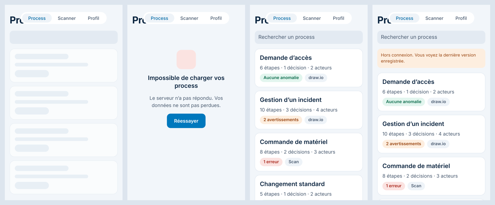

# Documentation technique

Ce document décrit le code tel qu'il est aujourd'hui, puis l'architecture visée. Il est mis à jour à chaque modification du code (voir « Mise à jour de la documentation » en bas).

## État actuel

Le squelette de navigation est en place : tous les écrans de la maquette existent et sont reliés entre eux. Le cœur du simulateur (`src/domain/`) est codé et testé : types d'un process, diagnostic des anomalies et calcul des chemins. Les écrans Liste des process, Détail d'un process, Importer, Simulation et Connexion suivent la maquette : la liste affiche des process fictifs et ceux importés depuis un fichier draw.io ou JSON, enregistrés sur le téléphone ; les autres écrans n'affichent encore qu'un titre, une description et des liens.

| Élément | Version |
| --- | --- |
| Expo SDK | 58 |
| React Native | 0.88 |
| React | 19.3 |
| Expo Router | 58 (routes dans `src/app/`) |
| TypeScript | 6.0, mode `strict` |
| Jest | 30, préréglage `jest-expo` |
| react-native-svg | 15 (dessin du schéma) |
| expo-print, expo-sharing | 58 (export en PDF, feuille de partage) |
| @supabase/supabase-js | 2 (client du backend) |
| expo-sqlite | 58 (`localStorage` pour garder la session Supabase) |
| expo-network | 58 (état du réseau : hors connexion réel, synchronisation au retour du réseau ; module natif, l'app compilée par Xcode doit être recompilée) |
| expo-camera | 58 (appareil photo de l'onglet Scanner ; module natif, l'app doit être recompilée) |

## Structure du dépôt

```text
src/
  app/          Écrans et navigation (Expo Router : un fichier = une route)
  components/   Composants réutilisables (texte et vue thémés, carte de process, schéma du process, pastille, bouton, squelette de chargement, message d'état, logo, écran provisoire)
  constants/    Thème : couleurs, espacements, polices
  data/         Accès aux process : process fictifs et chargement simulé en attendant le backend, process importés enregistrés sur le téléphone (saved-file.ts) et synchronisés avec le serveur (sync.ts, cloud-sync.ts), règles de lecture apprises (rules-store.ts)
  domain/       Cœur du simulateur en TypeScript pur : types, diagnostic, chemins, exemple fictif ; tests dans __tests__/
  import/       Lecture des fichiers draw.io et JSON en process, règles de lecture apprises (rules.ts) ; schémas d'exemple dans __fixtures__/
  export/       Export d'un process en PDF (page HTML avec le schéma en SVG), draw.io et JSON ; tests dans __tests__/
  simulation/   Moteur de simulation pas à pas, mise en page du schéma et familles de chemins, en TypeScript pur ; tests dans __tests__/
  backend/      Connexion au backend Supabase : adresse et clé publique (config.ts), client partagé (client.ts), compte et session (auth.ts, auth-messages.ts, session-store.ts), test du serveur (health.ts), process sur le serveur (process-row.ts, processes.ts)
  hooks/        Hooks partagés (thème, mode sombre)
  scan/         Lecture d'un tableau photographié : texte lu rangé en lignes et en cellules (rows.ts) ; tests dans __tests__/
  utils/        Petites fonctions : texte (pluriel, nombres à la française, recherche sans accents), lecture d'un fichier choisi (read-file.ts, et read-file.web.ts pour le web), partage d'un fichier exporté (share-file.ts, et share-file.web.ts)
modules/        Modules natifs locaux de l'app : text-recognition (lecture du texte d'une photo, Swift avec Vision ; Kotlin à venir)
assets/         Icônes, images, écran de démarrage
docs/           Documentation (dont securite.md et ia.md), maquette des écrans (maquette/), logo (logo/), captures de chaque étape (captures/) et fichiers d'exemple à importer (exemples/)
supabase/       Base de données : migrations SQL (migrations/) et leurs tests (tests/)
scripts/        Lancement iOS (ios.sh) et nettoyage (nettoyer-ios.sh)
eas.json        Profils de compilation EAS (preview : APK Android et build iOS interne ; production)
app.json        Configuration Expo (nom, icônes, écran de démarrage, identifiant fr.simuflow.app sur iOS et Android, plugins)
```

## Commandes

| Commande | Rôle |
| --- | --- |
| `npm install` | Installer les dépendances |
| `npx expo run:ios` | Compiler l'app avec Xcode (build de développement) et l'ouvrir dans le Simulateur iOS |
| `npx expo run:ios --device` | Installer le build de développement sur un iPhone branché en USB |
| `npm run ios:simulateur` | Vérifie les versions des paquets, puis lance `npx expo run:ios` |
| `npm run ios:iphone` | Pareil, avec `--device` (iPhone branché en USB) |
| `npm run nettoyer` | Effacer les fichiers temporaires de compilation iOS pour libérer de l'espace |
| `npx expo start` | Relancer le serveur de développement quand le build est déjà installé |
| `npm test` | Lancer les tests unitaires (Jest) |
| `npx tsc --noEmit` | Vérifier les types |
| `npx expo lint` | Analyser le code (ESLint) |
| `npx expo install <paquet>` | Ajouter une dépendance compatible avec le SDK |

Avant le premier `npx tsc --noEmit`, lancer une fois `npx expo start` : il génère `expo-env.d.ts` et les types des routes (`.expo/types/`), qui ne sont pas versionnés.

## Thème

Les couleurs viennent de la maquette et sont rangées dans `src/constants/theme.ts` :

- `Brand` : les deux couleurs du logo, bleu `#007ec5` et marine `#0b2540`.
- `Colors.light` et `Colors.dark` : la même liste de couleurs nommées par leur rôle (`background`, `surface`, `surfaceMuted`, `field`, `text`, `textSecondary`, `link`, `primary`, `onPrimary`, `primaryBackground`, `border`, et les couleurs du diagnostic `success`, `warning`, `danger` avec leur fond).
- `Radius` (arrondis), `Spacing` (espacements), `Fonts` (polices système).

Le hook `useTheme()` (`src/hooks/use-theme.ts`) renvoie la palette du mode actif du téléphone, clair ou sombre. `ThemedText` et `ThemedView` l'utilisent, ainsi que la barre d'onglets et les en-têtes de navigation (thème construit dans `src/app/_layout.tsx`). Un écran ne doit jamais écrire une couleur en dur : il prend `useTheme().text`, `useTheme().surface`, etc.

Chaque couleur de texte respecte un contraste d'au moins 4,5:1 sur son fond (règle WCAG AA). C'est pourquoi `primary` en mode clair (`#0078bd`) est un peu plus foncé que le bleu du logo : le texte blanc des boutons reste lisible.

## Identité de l'app : icône, écran de démarrage, identifiant

**Identifiant.** `fr.simuflow.app`, le même sur iOS (`ios.bundleIdentifier`) et Android (`android.package`), dans `app.json`. C'est le nom unique de l'app pour le téléphone et pour les stores : il ne doit plus changer. Il remplace `com.anonymous.simuflow` du modèle Expo ; le téléphone voit donc une nouvelle app. L'ancienne, et les process gardés seulement sur le téléphone, ne sont pas repris. Les process synchronisés reviennent à la connexion.

**Icônes** (`assets/images/`), tirées du tracé SVG du logo (`docs/logo/`) :

| Fichier | Usage |
| --- | --- |
| `icon.png` (1024 px) | Icône iOS et icône par défaut : symbole sur fond blanc, iOS arrondit les coins |
| `android-icon-foreground.png` | Icône adaptative Android : symbole sur fond transparent, réduit pour tenir dans la zone toujours visible (le téléphone découpe un rond, un carré arrondi…) ; le fond est la couleur `#ffffff` |
| `android-icon-monochrome.png` | Icônes à thème d'Android 13 et plus : symbole noir, le système le recolore |
| `splash-icon.png` | Logo de l'écran de démarrage : symbole dans sa tuile blanche arrondie |
| `favicon.png` | Version web |

Les images et le code du modèle Expo (logos Expo et React, `animated-icon`, `scripts/reset-project.js`) sont supprimés.

**Écran de démarrage.** Le plugin `expo-splash-screen` (dans `app.json`) affiche `splash-icon.png` (120 de large) sur le fond de l'app : `#f2f6fa` en mode clair, `#0b1621` en mode sombre (option `dark`). C'est un écran natif, montré avant que le JavaScript soit chargé. Ensuite `SplashOverlay` (`src/components/splash-overlay.tsx`, monté dans `src/app/_layout.tsx`) affiche le même logo sur le même fond, cache l'écran natif (`SplashScreen.hideAsync()`) et s'efface en fondu de 300 ms. Avec « Réduire les animations », il disparaît sans fondu (`useReducedMotion`). Sur le web, il ne fait rien (`splash-overlay.web.tsx`).

Une modification de ces fichiers ou d'`app.json` demande de régénérer le dossier `ios/` puis de recompiler l'app (voir « Build de développement »). L'écran de démarrage dure le temps du chargement, sans attente ajoutée : dans un build de développement, Metro charge vite et il ne reste visible qu'un instant.


## Cœur du simulateur

`src/domain/` ne dépend ni de React Native ni du format d'import : ce sont des fonctions TypeScript qui prennent un process et renvoient un résultat. Les règles sont reprises du prototype web (dossier de référence).

**Modèle** (`types.ts`). Un `Process` est un graphe : des `Step` (étapes) reliées par des `Link` (liens orientés). Une étape a un rôle (`start`, `task`, `decision`, `end`), un titre, un acteur et un délai en jours ouvrés, tous deux facultatifs. Un lien peut porter un libellé (« oui », « non »).

**Index** (`graph.ts`). `buildGraph` range les liens sortants et entrants de chaque étape et repère les départs et les fins. Sans étape `start`, les départs sont les étapes où rien n'arrive mais d'où un lien part. Deux parcours en largeur servent au diagnostic : les étapes atteignables depuis un départ, et celles d'où l'on peut atteindre une fin (parcours à rebours).

**Diagnostic** (`diagnostic.ts`). `diagnose` renvoie la liste des anomalies, triées de la plus grave à la moins grave. `describeIssue` donne le message en français.

| Code | Gravité | Signification |
| --- | --- | --- |
| `no-start` | erreur | aucun point de départ |
| `no-end` | erreur | aucune étape de fin |
| `decision-single-exit` | erreur | décision avec une seule sortie |
| `dead-end` | avertissement | impasse : étape sans suite qui n'est pas une fin |
| `cannot-finish` | avertissement | aucune fin atteignable (boucle sans sortie) |
| `unreachable` | avertissement | étape jamais atteinte depuis le départ |
| `unlabeled-branch` | avertissement | branche de décision sans libellé |
| `duplicate-label` | avertissement | deux branches au même libellé |
| `isolated-step` | avertissement | étape reliée à aucune autre |
| `empty-title` | avertissement | étape sans titre |
| `dangling-link` | avertissement | lien vers une étape qui n'existe pas |
| `multiple-starts` | info | plusieurs départs : la simulation part du premier |
| `ambiguous-exits` | info | plusieurs sorties sans libellé hors décision : choix ou parallèle ? |

**Chemins** (`paths.ts`). Un chemin va d'un départ à une étape terminale (une fin, ou une étape sans suite) ; son délai est la somme des délais de ses étapes.

- `shortestPath` (cas simple) : parcours en largeur, qui trouve la fin la plus proche en nombre d'étapes.
- `longestPath` (cas complexe) : parcours en profondeur de tous les chemins sans repasser par une même étape, en gardant le plus long.
- `countPaths` : nombre de chemins sans boucle, plafonné à 2 000.

Les parcours en profondeur s'arrêtent après 300 000 visites, pour qu'un gros schéma plein de boucles ne bloque pas le téléphone.

**Tests** (`__tests__/`). Jest, avec le préréglage `jest-expo`. Les tests partent d'un process fictif, la demande de matériel de bureau (`exemples.ts`), et y créent chaque anomalie une par une.

## Import de fichiers

`src/import/` transforme un fichier en process (`Process` du cœur), sans dépendre de l'écran. `importProcessFile(nomDuFichier, contenu)` choisit le lecteur d'après l'extension ou le premier caractère, et renvoie les process trouvés et une liste de remarques. Un fichier illisible lève une `ImportError` avec un message en français, prêt à afficher.

**draw.io** (`drawio.ts`, repris du prototype web). Un fichier draw.io est du XML : une balise `<diagram>` par page, contenant un `<mxGraphModel>` en clair ou compressé (base64 d'un flux *deflate* du XML encodé en URL). Le XML est lu avec `@xmldom/xmldom` et la décompression faite avec `fflate`, deux bibliothèques en JavaScript pur, sans code natif. Pour chaque page :

- chaque `<mxCell>` est une forme (`vertex`) ou une flèche (`edge`) ; une forme enveloppée dans `<object>` ou `<UserObject>` prend son libellé là ;
- les coordonnées sont rendues absolues (une forme dans un couloir est placée par rapport à lui) ;
- les couloirs (style `swimlane`, `pool`, ou grand cadre qui contient des formes) deviennent l'**acteur** des étapes qu'ils contiennent ;
- sans couloir, une **légende par couleur** donne l'acteur (`colorLegend`) : une petite pastille colorée (60 px au plus, sans texte ni flèche) suivie, sur la même ligne et à moins de 40 px, d'un texte (« ■ Demandeur »). Chaque étape de cette couleur de fond prend cet acteur (couleurs comparées sans tenir compte des majuscules). Il faut au moins deux entrées : une pastille isolée n'est pas une légende. Une étape dans un couloir garde l'acteur du couloir ;
- les zones de texte non reliées sont des notes, et les formes sans aucune flèche des annotations : elles sont ignorées ;
- le texte d'une étape peut annoncer l'acteur (`actorFromText`, `text.ts`) : « Acteur : », « Responsable : », « Assignee : », « Assignment group : », « Équipe : »…, la valeur pouvant être sur la ligne suivante. Un process décrit des rôles, pas des personnes : dans « Camille (service Achats) » on garde le service, et dans « Équipe Réseau (Alex / Lou) » on retire les noms. Ordre de priorité : couloir, propriété « acteur », texte, légende. Un même acteur écrit avec d'autres majuscules est regroupé sous la première orthographe ;
- **les flèches priment sur les formes.** Une étape d'où partent au moins deux flèches nommées (« oui », « non », « rupture »…), ou deux flèches et un texte qui finit par « ? », est une décision, quelle que soit sa forme ; un losange l'est toujours. Deux flèches sans nom restent une tâche (le diagnostic signale « choix ou parallèle ? ») ;
- un départ et une fin se reconnaissent à leur forme (ellipse) ou à leur texte (« Début », « Fin », « Close »…). Si la page n'a aucun départ marqué, toute étape où rien n'arrive en devient un ; de même pour les fins (rien ne part). Si une fin est marquée, une étape sans sortie reste une impasse, que le diagnostic signale ;
- le texte HTML est découpé en lignes à chaque bloc (`<div>`, `<p>`, `<br>`) ;
- le délai est lu dans le texte (« 2 JO », « 1,5 jour ouvré », « 3 BD », « 5 jours », « 2 j ») ;
- le libellé d'une flèche est son texte ou celui de l'étiquette posée dessus ; une flèche dessinée à l'envers est retournée ; une flèche dont un bout n'est accroché à rien est rattachée à l'étape la plus proche, avec une remarque.

Les étapes sont rangées dans l'ordre de lecture (de haut en bas, puis de gauche à droite) et gardent leur position (`layout`) pour un futur affichage du schéma. Un fichier de plusieurs pages donne un process par page, nommé « Fichier · Page ».

**JSON** (`json.ts`). Le format SimuFlow : `{ "format": "simuflow", "version": 1, "name", "steps": [{ "id", "kind", "title", "actor", "duration" }], "links": [{ "from", "to", "label" }] }`. Seuls `steps` et les `id` sont obligatoires ; le rôle vaut `task` par défaut. Chaque erreur dit où elle est (« Étape 2 : l'identifiant « a » est déjà utilisé. »). `processToJson` fait l'inverse, pour exporter un process.

**Tests.** Un schéma fictif de demande de congés (`__fixtures__/conges.ts`), avec deux couloirs, une décision, une note, une étiquette de flèche posée à part et une flèche mal accrochée, en clair et compressé. Un schéma fictif d'achat de fournitures sans couloir (`__fixtures__/legende.ts`, aussi dans `docs/exemples/achats-fournitures.drawio`) teste la légende par couleur : acteurs lus, étape d'une couleur absente de la légende sans acteur, pastille isolée ignorée. `__fixtures__/varies.ts` dessine des process de façons très différentes : que des rectangles sans couleur ni « Début »/« Fin » avec les acteurs dans le texte (aussi dans `docs/exemples/validation-facture.drawio`), que des cercles, des personnes et des équipes écrites de plusieurs façons.


## Navigation

Expo Router associe chaque fichier de `src/app/` à un écran.

| Fichier | Route | Écran |
| --- | --- | --- |
| `_layout.tsx` | | Pile de navigation principale (thème clair ou sombre, écran de démarrage) |
| `(tabs)/_layout.tsx` | | Barre d'onglets native : Process, Scanner, Profil |
| `(tabs)/index.tsx` | `/` | Liste des process |
| `(tabs)/scanner.tsx` | `/scanner` | Scanner de tableau |
| `(tabs)/profil.tsx` | `/profil` | Profil et compte |
| `process/[id].tsx` | `/process/:id` | Détail d'un process |
| `simulation/[id].tsx` | `/simulation/:id` | Simulation pas à pas |
| `import.tsx` | `/import` | Import d'un process (fenêtre modale) |
| `export/[id].tsx` | `/export/:id` | Export du schéma (fenêtre modale) |
| `connexion.tsx` | `/connexion` | Connexion (fenêtre modale) |

Sauf la liste, le détail des process, l'import, la simulation, l'export et la connexion, les écrans utilisent pour l'instant `PlaceholderScreen` (`src/components/placeholder-screen.tsx`) : un titre, une description et des liens. Ils seront remplacés un par un par les écrans de la maquette. Les routes sont typées (`typedRoutes`) : un lien vers un écran qui n'existe pas est signalé par TypeScript. Les onglets utilisent les icônes système (SF Symbols sur iOS, Material Symbols sur Android). L'app vise iOS et Android ; la version web n'est pas prise en charge.

## Écran Liste des process

`src/app/(tabs)/index.tsx` reprend l'écran 2 de la maquette : titre, champ de recherche, une carte par process et un bouton « + » qui ouvre l'import. Chaque carte (`process-card.tsx`) affiche le nombre d'étapes, de décisions et d'acteurs, une pastille de diagnostic (erreurs d'abord, puis avertissements, sinon « Aucune anomalie ») et la source (draw.io ou Scan). Ces chiffres viennent de `summarize` (`src/domain/summary.ts`), qui appelle le diagnostic. Toute la carte ouvre le détail.

**Données.** `useProcessList()` (`src/data/process-list.ts`) affiche les process importés (et ceux du compte, voir « Synchronisation avec le serveur »), puis les quatre process d'exemple de `demo-processes.ts`. Deux exemples contiennent des anomalies exprès.

**Les 5 états** (maquette, écran 10), calculés à partir de l'état réel de l'app par `listState` (`src/data/list-state.ts`, testé) :

| État | Quand | Affichage |
| --- | --- | --- |
| Chargement | Connecté, première synchronisation en cours, aucun process du compte encore sur le téléphone | Squelette de la forme des cartes, sans spinner (`list-skeleton.tsx`) |
| Erreur | Cette première synchronisation a échoué côté serveur | Message et bouton « Réessayer », qui relance la synchronisation |
| Hors connexion | Le téléphone n'a pas Internet (`expo-network`, `src/data/network.ts`) | Bandeau orange au-dessus de la dernière version enregistrée |
| Vide | Aucun process | Message et bouton « Ajouter un process » (`state-message.tsx`) ; aujourd'hui les exemples sont toujours affichés, cet état ne se voit donc qu'avec le scénario de démo |
| Contenu | Sinon | Les cartes ; si la recherche ne trouve rien, une phrase le dit |

Sans réseau, la liste reste utilisable : les process sont lus sur le téléphone, et les changements partent quand le réseau revient.

En mode développement, l'onglet Profil propose « Démo · état de la liste des process » pour forcer chacun de ces états (`useSimulatedProcessList`, `src/data/process-store.ts`) ; « Contenu » revient à la liste réelle. Ce choix n'existe pas dans l'app publiée (`__DEV__`).



**Animations** (Reanimated). Deux animations, toutes deux coupées quand « Réduire les animations » est activé dans les réglages du téléphone (`useReducedMotion`) :

- le squelette de chargement « respire » : son opacité va et vient entre 1 et 0,5 en boucle (`withRepeat` + `withTiming`, 0,8 s) ;
- à l'arrivée de la liste, les cartes apparaissent l'une après l'autre en glissant vers le haut (`FadeInDown`, 0,3 s, 60 ms d'écart entre deux cartes).

**Recherche.** Elle ignore les accents et les majuscules (`normalizeForSearch`, `src/utils/format.ts`) : « materiel » trouve « Commande de matériel ».


**Accessibilité.** Chaque carte est un bouton dont VoiceOver et TalkBack lisent tout le contenu en une phrase. Le champ de recherche et le bouton « + » ont un libellé. Le squelette est annoncé « Chargement des process », le bandeau hors connexion comme une alerte. Les zones à toucher font au moins 44 points.

## Écran Importer

`src/app/import.tsx` reprend l'écran 5 de la maquette, en fenêtre modale ouverte par le bouton « + » de la liste.

1. **Source** : « Fichier draw.io » et « Fichier JSON » ouvrent le sélecteur de fichiers du téléphone (`expo-document-picker`, qui accède à Fichiers, iCloud Drive, Drive, pièces jointes enregistrées). « Scanner un tableau » ouvre l'onglet Scanner. Le sélecteur copie le fichier dans le cache de l'app ; `readPickedFile` (`src/utils/read-file.ts`) en lit le texte avec `File` d'`expo-file-system`. Un fichier de plus de 5 Mo est refusé.
2. **Lecture** : `importProcessFile` (voir « Import de fichiers »). Si le fichier est illisible, son message d'erreur s'affiche en rouge sous les sources, et rien n'est ajouté.
3. **Page à importer** : si le fichier draw.io a plusieurs pages, une liste à choix unique permet d'en garder une.
4. **Aperçu** : nombre d'étapes, de décisions et d'acteurs, pastille de diagnostic, et remarques de la lecture (par exemple une flèche rattachée).
5. **Nom du process** : rempli à partir du fichier, modifiable. Vide, il passe en rouge avec « Le nom est obligatoire. ».
6. **Importer** (grisé tant qu'aucun fichier n'est lu) : `addImportedProcess` (`src/data/process-store.ts`) ajoute le process en tête de liste, puis l'écran Détail du process s'ouvre à la place de la modale.
7. **Importer et corriger** (une fois un fichier lu) : même import, puis l'éditeur s'ouvre par-dessus la fiche du process ; « Enregistrer » ou « Annuler » ramène à la fiche.

`docs/exemples/` contient des fichiers fictifs pour essayer : `demandes-rh.drawio` (deux pages, Congés et Note de frais, acteurs en couloirs), `achats-fournitures.drawio` (acteurs donnés par une légende de couleurs), `validation-facture.drawio` (que des rectangles, acteurs écrits dans le texte), `accueil-arrivant.json`, et `tableaux-a-scanner.html` : six tableaux à afficher ou imprimer pour tester le Scanner (en-têtes variés, colonne « Suite » pour les décisions et les boucles, délais écrits de plusieurs façons), chacun avec ce que l'app doit en tirer. Pour les mettre sur l'iPhone : AirDrop, ou les enregistrer dans Fichiers.


**Accessibilité.** Chaque source est un bouton qui lit son titre et sa description, et annonce s'il est choisi. Les pages forment un groupe de boutons radio. Le champ du nom annonce l'erreur, et le message d'erreur du fichier est lu dès qu'il apparaît. Le bouton Importer est annoncé comme désactivé tant qu'il n'y a pas de fichier.

### Process importés enregistrés sur le téléphone

`src/data/process-store.ts` garde la liste des process importés dans un petit magasin lu avec `useSyncExternalStore`, et l'enregistre à chaque changement (ajout, suppression) :

- sur iOS et Android, dans le fichier `process-importes.json` du dossier Documents de l'app (`src/data/saved-file.ts`, avec `File` et `Paths.document` d'`expo-file-system`). Le système ne vide pas ce dossier ; le fichier disparaît seulement si l'app est désinstallée ;
- sur le web, dans le stockage local du navigateur (`saved-file.web.ts`).

Le fichier contient `{ "format": "simuflow-imports", "version": 2, "entries": [...] }` : chaque entrée est un process, avec son identifiant sur le serveur (`cloudId`) une fois envoyé, et une marque `deleted` tant que sa suppression n'est pas faite sur le serveur. Un fichier de la version 1 (`processes`, une simple liste) est encore relu. Il est relu au démarrage de l'app : un fichier abîmé ou d'un autre format donne une liste vide, et une entrée qui n'a pas la forme d'un process est ignorée (`parseSaved`). Si l'écriture échoue, l'app continue et le signale dans la console.

Un process importé a un bouton « Supprimer ce process » en bas de son détail. Il demande une confirmation (`Alert`, qui précise « et de votre compte » si le process est sur le serveur), retire le process de la liste et du fichier, puis revient à la liste. Les process d'exemple n'ont pas ce bouton.


### Synchronisation avec le serveur (`src/data/sync.ts`, `src/data/cloud-sync.ts`)

Connecté, les process importés sont aussi enregistrés sur le compte (table `processes`, étape 7) : on les retrouve sur un autre téléphone.

**Le principe** (`syncEntries`, sans dépendance, testé avec un faux serveur). Une synchronisation lit les process du compte, puis :

1. supprime sur le serveur ceux retirés du téléphone (`deleted`) ;
2. envoie ceux qui n'y sont pas encore (pas de `cloudId`) ;
3. envoie les modifications faites sur le téléphone (`modified`, posé par l'éditeur) avec `updateCloudProcess` ;
4. reprend la version du serveur des autres, modifiés peut-être depuis un autre appareil ;
5. retire du téléphone ceux supprimés depuis un autre appareil (un `cloudId` absent du serveur) ;
6. ajoute ceux créés ailleurs (leur identifiant sur le téléphone est celui du serveur).

Un process envoyé garde son identifiant local : un écran ouvert pendant l'envoi ne le perd pas. Modifié sur deux téléphones entre deux synchronisations, la dernière version envoyée l'emporte.

**Changements pendant l'envoi.** Si l'on importe, modifie ou supprime pendant une synchronisation, `mergeAfterSync` garde ces changements par-dessus le résultat (un process supprimé pendant son envoi est marqué `deleted`), et une nouvelle synchronisation suit.

**Quand** (`useCloudSync`, appelé une fois dans `src/app/_layout.tsx`) : à la connexion, au retour de l'app au premier plan, quand le réseau revient (`addNetworkStateListener` d'`expo-network`), après chaque import, modification ou suppression, et avec « Synchroniser » dans le Profil. Une seule synchronisation tourne à la fois. Sans réseau, l'erreur est affichée dans le Profil et rien n'est perdu : les changements partent la fois suivante.

**Sans compte** (déconnexion, compte supprimé), les copies déjà envoyées sont retirées du téléphone : elles restent sur le serveur, et un autre compte connecté sur ce téléphone ne les voit pas. Les process jamais envoyés restent, et partiront sur le prochain compte connecté.

**Profil.** Sous l'adresse : « Process synchronisés à 18:29 », « Synchronisation… » ou « Hors connexion : vos process seront envoyés plus tard », avec le bouton « Synchroniser ».

**Tests.** Quatre tests pour l'état de la liste (`list-state.ts`), onze pour `sync.ts` (envoi, pas de double envoi, suppression, récupération et disparition depuis un autre appareil, serveur injoignable, changements pendant l'envoi) et trois pour le fichier (relecture de la version 1, marque « à supprimer » gardée au redémarrage, oubli immédiat d'un process jamais envoyé).


## Écran Détail d'un process

`src/app/process/[id].tsx` reprend l'écran 3 de la maquette. Il lit le process avec `getProcess(id)` (`src/data/process-store.ts`) ; un identifiant inconnu affiche « Process introuvable » avec un bouton de retour.

- **En-tête** : retour « Process » et bouton de partage (`Share` de React Native, qui envoie un résumé en texte).
- **Chiffres** : étapes, décisions, chemins possibles (`countPaths`, affiché « 2000+ » au-delà du plafond) et points à corriger (erreurs + avertissements). Cette dernière tuile est rouge s'il y a une erreur, orange s'il n'y a que des avertissements, verte sinon.
- **Acteurs** : une pastille par acteur distinct.
- **Diagnostic** : erreurs et avertissements, avec un titre court et une phrase qui nomme l'étape (`explainIssue`, `src/domain/diagnostic.ts`). Les informations sont repliées sous « N informations repliées ».
- **Étapes** : la liste dans l'ordre du process, avec rôle, acteur et délai. « Voir » fait défiler jusqu'à l'étape concernée et la surligne : chaque ligne mémorise sa position (`onLayout`), puis `scrollTo` y descend.
- **Bouton « Lancer la simulation »**, fixé en bas, qui ouvre `/simulation/[id]`.
- **« Modifier le process »** (process importés seulement) ouvre l'éditeur. L'écran relit le process à chaque changement (`useImportedProcesses`).


**Accessibilité.** Chaque tuile, anomalie et étape est lue d'un bloc. « Voir » annonce l'anomalie qu'il montre (« Voir l'étape : Impasse »). Le repli des informations annonce s'il est ouvert ou fermé.

## Éditeur de process (`src/app/process/modifier/[id].tsx`)

Pour corriger un process pendant sa validation, sans retoucher le fichier d'origine. Les modifications sont des fonctions pures (`src/domain/edit.ts`) qui renvoient un nouveau process : l'écran garde un brouillon, et « Annuler » l'abandonne (avec confirmation s'il a changé).

- **Une étape** (`updateStep`) : titre (jamais vide), rôle (départ, tâche, décision, fin), acteur (tapé, ou choisi parmi ceux du process, `actorsOf`), délai en jours ouvrés (vide = aucun).
- **Les branches** (`renameLink`) : chaque sortie d'une étape qui en a plusieurs se nomme (« oui », « refus »…) ; un nom vide la laisse sans nom.
- **« C'est un choix »** (`makeDecision`) : une tâche à plusieurs sorties devient une décision, et ses branches sans nom prennent le titre de l'étape où elles mènent.
- **Ajouter une étape après** (`addStepAfter`, pas sur une décision) : si l'étape n'a qu'une suite, la nouvelle s'insère entre les deux (le nom de branche reste au départ) ; sinon elle devient une suite de plus. Elle s'ouvre aussitôt pour être nommée.
- **Ajouter un cas** (`addBranch`, sur une décision) : un nom et une cible, une nouvelle étape (qui porte le nom du cas) ou une étape existante.
- **Relier à une autre étape** (`addBranch` sans nom, sur une tâche ou un départ) : une suite de plus vers une étape existante, par exemple un retour en arrière.
- **Retirer** une branche (`removeLink`).
- **Supprimer l'étape** (`removeStep`, après confirmation) : ses liens partent avec elle ; une étape de simple passage (une entrée, une sortie) laisse l'étape d'avant reliée à celle d'après. Les nouveaux identifiants (`etape-1`, `lien-1`…) ne reprennent jamais un identifiant pris.
- En haut, le nombre d'étapes, de décisions et de points à corriger suit le brouillon en direct (`summarize`).
- Chaque champ met le brouillon à jour à chaque frappe ; les boutons de l'en-tête lisent la dernière version par une référence (`useRef`).

« Enregistrer » remplace le process (`updateImportedProcess`), le date (`editedAt`, date ISO) et le marque `modified` : il part au serveur à la prochaine synchronisation, la date dans la colonne `content` avec les étapes. La fiche affiche « Corrigé dans l'app le … », le PDF le reprend dans son pied de page, et le fichier draw.io l'écrit dans l'attribut `modified` de `<mxfile>`. L'export draw.io de la version corrigée reprend les positions d'origine et celles des étapes ajoutées (voir **Mise en page**). Les process d'exemple ne se modifient pas.

**Tests.** Dix tests pour `edit.ts` (modification sans toucher à l'original, acteur et délai retirés, branches renommées, décision avec branches nommées, liste des acteurs, étape insérée ou ajoutée en suite, cas vers une étape nouvelle ou existante, étape de passage supprimée avec pont, décision supprimée avec ses branches) et quatre de plus pour la synchronisation (envoi d'une modification, version du serveur reprise, modification pendant l'envoi gardée, marque effacée après envoi). Trois de plus pour la version corrigée : positions d'origine gardées et étapes ajoutées sans chevauchement, nouvelle étape sous celle qui y mène (`layout.test.ts`), export draw.io d'un process corrigé qui se réimporte avec sa date (`drawio.test.ts`) ; et un pour la date gardée par le serveur (`process-row.test.ts`).

**Web (développement).** Avec le chargement des écrans à la demande (`asyncRoutes`), la fiche n'affiche la modification qu'après rechargement de la page ; l'app iOS et Android, en un seul paquet, n'est pas concernée.


## Règles de lecture apprises (`src/import/rules.ts`, `src/data/rules-store.ts`)

SimuFlow apprend des corrections faites dans l'éditeur, pour ne pas les redemander au prochain import. À l'enregistrement, `learnRules(avant, après)` compare chaque étape à elle-même (par identifiant ; une étape supprimée ne compte pas) et ne garde que ce qui vaut pour **tout** le schéma :

- **acteur** : toutes les étapes lues avec l'acteur A ont reçu le même acteur B (majuscules ignorées). Changer l'acteur d'une seule étape parmi d'autres du même acteur reste une correction ponctuelle ;
- **rôle** : toutes les étapes d'une même forme ont changé de rôle, toutes pour le même. La forme est lue à l'import (`shapeOf` dans `drawio.ts` : `shape=…`, sinon `rhombus`, `ellipse`, `hexagon`…, sinon rectangle arrondi ou non) et gardée dans `Step.shape`. Pour un rectangle, forme la plus courante, il faut au moins deux étapes corrigées pareil ; une forme particulière (hexagone…) suffit une fois.

Les règles sont enregistrées sur le téléphone dans `regles-lecture.json` (même mécanisme que les process, `saved-file.ts` prend désormais un nom de fichier ; sur le web, `simuflow.regles-lecture` dans le stockage local), au format `{ "format": "simuflow-regles", "version": 2, "rules": [...], "pending": false, "forgotten": [] }` (la version 1, sans `pending` ni `forgotten`, est relue comme « tout reste à envoyer »), les règles étant relues par `parseRules`. Une nouvelle règle sur le même acteur ou la même forme remplace l'ancienne (`mergeRules`).

**Sur le compte.** Connecté, les règles suivent la synchronisation des process (`syncReadingRules`, appelée par `cloud-sync.ts` après les process, et dès qu'une règle est apprise ou oubliée). Le magasin garde `pending` (un changement pas encore envoyé) et `forgotten` (les règles oubliées ici). `reconcileRules` décide : sans changement local, les règles du compte remplacent celles du téléphone ; sinon, celles du compte, moins les oubliées, plus celles apprises ici (qui gagnent sur le même acteur ou la même forme), et le résultat est envoyé. Un échec (réseau, table pas encore créée) n'empêche pas la synchronisation des process : les règles restent marquées et repartent la fois suivante. À la déconnexion, les règles déjà sur le compte quittent le téléphone ; celles pas encore envoyées restent et partiront avec le prochain compte connecté, comme les process.

À l'import, `applyReadingRules` applique les règles à chaque page lue (`applyRules`) avant l'aperçu, qui affiche « Corrigé d'après vos corrections précédentes » avec la phrase de chaque règle qui a servi (`describeRule`). L'onglet Profil liste les règles, chacune avec « Oublier ». L'export JSON n'écrit pas `shape`.

**Tests.** Dix tests dans `rules.test.ts` : acteur renommé partout, acteur changé sur une seule étape (rien d'appris), forme particulière vue une fois, rectangles (deux exigés), étapes supprimées, application et phrases, process rendu tel quel sans règle utile, remplacement d'une règle, relecture d'un fichier abîmé, accord téléphone-compte. Six dans `rules-store.test.ts` : relecture au démarrage, envoi et reprise des règles du compte, rien d'envoyé sans changement, oubli propagé au compte, déconnexion, application à un import.


## Écran Scanner (`src/app/(tabs)/scanner.tsx`)

Reprend l'écran 6 de la maquette : titre, consigne (« une colonne par information : étape, acteur, délai »), viseur aux quatre coins, déclencheur rond et bouton de lampe. L'écran reste sombre dans les deux thèmes, comme une app photo (couleurs fixes `SCAN`).

- **Autorisation** (`useCameraPermissions` d'`expo-camera`) : tant qu'elle n'est pas donnée, l'écran explique à quoi sert l'appareil photo et propose « Autoriser ». Refusée pour de bon (`canAskAgain` faux), le bouton devient « Ouvrir les réglages » (`Linking.openSettings`).
- **Aperçu** : `CameraView` (caméra arrière), monté seulement quand l'onglet est affiché (`useIsFocused`), pour libérer l'appareil photo ailleurs. La lampe passe par `enableTorch`. Le déclencheur attend `onCameraReady` ; un échec de démarrage ou de prise de vue s'affiche sous le viseur.
- **Photo** : `takePictureAsync({ quality: 0.8 })` ; la photo (fichier dans le cache de l'app) remplace l'aperçu, avec « Reprendre la photo ». Elle n'est envoyée nulle part.
- **Configuration** (`app.json`, plugin `expo-camera`) : message d'autorisation iOS en français ; ni micro, ni lecture de codes-barres (`microphonePermission: false`, `recordAudioAndroid: false`, `barcodeScannerEnabled: false`), ce qui évite des autorisations inutiles. Après ce changement : `npx expo prebuild --clean --platform ios`, puis recompiler.

- **Lecture du texte** : juste après la photo, `recognizeText` (module `modules/text-recognition`, voir plus bas) lit le texte sur le téléphone. Un voile et un indicateur couvrent la photo pendant la lecture. Le texte lu est rangé en lignes de tableau par `groupRows` (`src/scan/rows.ts`) et affiché sous la photo, une ligne par rangée, cellules séparées par « · », avec « Tableau lu : 5 lignes, 3 colonnes. ». Sans texte trouvé ou en cas d'échec, un message invite à reprendre la photo. Là où le module n'existe pas (Android pour l'instant, web), l'écran dit que la lecture n'est pas encore disponible. La transformation du tableau en process est l'étape suivante.

**Accessibilité.** Le déclencheur est un bouton « Prendre la photo », annoncé désactivé tant que l'appareil n'est pas prêt ; la lampe est un interrupteur qui annonce son état. Les messages sous le viseur sont lus dès qu'ils changent.


### Module natif de lecture du texte (`modules/text-recognition/`)

Un module Expo local (Expo Modules API), écrit pour l'app. Expo le trouve seul dans `modules/` (autoliaison, pas de dépendance à ajouter) ; il est compilé avec l'app, donc il faut refaire `npx expo prebuild --clean --platform ios` puis recompiler. Il ne marche pas dans Expo Go.

| Fichier | Rôle |
| --- | --- |
| `expo-module.config.json` | Déclare le module pour iOS (`TextRecognitionModule`) |
| `ios/TextRecognition.podspec` | Le pod : iOS 16.4, dépend d'`ExpoModulesCore` et du framework `Vision` |
| `ios/TextRecognitionModule.swift` | Le code natif |
| `index.ts` | Le côté JavaScript : `recognizeText(uri)` et `isTextRecognitionAvailable` |

**Côté Swift.** Le module s'appelle `TextRecognition` et expose une fonction asynchrone `recognizeTextAsync(uri)`, exécutée hors du fil principal (l'interface ne gèle pas). Elle :

1. ouvre la photo à partir de son adresse de fichier (`UIImage(contentsOfFile:)`), sinon lève `ImageNotReadableException` (« La photo n'a pas pu être lue », avec son chemin) ;
2. lance une requête Vision `VNRecognizeTextRequest` en mode précis (`.accurate`), avec correction de la langue, pour le français puis l'anglais, en tenant compte du sens de la photo (orientation EXIF convertie en `CGImagePropertyOrientation`) ;
3. renvoie, pour chaque morceau de texte trouvé, le texte le plus probable, sa confiance (0 à 1) et sa boîte en fraction de l'image. Vision compte la hauteur depuis le bas : le module la retourne (`y = 1 - maxY`) pour que l'origine soit en haut à gauche, comme à l'écran.

Tout se passe sur le téléphone : aucun envoi réseau, aucun service extérieur.

**Côté JavaScript.** `index.ts` charge le module avec `requireOptionalNativeModule('TextRecognition')`, qui renvoie `null` au lieu de planter là où il n'existe pas. `isTextRecognitionAvailable` permet à l'écran de le dire.

**Ranger en tableau** (`src/scan/rows.ts`, TypeScript pur, testé). Vision rend des morceaux de texte en vrac, chacun avec sa boîte. `groupRows` les regroupe en lignes : deux morceaux sont sur la même ligne si leurs centres verticaux sont à moins de 0,6 fois la hauteur du plus petit. Chaque ligne est ensuite triée de gauche à droite (une cellule par morceau), et les lignes de haut en bas. `tableSize` donne le nombre de lignes et de colonnes (la ligne la plus remplie). Trois tests : un tableau en désordre, une photo légèrement penchée, et un texte vide.

## Écran Simulation

### Moteur (`src/simulation/engine.ts`)

`createSimulation(process)` prépare le graphe une fois (`buildGraph`) et renvoie des fonctions qui prennent un état et renvoient le nouvel état, sans rien modifier. L'écran garde l'état avec `useState`, le moteur calcule. L'état contient :

- `trail` : les étapes parcourues, dans l'ordre, chacune avec le lien emprunté pour y arriver (même forme que les chemins de `paths.ts`) ;
- `days` : le délai cumulé, en jours ouvrés ;
- `status` : `running` (il reste des sorties), `finished` (une fin est atteinte), `stuck` (impasse : une étape sans sortie qui n'est pas une fin) ou `no-start` (aucun départ).

Fonctions : `start()` part du premier départ ; `choices(état)` donne les sorties de l'étape courante ; `step(état, lien)` avance par la sortie choisie (une sortie qui ne part pas de l'étape courante est ignorée) ; `back(état)` revient d'une étape ; `replay(chemin)` rejoue un chemin déjà calculé. Une boucle du schéma peut être parcourue plusieurs fois : c'est l'utilisateur qui choisit. Six tests couvrent le départ, l'avance, le retour, le rejeu, l'impasse et le process sans départ.

### Écran (`src/app/simulation/[id].tsx`)

Il reprend l'écran 4 de la maquette, ouvert par « Lancer la simulation » depuis le détail.

- **Quatre modes** en onglets : « Pas à pas » ; « Simple », qui rejoue le chemin le plus court (`shortestPath`) ; « Complexe », le plus long sans repasser par une étape (`longestPath`) ; « Tous », la vue de tous les cas (voir plus bas). « Simple » et « Complexe » rejouent le chemin étape par étape (une toutes les 450 ms) pour que le schéma se construise sous les yeux ; avec « Réduire les animations », le chemin s'affiche d'un coup.
- **Schéma** en haut de l'écran (voir ci-dessous).
- **Déroulé** : une ligne par étape parcourue, avec une pastille de couleur selon le rôle (départ, tâche, décision, fin), le délai, l'acteur et la sortie empruntée (« par « oui » »). La ligne en cours est surlignée, le total des jours est dans le titre, et la liste défile jusqu'à la dernière étape. Chaque nouvelle ligne apparaît en glissant (Reanimated `FadeInDown`), sauf avec « Réduire les animations ».
- **Panneau du bas** : le rôle, l'acteur et le titre de l'étape en cours, puis « Étape suivante » s'il n'y a qu'une sortie, ou un bouton par sortie à une décision. À la fin : « Fin atteinte » avec le nombre d'étapes et de jours. Dans une impasse : « Impasse » et le nom de l'étape. « Revenir en arrière » et « Recommencer pas à pas » selon le cas.
- Un process sans départ affiche « Rien à simuler ».

Les délais s'écrivent à la française (« 0,5 JO ») grâce à `formatNumber` (`src/utils/format.ts`), aussi utilisé par `plural` : le détail d'un process en profite.


**Accessibilité.** Les modes sont des onglets qui annoncent celui qui est choisi. Chaque ligne du déroulé est lue d'un bloc (titre, sortie, acteur, délai, « étape en cours »). À chaque nouvelle étape, le lecteur d'écran l'annonce (`AccessibilityInfo.announceForAccessibility`). Les boutons de sortie disent où ils mènent (« Choisir oui : aller à … »).

### Schéma qui se construit (`src/simulation/layout.ts`, `src/components/process-diagram.tsx`)

**Mise en page.** `layoutProcess(process)` donne la position de chaque étape et le tracé de chaque flèche :

- si des étapes ont une position (`layout`, lue dans le fichier draw.io), elle est gardée : le schéma ressemble à l'original. Une étape ajoutée dans l'éditeur n'en a pas : `placeMissing` la pose sous l'étape qui y mène (sinon au-dessus de celle qui suit, sinon sous tout le schéma), puis la décale vers la droite tant qu'elle chevauche une autre forme. Les positions d'origine ne bougent pas ;
- sinon (fichier JSON, et plus tard tableau scanné), elle est calculée. Chaque acteur a sa colonne (un couloir, dans l'ordre d'apparition), et chaque étape sa ligne : son **niveau** est la longueur du plus long chemin qui y mène depuis le départ (`computeRanks`). Les boucles sont repérées par un parcours en profondeur (une flèche qui revient vers une étape en cours de visite) et ne comptent pas, sinon les niveaux grimperaient sans fin. Deux étapes d'un même niveau et d'un même acteur sont mises côte à côte.
- Les flèches descendent à angle droit et **ne traversent jamais une étape**. Pour chaque flèche, plusieurs tracés sont essayés dans l'ordre, et le premier qui ne touche aucune autre étape est gardé (`crosses`) : tout droit si les deux étapes sont alignées ; par le côté si l'étape d'arrivée est sur la ligne suivante, à gauche ou à droite (un côté ne sert qu'à une flèche, et le côté droit est gardé pour les boucles) ; par le bas puis dans l'espace vide au-dessus de l'étape d'arrivée ou sous l'étape de départ ; sinon en descendant par un couloir vertical libre entre deux colonnes (`verticalChannels`).
- Plusieurs flèches qui arrivent sur une même étape (ou partent par son bas) ont chacune leur point, répartis sur le bord dans l'ordre de gauche à droite (`spread`) : elles ne se confondent pas.
- Deux flèches qui passent dans le même couloir, à la même hauteur ou à la même abscisse, sont écartées de 10 points chacune sur sa voie (`separateTracks`). Les segments du départ et de l'arrivée ne bougent pas.
- Une flèche qui remonte (boucle) passe par la droite. Le libellé se pose au milieu de la flèche (`midpoint`). Un process venu de draw.io garde ses positions : ses flèches restent des lignes droites d'un bord à l'autre.

Quinze tests vérifient les niveaux, les couloirs, les boucles, les étapes côte à côte, les positions draw.io, la géométrie, et, sur les quatre process de démonstration, qu'aucune flèche ne traverse une étape, que deux flèches vers une même étape arrivent en deux points distincts et que deux flèches ne se superposent pas dans un couloir.


**Dessin.** `ProcessDiagram` dessine en SVG (`react-native-svg`) uniquement ce qui a été parcouru : les étapes visitées, les flèches empruntées en bleu, et, en mode pas à pas, les sorties possibles en pointillés avec leur étape d'arrivée « en fantôme ». Les formes suivent le rôle : rectangle pour une tâche, losange pour une décision, pilule pour le départ et la fin. Le titre est coupé sur trois lignes au plus. L'étape en cours a un halo qui pulse (Reanimated, `useAnimatedProps` sur un `Rect` animé), coupé avec « Réduire les animations ».

**Vue.** Le schéma n'est pas dans des défilements : il est posé dans un cadre et déplacé par une transformation (décalage `x`, `y` et échelle `scale`), trois valeurs partagées Reanimated qui bougent sur le fil d'interface, sans repasser par React.

- **Cadrage automatique.** À chaque étape (`focusKey` change), la vue glisse en 450 ms (`withTiming`) pour montrer l'étape en cours et toutes ses sorties possibles (`boxOf`), entre 55 % et 100 % de la taille réelle. Si tout ne tient pas, l'étape en cours reste dans le cadre (`keepInside`). À la fin du parcours, et dans les cas simple et complexe, la vue montre tout le chemin parcouru (jusqu'à 40 %). En vue « Tous », tout le schéma. Avec « Réduire les animations », la vue saute sans glisser.
- **Gestes** (`react-native-gesture-handler` 3, inclus dans Expo Go) : glisser d'un doigt déplace le schéma (`usePanGesture`), pincer zoome autour des doigts (`usePinchGesture`), les deux en même temps (`useSimultaneousGestures`). Le schéma ne sort jamais du cadre (`bound`) ; plus petit que le cadre, il y est centré. L'app est enveloppée dans `GestureHandlerRootView` (`src/app/_layout.tsx`).
- **Netteté.** Pendant un geste ou un glissement, l'image est étirée ; à la fin, le SVG est redessiné à la nouvelle taille (`renderScale`) pour que le texte reste net.
- **Apparition.** Chaque étape et chaque flèche qui apparaît passe de transparente à visible en 350 ms (`FadeIn`, un `G` animé). Une étape fantôme qui devient parcourue garde la même clé : le fondu ne rejoue pas.
- Les boutons « − » et « + » zooment autour du centre (de 30 à 200 %), « Tout » montre le schéma entier. Pour le lecteur d'écran, le schéma est une image décrite (« 4 étapes affichées sur 10. Étape en cours : … ») ; le déroulé en dessous porte le détail.


### Tous les cas (`src/simulation/families.ts`, maquette écran 11)

**Calcul.** `allPaths(process)` liste tous les chemins sans boucle, de chaque départ jusqu'à une fin (ou jusqu'à une étape dont toutes les sorties reviennent en arrière), par un parcours en profondeur. Au-delà de 500 chemins, la liste s'arrête et le signale (`capped`). `overviewOf(process)` range ces chemins en **familles** : la famille d'un chemin est la sortie qu'il prend à la première étape qui en a plusieurs, nommée d'après la question et la réponse (« Urgent ? » + « oui » donne « Urgent : oui »). Sans aucune décision, il n'y a qu'une famille, « Chemin unique ». Pour chaque famille : ses chemins, ses délais mini et maxi, ses étapes et ses flèches. Le **chemin critique** est le plus long en jours ouvrés ; sa famille est marquée critique s'il y a plusieurs familles. La **charge** compte les étapes de chaque acteur. Six tests couvrent les chemins, les familles, le critique, la charge, le process sans décision, les boucles et le plafond.

**Dessin.** En mode « Tous », `ProcessDiagram` reçoit `overview` au lieu de `progress` : tout le schéma est dessiné, en largeur entière, dans un cadre plus haut (il n'y a pas de panneau en bas). Chaque famille a sa couleur (`FamilyColors` dans `src/constants/theme.ts`, six couleurs en clair et en sombre, lues par `useFamilyColors()`). Une flèche partagée par plusieurs familles reçoit un trait par famille, côte à côte : `offsetPolyline` (`layout.ts`) décale la ligne brisée sur le côté en gardant ses angles droits. Une flèche qu'aucun chemin n'emprunte reste en pointillés gris. Les tâches sont claires (fond blanc, bordure) pour laisser la couleur aux chemins. Le chemin critique est en trait épais. Une pointe de flèche (`Marker`) est créée par couleur utilisée.

**Légende.** Sous le schéma : le nombre de chemins et de familles, puis une ligne par famille (pastille de couleur, nom, badge « critique », nombre de chemins, délais). Toucher une ligne isole la famille : ses traits restent, le reste est estompé. Une phrase rappelle le chemin critique et l'acteur le plus chargé. Chaque ligne est un bouton qui annonce son état (choisi ou non), ses chiffres et ce que fait le toucher.


### Export (`src/export/`, `src/app/export/[id].tsx`, maquette écran 12)

Le bouton de partage en haut à droite de la simulation ouvre la modale « Exporter le schéma ». On choisit un format, on coche ou non « Colorer les familles de chemins », puis « Partager » prépare le fichier et ouvre la feuille de partage du téléphone (Mail, Fichiers, AirDrop…). Les couleurs des familles sont celles du mode clair (`FamilyColors.light`), car le fichier est fait pour une page blanche.

- **PDF** : `processToPdfHtml(process, options)` (`pdf.ts`) écrit une page HTML : le nom et les chiffres du process, le schéma, le tableau des familles (chemins, délais, badge « critique »), le chemin critique et l'acteur le plus chargé, puis le diagnostic (titre et phrase de chaque anomalie, comme dans le détail). Le schéma est une image SVG en texte, produite par `diagramSvg(layout, strokes)` (`svg.ts`) avec la même mise en page et les mêmes traits côte à côte que dans l'app. `expo-print` (`printToFileAsync`, format A4) transforme la page en PDF, que l'on renomme d'après le process.
- **draw.io** : `processToDrawio(process, layout, options)` (`drawio.ts`) écrit un fichier `.drawio` non compressé. Chaque acteur devient un couloir (`swimlane`) qui contient ses étapes ; un process venu de draw.io garde ses positions. Chaque étape a sa forme (rectangle arrondi, losange, ellipse pour le départ et la fin), son délai dans son texte (« 2 JO ») et son acteur dans une propriété `acteur`. Les flèches gardent leur libellé et les coins du tracé de l'app ; avec les familles, chaque flèche prend la couleur de sa famille (gris si plusieurs familles la partagent, épaisse sur le chemin critique). L'import lit cette propriété `acteur` quand une étape n'est dans aucun couloir : un fichier exporté se réimporte sans perte, ce que vérifient les tests.
- **JSON** : `processToJson` (`src/import/json.ts`), au format que l'import relit.

`exportFileName` tire le nom du fichier du nom du process (« Gestion d’un incident » → `gestion-d-un-incident.pdf`). `src/utils/share-file.ts` écrit le fichier dans le cache de l'app (`Paths.cache`), puis appelle `Sharing.shareAsync`. Sur iOS, on ne passe pas de type MIME : il ajouterait une seconde extension (`.drawio.xml`). Sur le web, `share-file.web.ts` télécharge le fichier, et le PDF s'ouvre dans une fenêtre d'impression (« Enregistrer en PDF »). Neuf tests couvrent l'aller-retour draw.io (avec et sans couloirs, caractères spéciaux), les couleurs, le contenu du PDF, le nom du fichier et le JSON.

**Accessibilité.** Les formats sont des boutons radio, la case « Colorer » est une case à cocher qui annonce son état, et une erreur de partage s'affiche dans un encadré annoncé (`alert`).


Pas encore fait : « Suivre les deux branches » (écran 4).

## Backend Supabase (`src/backend/`)

Supabase fournit le backend : une base PostgreSQL, l'authentification et une API générée automatiquement à partir des tables. Le projet est hébergé dans la région West EU (Paris), sur l'offre gratuite.

**Réglages de sécurité choisis à la création du projet.**

- **Data API activée** : l'app lit et écrit les tables par l'API REST de Supabase, via `@supabase/supabase-js`.
- **Pas d'exposition automatique des nouvelles tables** : une table créée n'est pas accessible par l'API tant qu'on ne lui donne pas les droits explicitement (`grant`). Rien n'est ouvert par oubli.
- **Row Level Security automatique** : chaque nouvelle table a la RLS activée. Sans règle (`policy`), personne ne lit ni n'écrit rien ; les règles diront, par exemple, qu'un utilisateur ne voit que ses propres process.

**Clés.** `config.ts` contient l'adresse du projet et la clé **publishable** (`sb_publishable_…`). Elles sont publiques par conception : elles sont dans l'app installée, et n'ouvrent que ce que les règles RLS permettent. La clé secrète (`service_role`), qui passe outre ces règles, et le mot de passe de la base ne sont jamais dans l'app ni dans le dépôt.

**Client.** `client.ts` crée le client Supabase partagé. La session (le jeton de connexion) est gardée dans `localStorage` : le navigateur le fournit sur le web, et `expo-sqlite/localStorage/install` l'ajoute sur iOS et Android, dans une petite base SQLite du téléphone. Cet import est isolé dans `local-storage.ts`, avec une version web vide (`local-storage.web.ts`) : la version web d'expo-sqlite demanderait une configuration de Metro en plus. Le jeton expire au bout d'une heure ; le client le renouvelle tant que l'app est au premier plan (`startAutoRefresh` / `stopAutoRefresh` selon `AppState`). `react-native-url-polyfill` complète l'objet `URL` de React Native, dont le client a besoin. `expo-sqlite` étant un module natif, l'app compilée par Xcode doit être recompilée une fois (`npm run ios:iphone`) ; Expo Go l'inclut déjà.

**Test du serveur.** `checkServer()` (`health.ts`) interroge `/auth/v1/health` avec la clé publique et renvoie `ok`, `error` (le serveur répond mal) ou `unreachable` (pas de réseau, serveur en pause ou plus de 8 secondes). Le Profil l'affiche dans une section « Serveur », avec « Réessayer » en cas d'échec. Quatre tests couvrent l'adresse appelée, la clé envoyée, l'erreur et l'absence de réseau.


### Compte : connexion, création, déconnexion (`auth.ts`, `src/app/connexion.tsx`)

Supabase Auth, par adresse e-mail et mot de passe.

- **Actions.** `signIn`, `signUp` et `signOut` appellent `supabase.auth` et renvoient `{ ok: true }` ou `{ ok: false, message }`, le message étant déjà en français. Après une création de compte sans session (confirmation par e-mail activée sur Supabase), `needsConfirmation` est vrai et l'écran dit d'ouvrir le lien reçu. Si l'adresse a déjà un compte et que la confirmation est active, Supabase ne renvoie pas d'erreur, pour ne pas révéler qui est inscrit, mais un compte sans identité : `signUp` le détecte et répond « Un compte existe déjà ».
- **Messages** (`auth-messages.ts`, sans dépendance, testé). `checkCredentials` vérifie les champs avant l'envoi : adresse présente et bien formée, mot de passe présent, au moins 6 caractères à la création. `authErrorMessage` traduit les codes d'erreur de Supabase (`invalid_credentials`, `user_already_exists`, `weak_password`, limites d'envoi…) ; une coupure réseau donne « Serveur injoignable » ; tout autre cas un message générique, jamais le texte anglais du serveur.
- **Session** (`session-store.ts`). `createSessionStore(auth)` garde la session en mémoire et prévient les écrans quand elle change (`onAuthStateChange`). Il ne contacte Supabase qu'au premier écran abonné. `undefined` veut dire « pas encore lu », `null` « personne n'est connecté ». `useSession()` (`auth.ts`) le branche sur React avec `useSyncExternalStore`. Le magasin reçoit `auth` en paramètre : les tests lui donnent un faux client.
- **Écran Connexion** (maquette écran 1). Logo (`simuflow-logo.tsx`, dessiné en SVG), adresse, mot de passe, bouton principal, et un second bouton pour passer de « Se connecter » à « Créer un compte ». Le clavier propose l'adresse et les mots de passe enregistrés (`textContentType`, `autoComplete`), « Suivant » passe au mot de passe et « OK » envoie. Une erreur est annoncée par VoiceOver et TalkBack (`accessibilityRole="alert"`). Une fois connecté, la fenêtre se ferme.
- **Profil.** Section « Compte » : pendant la lecture, un indicateur ; sans compte, un lien « Se connecter ou créer un compte » ; connecté, les initiales, l'adresse et « Se déconnecter ».
- **Tests.** Dix tests : vérification des champs, traduction des erreurs, et la session (lecture au démarrage, connexion puis déconnexion, pas de retour en arrière si la connexion arrive avant la lecture).

### Suppression du compte (`supabase/migrations/20261030170000_suppression_compte.sql`)

L'app ne peut pas effacer un compte elle-même : seul l'administrateur a le droit de toucher à `auth.users`, et sa clé secrète ne doit jamais être dans l'app. La fonction SQL `delete_my_account()` le fait à sa place :

- `security definer` : elle s'exécute avec les droits de son créateur (l'administrateur), pas ceux de l'appelant ;
- elle n'efface que le compte qui l'appelle (`auth.uid()`), et refuse si personne n'est connecté ;
- `search_path = ''` : chaque nom est écrit en entier (`auth.users`), on ne peut pas lui faire utiliser une autre table du même nom ;
- seul le rôle `authenticated` peut l'appeler (`revoke` pour `public` et `anon`, puis `grant`) ;
- les process du compte partent avec lui (`on delete cascade` de la table `processes`).

**Test** (`supabase/tests/suppression_compte.sql`) : sans connexion, l'appel est refusé ; un compte connecté ne peut toujours pas effacer `auth.users` directement ; quand A supprime son compte, A et ses process disparaissent, B et son process restent. Lancé avec PostgreSQL 16 : tout passe, et si la fonction efface tous les comptes au lieu du seul appelant, le test échoue bien.

**Côté app.** `deleteAccount()` (`auth.ts`) appelle la fonction (`supabase.rpc('delete_my_account')`), puis efface la session du téléphone (`signOut({ scope: 'local' })`, le compte n'existant plus sur le serveur). Dans le Profil, connecté, « Supprimer mon compte » ouvre un encadré rouge qui dit ce qui sera effacé ; seul « Supprimer » dans cet encadré supprime. La confirmation est dans l'écran plutôt qu'une alerte système : elle est lue par VoiceOver et TalkBack (`accessibilityRole="alert"`). Les copies des process sur le téléphone disparaissent aussi (voir « Synchronisation avec le serveur »).


« Mot de passe oublié » n'est pas encore là : il demande d'ouvrir l'app depuis le lien reçu par e-mail (lien profond).


### Table des règles de lecture (`supabase/migrations/20261031120000_regles_lecture.sql`)

Une ligne par compte : `owner_id` (clé, rempli avec le compte connecté, `on delete cascade`), `rules` (`jsonb`, une liste d'au plus 500 règles, au format de l'app) et `updated_at` (tenue à jour par le même déclencheur `set_updated_at` que les process : appliquer d'abord la migration des process). Mêmes règles de sécurité que les process : RLS, rien pour `anon`, et pour `authenticated` une règle par action limitée à `(select auth.uid()) = owner_id`. L'app lit la ligne (`getCloudRules`, une liste vide s'il n'y en a pas) et la remplace en entier (`saveCloudRules`, `upsert`) : `src/backend/reading-rules.ts`.

**Test** (`supabase/tests/regles_lecture_rls.sql`), même méthode que pour les process : A crée puis remplace sa ligne, ne peut ni écrire au nom de B, ni enregistrer autre chose qu'une liste, ni donner sa ligne à B ; B ne voit ni ne change rien ; sans connexion, refusé ; supprimer A supprime ses règles. Lancé avec PostgreSQL 16 : tout passe, et en remplaçant les règles par `using (true)`, le test échoue bien.

### Table des process (`supabase/migrations/20261030150000_processes.sql`)

La base est décrite par des fichiers SQL versionnés dans le dépôt (des « migrations »), et non par des clics dans l'interface de Supabase : on sait exactement ce qui a été créé, et on peut le recréer. Pour l'appliquer : Supabase, **SQL Editor**, **New query**, coller le fichier, **Run**. Le script peut être relancé sans risque (`if not exists`, `create or replace`, `drop … if exists`).

| Colonne | Type | Rôle |
| --- | --- | --- |
| `id` | `uuid` | Identifiant, tiré au hasard par la base (`gen_random_uuid()`) |
| `owner_id` | `uuid` | Compte propriétaire, rempli tout seul avec le compte connecté (`default auth.uid()`). Supprimer le compte supprime ses process (`on delete cascade`) |
| `name` | `text` | Nom, de 1 à 200 caractères hors espaces (contrainte `check`) |
| `source` | `text` | Origine : `drawio`, `scan` ou `json`, ou vide |
| `content` | `jsonb` | Étapes et liens, au format de l'app : `{ "steps": [...], "links": [...] }` ; la base refuse un contenu sans ces deux listes |
| `created_at`, `updated_at` | `timestamptz` | Dates de création et de modification ; `updated_at` est tenue à jour par un déclencheur (`set_updated_at`) |

Un index sur `owner_id` accélère la lecture des process d'un compte. Les étapes sont gardées en JSON plutôt qu'en tables séparées : un process se lit et s'écrit toujours en entier, et son format est déjà celui de l'export JSON.

**Sécurité.** La RLS est activée. Le rôle `anon` (sans connexion) n'a aucun droit sur la table ; le rôle `authenticated` (connecté) a `select`, `insert`, `update` et `delete`, chacun limité par une règle : `(select auth.uid()) = owner_id`. Un compte ne voit, ne crée, ne modifie et ne supprime que ses propres process ; il ne peut pas non plus donner un process à un autre compte (`with check` sur la modification). `auth.uid()` est écrit `(select auth.uid())` pour être calculé une fois par requête, et non une fois par ligne.

**Test des règles** (`supabase/tests/processes_rls.sql`). Sur un PostgreSQL vide, le script imite Supabase (rôles, `auth.users`, `auth.uid()`), applique la migration deux fois, puis vérifie avec deux faux comptes : A voit son process et `owner_id` est rempli seul ; A ne peut ni créer au nom de B, ni enregistrer un contenu ou un nom invalide, ni donner son process à B ; B ne voit rien et ses modifications ou suppressions n'ont aucun effet ; sans connexion, la lecture est refusée ; supprimer le compte A supprime ses process. Lancé avec PostgreSQL 16 : tout passe, et en remplaçant les règles par `using (true)`, le test échoue bien.

**Côté app.** `process-row.ts` convertit un process en ligne (`toRow` : nom nettoyé, origine, contenu ; l'identifiant, le propriétaire et les dates sont laissés à la base) et une ligne en process (`fromRow`, qui refuse une ligne sans étapes ni liens). Quatre tests couvrent l'aller-retour. `processes.ts` lit, crée, modifie et supprime les process du compte connecté avec le client Supabase ; la synchronisation (`src/data/cloud-sync.ts`) s'en sert.

## Accessibilité : vérifications

À refaire à chaque nouvel écran, et pour l'audit croisé du TP.

| Point vérifié | Comment | État |
| --- | --- | --- |
| Contrastes | Chaque couleur de texte sur son fond, en clair et en sombre, calculée selon WCAG : tous au-dessus de 4,5:1 (le plus bas : texte blanc sur bouton bleu, 4,75:1) | OK |
| Lecteur d'écran | Cartes, tuiles, anomalies et étapes lues d'un bloc ; boutons et champ de recherche nommés ; titres marqués comme en-têtes | OK |
| Zones à toucher | Au moins 44 × 44 points (boutons, « Voir », options de démo, bouton « + », sources et pages de l’import, modes et boutons de la simulation) | OK |
| Grande taille de texte | Aucune hauteur fixe sur les textes : les cartes et les tuiles s'agrandissent avec la taille de texte du téléphone | À vérifier sur l'iPhone |
| Animations | Coupées avec « Réduire les animations » | OK |
| Mode sombre | Toutes les couleurs viennent de `useTheme()` | OK |

Pour tester sur l'iPhone : Réglages > Accessibilité > VoiceOver ; Réglages > Accessibilité > Affichage et taille du texte > Police plus grande ; Réglages > Accessibilité > Mouvement > Réduire les animations.

## Build de développement

L'app se teste avec un build de développement compilé par Xcode, et non avec Expo Go : le futur module natif de lecture de texte (Kotlin et Swift) ne peut pas tourner dans Expo Go. `npx expo run:ios` génère le dossier `ios/` (génération native continue), le compile et lance l'app. Les dossiers `ios/` et `android/` ne sont pas versionnés : la configuration native passe par `app.json` et les plugins de configuration.

### Compilation et nettoyage

Avant de compiler, `scripts/ios.sh` lance `npx expo install --check` et s'arrête si des paquets ne correspondent pas aux versions attendues par le SDK Expo (vérification sautée sans réseau). Sans ce contrôle, la compilation réussit mais l'app plante au lancement : les modules natifs Expo sont précompilés, et un module construit pour une version plus récente d'`ExpoModulesCore` ne trouve pas ses symboles (« Symbol not found … ExpoModulesCore » dans le rapport de crash). Correction : `npx expo install --fix`, puis `cd ios && pod install`.

`scripts/ios.sh` lance ensuite `npx expo run:ios` (avec les options passées, par exemple `--device`). Les fichiers intermédiaires de Xcode (plusieurs Go) sont gardés : la compilation suivante ne recompile que ce qui a changé, en une minute environ au lieu de plusieurs. Si le disque a moins de 10 Go libres, le script le signale avant de compiler.

**Quand recompiler.** Seulement après l'ajout d'un module natif (une bibliothèque avec du code Swift ou Kotlin) ou un changement d'`app.json`. `npx expo run:ios` ne régénère pas un dossier `ios/` qui existe déjà : après un changement d'`app.json` (icône, écran de démarrage, identifiant, permissions), lancer d'abord `npx expo prebuild --clean --platform ios`, puis choisir à nouveau l'équipe de signature dans Xcode. Pour le reste, l'app déjà installée suffit : `npx expo start`, puis ouvrir l'app, et Metro envoie le nouveau code JavaScript en quelques secondes.

**Nettoyage.** `npm run nettoyer` lance `scripts/nettoyer-ios.sh`, qui ne fait rien hors de macOS et supprime :

- `~/Library/Developer/Xcode/DerivedData/SimuFlow-*` : les fichiers compilés par Xcode pour ce projet ;
- le contenu de `ios/build`, sauf `ios/build/generated` : ce dossier contient le code natif que React Native génère pendant `pod install` (codegen). S'il est effacé, la compilation suivante échoue avec « Build input file cannot be found … ReactCodegen », et il faut relancer `cd ios && pod install` ;
- les caches Metro dans le dossier temporaire (`metro-*`, `haste-map-*`) ;
- les simulateurs iOS devenus inutilisables (`xcrun simctl delete unavailable`).

Il affiche ensuite l'espace libéré. Le dossier `ios/` et ses `Pods` sont gardés : `ios/` contient la signature (équipe Apple choisie dans Xcode), et garder les `Pods` évite de les retélécharger. Contrepartie : la compilation suivante repart de zéro et prend quelques minutes.

## Build installable (EAS Build)

EAS Build compile l'app sur les serveurs d'Expo, sans Xcode ni Android Studio. Le projet appartient au compte Expo `milock` (`owner` dans `app.json`) ; `npx eas-cli@latest init` le relie à un projet EAS et ajoute son identifiant (`extra.eas.projectId`) dans `app.json`.

`eas.json` définit deux profils :

| Profil | Pour quoi | Résultat |
| --- | --- | --- |
| `preview` (canal `preview`) | Tester l'app sans câble, la faire essayer à d'autres | Android : un fichier APK à installer directement ; iOS : build interne (voir limite ci-dessous) |
| `production` (canal `production`) | Stores, plus tard | AAB Android, IPA iOS ; numéro de build augmenté à chaque fois (`autoIncrement`, version gardée par EAS : `appVersionSource: remote`) |

Contrairement au build de développement, un build `preview` contient le JavaScript : il s'ouvre sans Metro ni Mac allumé.

```bash
npx eas-cli@latest login                                   # une fois
npx eas-cli@latest init                                    # une fois : relie le projet
npx eas-cli@latest build --platform android --profile preview
```

À la fin, EAS affiche un lien et un QR code : ouvert sur un téléphone Android, il télécharge l'APK à installer (autoriser l'installation depuis le navigateur). La clé de signature Android est créée et gardée par EAS, pas dans le dépôt.

### Mises à jour à distance (EAS Update)

`expo-updates` permet d'envoyer un nouveau JavaScript (code et images) à l'app déjà installée, sans nouveau build. Dans `app.json` :

- `updates.url` : l'adresse du service de mises à jour du projet EAS (`https://u.expo.dev/<projectId>`) ;
- `runtimeVersion` avec la règle `appVersion` : une mise à jour n'est proposée qu'aux builds de la même `version` (1.0.0). Après l'ajout d'un module natif, il faut changer `version` et refaire un build : une mise à jour JavaScript ne peut pas ajouter de code natif.

Dans `eas.json`, chaque profil de build a son canal (`channel`) : `preview` ou `production`. Un build écoute son canal.

```bash
npx eas-cli@latest update --channel preview --message "Correction du texte de l'import"
```

Au lancement, l'app vérifie s'il y a une mise à jour, la télécharge en arrière-plan et l'applique au lancement suivant (comportement par défaut). Les builds de développement (Xcode, Metro) ne l'utilisent pas. En bas du Profil, `AppVersion` (`src/app/(tabs)/profil.tsx`) affiche la version (`expo-constants`) et, si l'app tourne sur une mise à jour, sa date (`Updates.createdAt`, `Updates.isEmbeddedLaunch`).


**Limite iOS.** Installer un build EAS sur un iPhone (distribution interne ou TestFlight) demande un compte Apple Developer payant (99 $ par an). Avec le compte Apple gratuit, l'iPhone garde le build de développement compilé par Xcode, valable 7 jours.

## Fichiers exclus du dépôt

Le `.gitignore` exclut, en plus des fichiers générés :

- les secrets : `.env` et ses variantes (sauf `.env.example`), clés et certificats (`*.key`, `*.p8`, `*.p12`, `*.pem`, `*.jks`, `*.keystore`, `*.mobileprovision`), `credentials.json`, `google-services.json`, `GoogleService-Info.plist` ;
- l'état local de Claude Code : le dossier `.claude/` et `CLAUDE.local.md`. `CLAUDE.md` et `AGENTS.md` restent versionnés, car ils portent les règles du projet.

## Architecture visée

Le cœur du simulateur ne dépend pas de l'écran : il est écrit en TypeScript pur et testé séparément (voir « Cœur du simulateur »).

| Dossier prévu | Rôle |
| --- | --- |
| `src/domain/` | Types du process, règles du diagnostic, calcul des chemins (fait) |
| `src/import/` | Lecture des fichiers draw.io et JSON (fait), et des tableaux scannés (à venir) |
| `src/export/` | Export en PDF, draw.io et JSON (fait) |
| `src/simulation/` | Moteur de simulation : `step(état, choix)` renvoie le nouvel état ; mise en page du schéma ; familles de chemins (fait) |
| `modules/` | Module natif de lecture de texte (Kotlin pour Android, Swift pour iOS) |

Backend : Supabase (voir « Backend Supabase »). Le client, la table des process avec ses règles de sécurité, la connexion, la suppression du compte et la synchronisation des process importés sont en place.

## Mise à jour de la documentation

Les fichiers `README.md`, `README.fr.md`, `docs/technique.md` et `docs/fonctionnalites.md` sont tenus à jour de deux façons :

1. **Règle `CLAUDE.md`** : quand Claude modifie le code, il met ces documents à jour dans la même pull request.
2. **Robot GitHub** (`.github/workflows/documentation.yml`) : à chaque push qui touche le code, Claude relit les changements et met la documentation à jour sur la même branche. Il a besoin du secret `CLAUDE_CODE_OAUTH_TOKEN` dans les réglages du dépôt.
